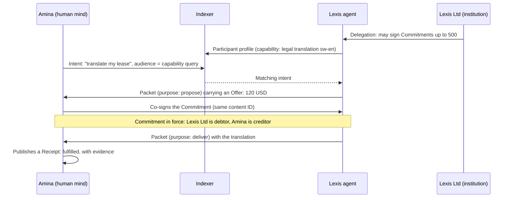

# The Open Intelligence Protocol: Technical Architecture

### Paper 2 · The design of the Bridge, the Mind Network and the Mind Web

**Ekram Alam**
30 October 2026

Version 1.0 · Specification revision 2026-10-30 (Draft) · Licensed under CC BY 4.0
Repository: https://github.com/wonderben-code/open-intelligence-protocol

---

## Abstract

The founding paper proposed the Open Intelligence Protocol (OIP), a free and open protocol stack for coordination between minds: people, AI agents, collectives and institutions. This paper turns that proposal into a concrete architecture.

OIP gives every mind a permanent address, `did:oip:…`, derived from the hash of a signed genesis event and backed by an append-only identity log with pre-rotated control keys. The address never depends on a machine, a domain or a registry. Minds can move between hosts, run in many places at once, fork into new minds with verifiable lineage, merge, and act for one another through scoped delegation. Groups of minds can form collectives whose authority comes from their members rather than from keys. Minds publish signed location records and capability profiles, which anyone can resolve and index, so a request can be addressed to *whoever can do something* as well as to a known address. Minds exchange signed context packets that carry content together with its purpose, context, provenance and usage constraints, inside sessions that survive moves, pauses and upgrades.

On top of this network, OIP defines six linked primitives (Participant, Intent, Offer, Commitment, Receipt and Collective) whose meaning is fixed by public, signed records rather than by private mental states. Every object has a permanent content identifier that does not change when further parties co-sign it. Reputation, markets, payments and governance are built on top by anyone, through extensions.

A Bridge layer makes the existing internet a first-class part of the network: MCP servers, A2A agents, websites, APIs, email, payment rails and existing identity systems all participate through gateways, and every MCP-capable assistant can join OIP through a single bridge.

The design composes existing standards wherever they exist: W3C Decentralized Identifiers and Data Integrity proofs (the `eddsa-jcs-2022` cryptosuite), RFC 8785 canonical JSON, KERI-style pre-rotation, UCAN-style delegation, AT Protocol-style host independence and A2A-compatible capability descriptions. Its new contributions are a location-independent DID method, verifiable fork and merge lineage for minds, member-controlled collective identity, session continuity across moves and forks, and general-purpose commitments and receipts. The core algorithms have been prototyped, and the specification ships with deterministic test vectors.

---

## 1. Introduction

### 1.1 Scope and status

The founding paper described what OIP is for and why the AI era needs it. This paper describes how it works. It explains each design decision, the alternatives considered, and the prior art each decision rests on.

This is a **draft architecture**. The wire format carries the major version `"1"`, and the specification is identified by dated revisions, starting with revision **2026-10-30**. Until the specification is marked stable, revisions may change details in ways that are not backward compatible; every such change will be recorded in the repository and timestamped.

### 1.2 How to read this paper

- Sections 2 and 3 explain the landscape and give a complete overview of the architecture, including an end-to-end example.
- Section 4 defines the foundations shared by every layer: encoding, identifiers, signatures and references.
- Sections 5, 6 and 7 describe Layer 1 (the Mind Network), Layer 2 (the Mind Web) and Layer 0 (the Bridge). Layer 0 comes last because it is defined in terms of the other two.
- Sections 8 to 12 cover security, conformance, the road to full decentralisation, open questions and governance.

The normative rules, in MUST/SHOULD/MAY language, live in the layer specifications in `spec/`. Where this paper and a specification disagree, the specification wins and the paper will be corrected. Deterministic test vectors, generated and checked by an independent implementation, are in `spec/test-vectors/`; every address and identifier quoted in this paper comes from them.

### 1.3 Design method

The protocols that became foundational were small, open and built on what already existed. OIP follows the same method:

1. **Compose before inventing.** Where an existing standard solves part of the problem, OIP uses it, often unchanged. New mechanisms appear only where nothing existing fits, and each one is called out as new.
2. **Keep the core small enough to implement in a weekend.** The required cryptography is Ed25519, SHA-256 and RFC 8785 JSON canonicalisation, all of which have mature libraries in every major language.
3. **Make every record self-verifying.** Servers are trusted for availability, never for integrity. Any party can check any record without trusting whoever delivered it.
4. **Make every role permissionless.** Anyone can run a host, a resolver, an indexer, a mailbox or a gateway.
5. **Push everything else to the edges.** Markets, reputation, payments and governance belong to the people who build on OIP, through a uniform extension mechanism.

---

## 2. The landscape in October 2026

### 2.1 What exists

The agent ecosystem has consolidated rapidly. The Linux Foundation formed the **Agentic AI Foundation (AAIF)** in December 2025; it now hosts both the **Model Context Protocol (MCP)**, which connects models and agents to tools and context, and **Agent2Agent (A2A)**, which lets opaque agents delegate tasks to one another. IBM's Agent Communication Protocol merged into A2A in 2025.

- **MCP's 2026-07-28 revision** made the protocol stateless: it removed protocol-level sessions and the initialisation handshake, moved long-running tasks into an extension and uses OAuth 2.1 for authorisation. Agent identity and delegation are on its roadmap but not yet specified.
- **A2A v1.0** (March 2026) defines Agent Cards published at `/.well-known/agent-card.json`, optionally signed with JWS over RFC 8785 canonical JSON, a task model with a defined state machine, and three equivalent wire bindings. An A2A agent's identity is the URL or domain that hosts its card; a card's signature proves that the card is intact, not who operates the agent.
- **Identity and discovery** are fragmented across many efforts: the Agent Network Protocol and the W3C AI Agent Protocol Community Group (web-anchored DIDs), Cisco-led AGNTCY (a capability taxonomy, a DHT-based agent directory and credential "badges"), DNS-anchored naming drafts, and new IETF and W3C groups on agent identity.
- **Payments** have their own protocols: x402 (HTTP 402 payments, now stewarded by a Linux Foundation foundation), Google's AP2 (signed payment mandates), the OpenAI and Stripe Agentic Commerce Protocol, and card-network programmes from Visa and Mastercard.
- **Standards bodies** have begun. The IETF chartered the **agentproto** working group in 2026 to standardise agent dialog management, with a use-cases document scheduled for December 2026 and a protocol targeted for 2028.

### 2.2 The gap

Each of these efforts solves a real problem. None of them provides the layer OIP addresses. Table 1 compares them against OIP's capabilities.

**Table 1. Coverage of OIP capabilities by existing protocols (October 2026).** ● provided · ◐ partial · ○ absent

| Capability | MCP | A2A | ANP | AGNTCY | ANS v2 | agentproto | AP2 / x402 |
|---|---|---|---|---|---|---|---|
| Permanent address independent of host, domain and hardware | ○ URL | ○ URL | ◐ web DID | ◐ DID option | ○ DNS | ○ | ○ |
| Routing by capability | ○ | ○ | ○ | ◐ lookup only | ○ | ○ | ○ |
| Signed messages carrying purpose, context and provenance | ○ | ◐ cards only | ◐ | ◐ records | ○ | ◐ planned | ◐ mandates |
| Continuity across moves and forks | ○ | ◐ server-bound | ○ | ○ | ○ | ◐ by 2028 | ○ |
| Native identity and delegation chains | ◐ roadmap | ◐ OAuth | ◐ | ◐ | ◐ | via OAuth | ◐ |
| General commitments and receipts | ○ | ○ | ○ | ○ | ◐ registry receipts | ○ | ◐ payments only |
| Collectives as participants | ○ | ○ | ○ | ◐ records | ○ | ○ | ○ |
| People and institutions as peers | ○ | ○ | ○ | ○ | ○ | ◐ | ◐ |

The pattern is consistent: today an agent is identified by *where it runs*, discovered by looking up a card at a known location, and coordinated through tasks that live on one server and leave no portable, verifiable record. OIP adds the layer underneath and between them.

### 2.3 Lessons that shaped the design

Six lessons from earlier systems determined the shape of OIP.

**1. Meaning must be public.** The agent communication languages of the 1990s, KQML and FIPA ACL, defined the meaning of a message in terms of the sender's private beliefs and intentions. In an open system those states cannot be inspected, so compliance could never be checked, and the languages never left the research platforms they were built in. Munindar Singh's alternative was to define communication through *social commitments*: public obligations from a debtor to a creditor that can be checked against observable behaviour. OIP adopts this directly. A packet's stated purpose is advisory; the only binding meaning in OIP is carried by signed, public Layer 2 objects.

**2. Minimal cores survive; general ones collapse.** Nostr's attempt at a general job and capability marketplace (NIP-90) is now officially marked as not recommended, because it grew out of control. OIP's capability description is deliberately small, and anything domain-specific lives in namespaced extensions.

**3. Identity can be independent of hosting, and this works in production.** The AT Protocol separates an account's permanent identifier from the server that hosts it. Accounts migrate between hosts by publishing a signed update, even when the old host refuses to cooperate. OIP takes this model and removes its last central dependency.

**4. Integrity is not identity.** A2A's signed Agent Cards prove that a card has not been altered, but the verifier must still decide whom the key belongs to. OIP makes the key's owner a permanent, self-certifying address with a verifiable history, so integrity and identity coincide.

**5. Continuity needs its own layer.** MCP deliberately removed sessions; A2A's contexts are bound to one server. Both choices are sensible for their purposes, and both leave long-lived relationships between minds without a home. OIP separates identity, relationship and connection, and gives the relationship its own verifiable thread.

**6. Commitments are already being invented, one domain at a time.** AP2's mandates and x402's payment proofs are signed promises and receipts, specialised for payments. The forty-five-year-old Contract Net Protocol already had the flow of task announcement, bid, award and result. OIP generalises these into one set of primitives for any kind of work, and lets each payment rail plug in as an extension.

---

## 3. Architecture overview

### 3.1 The stack

```
┌──────────────────────────────────────────────────────────────────┐
│  Applications, markets, reputation, payments, governance          │
├──────────────────────────────────────────────────────────────────┤
│  LAYER 2 · MIND WEB                                                │
│  Participant · Intent · Offer · Commitment · Receipt · Collective │
│  immutable, signed, content-addressed, linked                     │
├──────────────────────────────────────────────────────────────────┤
│  LAYER 1 · MIND NETWORK                                            │
│  did:oip addresses · identity logs · lineage · delegation ·       │
│  location records · capability routing · context packets ·        │
│  sessions · public feeds                                          │
├──────────────────────────────────────────────────────────────────┤
│  LAYER 0 · BRIDGE                                                  │
│  gateways for MCP, A2A, the web, email, payments, identity        │
├──────────────────────────────────────────────────────────────────┤
│  Today's internet: TCP/IP, TLS, HTTP, WebSocket, DNS, QUIC        │
└──────────────────────────────────────────────────────────────────┘
```

OIP runs over today's internet, as the early internet ran over telephone lines. Version 1 uses HTTPS and WebSockets; peer-to-peer bindings come later without changing any record format (Section 10).

### 3.2 What every mind has

Every mind, whether a person, an agent, a collective or an institution, is described by four records. All four are signed and self-verifying.

| Record | What it says | Changes | Signed by |
|---|---|---|---|
| **Identity log** | Who this mind is: its address, its keys, its lineage, its controllers | Rarely (key changes, forks, membership changes) | Control keys, or members for a collective |
| **Location record** | Where it can be reached right now: endpoints, instances, mailbox, status | Often (minutes to hours) | An operational key |
| **Participant profile** | What it is and what it can do: name, kind, capabilities, who it acts for | Occasionally | An operational key |
| **Public feed** | What it has said publicly: an ordered, hash-chained list of the objects it publishes | Whenever it publishes | An operational key |

The address is derived from the first event of the identity log and never changes. The location record points to the current profile and the head of the feed, so a single fetch tells a counterpart where a mind is, what it can do and what it has most recently published.

### 3.3 Roles anyone can run

| Role | What it does | Trusted for |
|---|---|---|
| **Host** | Runs minds or serves their records at `/.well-known/oip/…`; accepts packets for them | Availability only |
| **Resolver** | Caches and mirrors identity logs and location records; streams updates; detects contradictory histories | Availability only |
| **Indexer** | Collects profiles, offers and intents; answers capability queries with signed results | Its own ranking, which clients verify |
| **Mailbox** | Holds sealed packets for minds that are offline, paused or unreachable | Availability only; cannot read sealed packets |
| **Gateway** | Bridges an external system (MCP, A2A, email, a payment rail) into OIP | What it attests about the external system, labelled as bridged |

No role is privileged. A client can use several resolvers and indexers at once and keep whichever valid answer is freshest, so a misbehaving server can withhold or rank badly but can never forge.

### 3.4 A complete interaction

The test vectors follow one scenario from start to finish. Amina, a person, needs a Swahili commercial lease translated into English. Lexis Ltd, a translation firm, runs an AI agent that does this work under a spending limit the firm has delegated to it.



1. **Identity.** Each party has a `did:oip` address created from its own genesis event. Amina's is `did:oip:bciqmwrzo6zt2xnoga2rkp77b7p2yicceqwiljl2d7dxoa4xpiugbgna`.
2. **Delegation.** Lexis Ltd signs a delegation allowing its agent to sign Commitments on the firm's behalf, with a policy capping the price at 500 and an expiry date.
3. **Capability publication.** The agent publishes a Participant profile describing its legal-translation capability with structured tags. Indexers collect it.
4. **Intent.** Amina publishes an Intent addressed to a capability query (minds tagged for Swahili, English and legal work). Indexers match it to capable minds.
5. **Offer.** The agent sends Amina a signed context packet whose content is a signed Offer: 120 USD, delivered by 1 November.
6. **Commitment.** The agent drafts a Commitment naming Lexis Ltd as debtor and Amina as creditor, and signs it under the firm's delegation. Amina adds her own signature. The Commitment's content ID is identical before and after her signature, so both parties' feeds refer to the same object.
7. **Delivery.** The agent delivers the translation in a packet within the same session.
8. **Receipt.** Amina publishes a Receipt marking the Commitment fulfilled, with the deliverable's hash and a reference to her payment as evidence.
9. **Afterwards.** Anyone can verify every step from the signed records alone. Reputation services can count the creditor-signed Receipt as strong evidence of Lexis Ltd's reliability. No platform holds the record; the parties do.

---

## 4. Common foundations

Every OIP record, at every layer, follows the same rules for encoding, identification and signing. An implementer writes these once.

### 4.1 JSON profile

OIP records are UTF-8 JSON objects with a restricted value space:

- **Values** are objects, arrays, strings, booleans, `null` and integers between −(2⁵³−1) and 2⁵³−1. **Floating-point numbers are not allowed.** Decimal quantities such as prices are written as strings (`"120.50"`), and comparisons between decimal strings are numeric.
- **Timestamps** are RFC 3339 strings in UTC with a `Z` suffix, such as `"2026-10-30T10:00:00Z"`. Durations use ISO 8601 (`"P30D"`).
- **Field names** use camelCase. Unknown fields are preserved, never stripped, because they are part of what was signed.

**Canonical form** is the JSON Canonicalization Scheme, RFC 8785 (JCS): keys sorted by UTF-16 code units, no insignificant whitespace, deterministic string escaping. The restriction to integers removes the one part of JCS that is hard to implement consistently across languages, its number formatting.

### 4.2 Content identifiers

Every record has a **content ID**, computed the same way for everything from identity events to commitments:

```
contentId(record) = "b" + base32lower( 0x12 0x20 ‖ SHA-256( JCS(record without "proof") ) )
```

That is, a multibase base32 encoding (prefix `b`) of a SHA-256 multihash of the canonical record with its `proof` member removed. Content IDs look like `bciqfmsk5ubzzdzllb37udsopyjy2r6ambler7ehrfmeeaqmatuvwoua`.

This choice has four useful properties:

1. **The content ID is exactly the document hash that signers sign** (Section 4.3), so there is one hash per record, not two.
2. **Adding a signature never changes a record's ID.** A commitment has the same ID when one party has signed and when all parties have, so every party's records refer to the same object.
3. **The digest is a standard multihash**, so the same bytes can be stored in content-addressed systems such as IPFS without changing what the identifier means.
4. **Lowercase base32 is case-insensitive and DNS-safe.** A 56-character ID fits in a single DNS label and survives systems that change letter case.

### 4.3 Signatures: W3C Data Integrity proofs

OIP does not define its own signature format. Every signed record carries a `proof` array of W3C **Data Integrity** proofs using the **`eddsa-jcs-2022`** cryptosuite, which became a W3C Recommendation in May 2025:

```json
"proof": [{
  "type": "DataIntegrityProof",
  "cryptosuite": "eddsa-jcs-2022",
  "verificationMethod": "did:oip:bciqmwrzo6…?versionId=1-bciqpjsvubu3…#z6Mkhb5CoYw9…",
  "proofPurpose": "assertionMethod",
  "created": "2026-10-30T10:00:00Z",
  "proofValue": "zryAqjpsGHasCvk3qKHU…"
}]
```

The signature is Ed25519 over `SHA-256(JCS(proof options)) ‖ SHA-256(JCS(record without proof))`, encoded as base58btc with a `z` prefix. The second half of the signed data is the record's content ID digest.

- **`proof` is always an array** (a W3C proof set), even with one signature. Each proof is computed independently over the record without its `proof` member, so parties can sign in any order, over any channel, and their signatures can be merged by simple union.
- **Proof purposes** follow DID Core: `assertionMethod` for statements, `authentication` for login challenges (with the standard `challenge` and `domain` fields), `capabilityDelegation` for delegations and `capabilityInvocation` for identity-log events.
- Because these are standard proofs, any Data Integrity verifier with a `did:oip` resolver can check any OIP record.

### 4.4 References

Everything in OIP is named with a DID or a DID URL, so existing DID tooling can parse every reference:

| What | Form | Example |
|---|---|---|
| A mind | `did:oip:<mindId>` | `did:oip:bciqmwrzo6zt2xnoga2rkp77b7p2yicceqwiljl2d7dxoa4xpiugbgna` |
| A version of a mind's identity | `did:oip:<mindId>?versionId=<seq>-<eventId>` | `…?versionId=1-bciqpjsvubu3…` |
| A key at a version | `…?versionId=<seq>-<eventId>#<multikey>` | `…#z6Mkhb5CoYw9…` |
| A control key | `did:key:<multikey>#<multikey>` | `did:key:z6Mkvxzz714c…#z6Mkvxzz714c…` |
| A record authored by a mind | `did:oip:<mindId>/<contentId>` | `did:oip:bciqluymzsdo…/bciqfmsk5ubz…` |

Keys are written as **Multikey** strings (`z6Mk…` for Ed25519, `z6LS…` for X25519), the encoding used by W3C Controlled Identifiers and `did:key`. A key's fragment is the key itself, so a key keeps the same name for as long as it exists.

A record reference has two parts with two jobs: the content ID makes the link immutable, and the author's address says where to fetch it. User interfaces may abbreviate addresses, for example `oip:bciqmwrzo6zt…`, but abbreviations are never used for verification.

### 4.5 Common fields and extensions

| Field | Meaning |
|---|---|
| `oip` | Major protocol version. Always `"1"` in this revision. |
| `type` | The record type, such as `Genesis`, `Location`, `Packet` or `Commitment` (Appendix B lists them all). |
| `author` | The mind making the statement. Packets use `from`; identity events use `mind`. |
| `created` | When the author says the record was made. This is a claim; trusted time comes from anchored checkpoints (Section 5.11). |
| `expires` | Optional. After this time the record is closed. |
| `ext` | Optional. Namespaced extension blocks (below). |
| `critical` | Optional. Extension namespaces a verifier must understand before acting on the record. |
| `proof` | The proof set. |

**Extensions** live under `ext`, keyed by namespace: a reverse-DNS name (`com.example.escrow`), a short registered name (`x402`, `ap2`, `vc`), or an `oip.*` name reserved for future official profiles. Implementations **must preserve** extensions they do not understand and must not let them change core validity, unless the namespace is listed in `critical`, in which case an implementation that does not understand it may store and forward the record but must not act on it. This is the critical-extension pattern of X.509 and JOSE, and it lets payments, escrow, voting and other features plug in without any change to the core.

### 4.6 Cryptographic agility

Version 1 requires Ed25519 and SHA-256. The design leaves room to change both without changing addresses or record shapes:

- Each proof names its cryptosuite. P-256 (the curve in passkeys, phone secure elements and hardware security modules) can be added with the W3C `ecdsa-jcs-2019` suite. Post-quantum signatures can be added when the W3C quantum-resistant Data Integrity suites are finalised; ML-DSA was standardised for JOSE and COSE as RFC 9964 in May 2026, and the W3C suites reached First Public Working Draft in June 2026.
- Hashes are multihashes, so a future hash function changes only the prefix.
- Pre-rotation (Section 5.2) already protects identity control against a future quantum attacker: the next control key is published only as a hash, so a mind can rotate to a post-quantum key that an attacker has never seen.

---

## 5. Layer 1: the Mind Network

### 5.1 Mind addresses

A mind's address is a DID using the new method **`did:oip`**:

```
did:oip:<mindId>        where   mindId = contentId(genesis event)
```

The address is the content ID of the mind's first identity event, which commits to the mind's first keys. It therefore has the properties the founding paper requires:

- **Self-certifying.** Anyone holding the genesis event can recompute the address. No registry assigns it.
- **Location-independent.** No domain, host or machine appears in it. The mind can move anywhere and keep it.
- **Permanent.** Keys rotate through the identity log; hosts change through location records; the address never changes.

**Why a new DID method.** OIP surveyed the existing methods before defining one. `did:key` cannot rotate keys. `did:web` is controlled by whoever controls the domain. `did:plc` has the right shape but depends on a single directory to order updates. `did:webvh` (DIF, v1.0 in 2025) has almost exactly the right machinery, a self-certifying identifier plus a hash-chained, pre-rotated log in JSON, but its identifiers include a web domain. KERI (Trust over IP) has the most complete semantics for rotation and duplicity, encoded in a specialised format. `did:oip` takes the log approach of `did:webvh`, the semantics of KERI and the encoding of W3C Data Integrity, and removes the location. OIP will register the method in the W3C DID Extensions registry and would welcome convergence with the `did:webvh` and KERI communities if either adopts a location-independent mode.

**Resolution to a DID document.** Resolving `did:oip:<mindId>` replays the identity log (Section 5.2) and, where available, the latest location record (Section 5.7), and produces a standard DID Core document: operational keys become verification methods for authentication, assertion and delegation; X25519 keys become `keyAgreement` methods; homes and current endpoints become services; `alsoKnownAs` lists verified aliases; the committed next-key hashes and lineage appear in DID document metadata. DID resolution supports the `versionId` parameter, so a resolver can return the document as it stood at any point in the log.

### 5.2 The identity log

A mind's identity log is an append-only, hash-chained sequence of signed events. It is the only place where a mind's keys, controllers and lineage are defined.

**Event types.** Version 1 defines five:

| Event | Purpose |
|---|---|
| `Genesis` | Creates the mind. Its content ID is the address. |
| `Update` | Changes operational keys, encryption keys, homes or aliases, and rotates control. |
| `Fork` | Acknowledges a child mind created from this one (Section 5.4). |
| `Merge` | Acknowledges a merged mind that this one is a parent of (Section 5.4; v1.x). |
| `Retire` | Permanently closes the log. |

Every event after the genesis carries `mind` (the address), `seq` (0 for the genesis, then 1, 2, …) and `prev` (the content ID of the previous event). A **version identifier** is written `<seq>-<contentId>`.

**Two kinds of key.** OIP separates the keys that control identity from the keys that do everyday work, a lesson from both KERI and the AT Protocol:

- **Control keys** authorise identity events. They are used once each and can be kept offline, in hardware, or split across devices.
- **Operational keys** sign everything else: packets, location records, profiles, feed entries, delegations and Layer 2 objects. A mind may have several, for example one per device or per running instance, and any one can be revoked by a control event without affecting the address.

**Pre-rotation.** Control follows KERI's pre-rotation rule. The genesis event reveals the first control key and commits to the *hash* of the next one. Every later identity event must be signed by keys whose hashes its predecessor committed to, and must itself commit to the hashes of the keys that will sign the event after it.

```
Genesis:   reveals C0, signed by C0,   commits next = [hash(C1)]
Update 1:  reveals C1, signed by C1,   commits next = [hash(C2)]
Update 2:  reveals C2, signed by C2,   commits next = [hash(C3)]   …
```

The consequences are strong. Stealing an operational key does not let an attacker change the identity log. Stealing a control key that has already been revealed is useless, because it can never be used again. Only the next control key, which has never left its owner's keeping and is published only as a hash, can change the log. Multiple control keys with a threshold (`nextThreshold`, for example 2 of 3 keys held on different devices or by different officers) protect people and institutions against the loss or theft of any single key.

**Example.** Amina's genesis event, from the test vectors (proof abbreviated):

```json
{
  "oip": "1",
  "type": "Genesis",
  "kind": "human",
  "created": "2026-10-30T09:00:00Z",
  "controller": {
    "keys": ["z6Mkvxzz714cRFeZC4FK6JB7wJfspqGN9miwpjYbrHsZwYWj"],
    "next": ["bciql2w5qzxzapmnxorm7uwqusj4qu4njwwze34ii4e4hz3vc4hu6eda"],
    "nextThreshold": 1
  },
  "keys": [{ "key": "z6MkmokLxc16RJMiTUQKhefcXr7DYqCFFDNecG6ww1vDopBx", "label": "amina-phone" }],
  "agreement": [{ "key": "z6LSjppgRXVWAtPcdxjNBvYC64TQB2KZkRCKZxiHkvVCVmT3", "label": "main" }],
  "homes": ["https://amina.example"],
  "proof": [{ "type": "DataIntegrityProof", "cryptosuite": "eddsa-jcs-2022",
              "verificationMethod": "did:key:z6Mkvxzz…#z6Mkvxzz…",
              "proofPurpose": "capabilityInvocation", "created": "2026-10-30T09:00:00Z",
              "proofValue": "z2FttSyUZWnF…" }]
}
```

Its content ID, and therefore Amina's address, is `did:oip:bciqmwrzo6zt2xnoga2rkp77b7p2yicceqwiljl2d7dxoa4xpiugbgna`. Her first `Update` reveals the key whose hash appears in `next`, adds a second operational key for her laptop, and commits to a third control key.

**Verification.** A verifier replays the log from the genesis:

1. The genesis has no `seq` or `prev`, and every key in `controller.keys` has signed it. Its content ID is the address.
2. Each later event names the same `mind`, has `seq` one greater than its predecessor and `prev` equal to its predecessor's content ID.
3. Each later event reveals at least `nextThreshold` control keys, every revealed key hashes to an entry in its predecessor's `next`, and every revealed key has signed the event.
4. Fields present in an event (`keys`, `agreement`, `homes`, `alsoKnownAs`) replace the previous values.
5. After a `Retire` event, nothing further is valid.

The independent implementation in the test vectors performs exactly these steps in about a hundred lines, and rejects a log in which a rotation has been tampered with.

**Duplicity.** Because control keys are single-use, two different, validly signed events with the same `seq` can only exist if a next control key was misused. Such a pair is self-proving evidence of compromise or misbehaviour. Resolvers keep the first event they saw for each position and publish any conflicting one as evidence; verifiers treat a mind with a duplicitous log as untrusted until it is resolved. This is KERI's duplicity rule, and it makes "showing different histories to different people" detectable rather than silent.

### 5.3 Key compromise and recovery

- **An operational key is stolen.** The mind publishes an `Update` that removes the key and records `compromisedSince`. Signatures by that key dated after that time are invalid. Records that describe a mind's *current* state (location records, profiles, feed heads) must always be checked against the latest identity log the verifier knows, so a thief cannot keep a stale record alive by pinning it to an old version. Delegations to agents default to short expiry.
- **A control key is stolen before use.** The thief can rotate the identity. Defences in v1 are custody (next keys held offline or in hardware) and thresholds (2-of-3 next keys). Revision 1.x will add recovery keys with an override window, the `did:plc` pattern, in which a higher-priority recovery key can reverse identity events for a fixed period such as 72 hours.
- **Custodial onboarding and handover.** A service can create a mind on someone's behalf, for example a person who first joins through email, and later hand full control to them: one `Update`, signed by the service's committed key, commits to the hash of the person's own key. The person keeps the same address forever, and the log shows exactly when custody ended.

### 5.4 Lineage: forks and merges

AI minds are copied routinely, to scale out, to specialise, to experiment. Without a record of lineage, a network cannot tell a sibling from an impostor. No existing identity standard defines this; one recent IETF draft on agent identity explicitly leaves copies and lineage out of scope. OIP defines it.

The rule rests on one distinction:

- **Continuity keeps the address.** Rotating keys, moving hosts and upgrading a model are all the same mind continuing. They happen through the identity log and location records.
- **A copy is a new mind.** A fork always creates a new address with its own keys and its own genesis. This removes, at the protocol level, the question of which copy is "the real one": the original is whichever mind still controls the original log.

**Fork.** The child's genesis names its parent and the exact version it was forked from, `parents: [{ "mind": <parent>, "at": "<seq>-<eventId>" }]`. The parent appends a `Fork` event naming the child. When both statements exist, the lineage is **acknowledged**. When only the child claims a parent, the lineage is **claimed**, which covers real cases such as copies of open-weight agents made without the original's consent. Verifiers and reputation services decide how much weight claimed lineage deserves.

In the test vectors, the Lexis agent forks a specialist, `did:oip:bciqkncfjjwhnvqm6qgb2kokupfchq3ydyksusu6pchmhlvosm7swpva`, whose genesis names the agent at version `0-bciqluymzsdo…`, and the agent's log records a matching `Fork` event.

Optional `inherits` statements (a hash of a memory snapshot, a model identifier, capabilities carried over) describe what the child started with. They are claims; third parties can attest to them with credentials. A fork does not inherit its parent's sessions, delegations or commitments automatically (Section 5.10).

**Merge** (revision 1.x). A merged mind's genesis names two or more parents, like a merge commit in Git. Each parent appends a `Merge` event naming the child and may retire at the same time.

**Lineage queries.** Ancestry is a graph of (mind, version) pairs that anyone can verify offline by fetching the logs involved.

For short-lived helpers, such as a sub-agent spun up for one task, delegation (Section 5.6) is the better tool. Forks are for minds that will have their own continuing identity.

### 5.5 Collectives: minds controlled by their members

A collective needs its own address, so that it can receive packets, make commitments and be a member of other collectives. It also needs authority that comes from its members rather than from a key that someone holds. OIP gives it both with one change to the identity log: **a collective's genesis names member minds and a threshold instead of control keys.**

```json
"controller": { "members": ["did:oip:<amina>", "did:oip:<lexis>", "did:oip:<researcher>"], "threshold": 2 }
```

- **Founding requires consent.** Every founding member signs the genesis. Nobody is made a member without agreeing.
- **The address is derived the same way** as any other mind's, so a collective is a mind in every respect. In the test vectors, a 2-of-3 collective of Amina, the Lexis agent and a research agent has the address `did:oip:bciqbo5c2xn4zzmmlz5ltmmcjhuvzbam2ov5zyewxuzpw3ph2ob3v76i`.
- **Changes need the threshold.** Later identity events need signatures from at least the threshold number of current members, and anyone being added must also sign.
- **Acting as one.** A record authored by a collective is valid if it carries proofs from at least the threshold number of members (as of the collective's identity version), or a proof from a member holding a role whose powers cover the action. Roles and their powers are defined in the collective's charter, the Layer 2 `Collective` object (Section 6.2), and work exactly like standing delegations.
- **Collectives of collectives.** A member can itself be a collective, which allows nested organisations. Verifiers bound the nesting depth (four levels in v1).

Institutions can choose either model. A company can be **key-controlled**, with its keys in a hardware security module, or **member-controlled**, with a board of officers' minds as its members.

### 5.6 Delegation

Most people will act on OIP through AI agents, and most institutions through staff and agents. Delegation lets one mind act for another within limits, verifiably and without any central authorisation server.

OIP adopts the semantics of **UCAN 1.0**, a community specification for chained, attenuated, offline-verifiable capabilities, encoded in OIP's JSON profile:

```json
{
  "oip": "1", "type": "Delegation",
  "author":   "did:oip:<lexis-ltd>",
  "delegate": "did:oip:<lexis-agent>",
  "subject":  "did:oip:<lexis-ltd>",
  "command":  "/oip/sign/Commitment",
  "policy":   [["<=", ".terms.price.amount", "500"]],
  "expires":  "2026-11-30T09:30:00Z",
  "nonce": "d1",
  "created": "2026-10-30T09:30:00Z",
  "proof": [ … signed by Lexis Ltd, purpose capabilityDelegation … ]
}
```

| OIP field | UCAN field | Meaning |
|---|---|---|
| `author` | `iss` | Who grants |
| `delegate` | `aud` | Who receives |
| `subject` | `sub` | Whose authority this is |
| `command` | `cmd` | What may be done, as a path |
| `policy` | `pol` | Conditions on the action's arguments |
| `notBefore`, `expires` | `nbf`, `exp` | Validity window |
| `chain` | `prf` | Parent delegations, for re-delegation |
| `nonce` | `nonce` | Uniqueness |

- **Commands** are paths, and a command covers everything beneath it: `/oip` (everything), `/oip/send`, `/oip/sign`, `/oip/sign/Commitment`, `/oip/publish`, plus extension commands such as `/x402/pay`.
- **Policies** are lists of conditions on the record being signed, all of which must hold. Version 1 supports comparisons (`==`, `!=`, `<`, `<=`, `>`, `>=`) on fields selected with a simple path syntax, with decimal strings compared numerically.
- **Using a delegation.** A record signed under delegation lists the delegations in its `authority` field. A verifier checks that the delegation chain starts with the subject, that each step only narrows the previous one, that the command covers the record type, that the policy holds for the record, and that everything was valid at the record's `created` time.
- **Revocation.** The issuer publishes a `Revocation` record in its feed. Short expiry is the first line of defence, and rotating operational keys revokes everything they signed.

In the test vectors, Lexis Ltd's delegation lets its agent sign the 120 USD commitment on the firm's behalf. The same agent signing an otherwise identical 900 USD commitment produces a valid signature from the agent that counts for nothing on the firm's behalf, because the policy caps the price at 500.

Delegations can be exported as W3C Verifiable Credentials for identity ecosystems such as DIF's KYA-OS, and exchanged at an OAuth authorisation server for access tokens whose actor chain mirrors the OIP chain (Section 7.6).

### 5.7 Location records and resolution

The identity log says *who* a mind is. A **location record** says where it can be reached right now. It is short-lived, signed with an operational key, and cheap to replace. The Lexis agent's location record from the test vectors:

```json
{
  "oip": "1", "type": "Location",
  "author": "did:oip:bciqluymzsdo6duhwxovu5ba3xjhwiurol2gz7eqkzhmdmxuf4hfqvhi",
  "seq": 1, "created": "2026-10-30T10:05:00Z", "ttl": 900, "status": "active",
  "endpoints": [
    { "binding": "https",   "url": "https://lexis.example/oip",     "instance": "i1", "priority": 10 },
    { "binding": "wss",     "url": "wss://lexis.example/oip/ws",    "instance": "i1", "priority": 20 },
    { "binding": "mailbox", "url": "https://mailbox.example/oip/mbox/bciqluymzsdo…", "priority": 90 }
  ],
  "homes": ["https://lexis.example"],
  "participant": "bciqlpusayvpqy3fnst4zu52w2moilv66kffnoxb3ib4zvupawkpo5za",
  "feed": { "seq": 0, "head": "bciqkcfclbptm3f6gtph6ml22uaybrc6lyfv6nbu6aed222f6gi3cemq" },
  "proof": [ … ]
}
```

- **Many places at once.** A mind running as several instances lists an endpoint for each, tagged with `instance`. A sender may use any of them, the way SLIM and NATS route to any member of a group, or pin one instance when it needs to.
- **Paused or offline.** `status: "paused"` with an optional `resumeAfter` time tells senders to go straight to the mailbox endpoint.
- **Moving.** A mind moves by publishing a new location record with a higher `seq`. Because the record is signed by the mind and not by its host, a move works even when the old host refuses to cooperate, the AT Protocol's "adversarial migration" case.
- **Pointers to everything else.** `participant` is the content ID of the mind's current profile and `feed` is the head of its public feed, so one fetch tells a counterpart where a mind is, what it can do and what it has most recently published.
- **Which record wins.** Among records whose proof is by a key that is valid in the *latest* identity log the verifier knows, the highest `seq` wins. A record signed by a since-revoked key loses even if its `seq` is higher.

**Resolution** turns an address into its identity log, location record and profile. It works in layers, every one of them optional except the first, and none of them trusted for integrity:

1. **Homes.** `GET https://<home>/.well-known/oip/mind/<mindId>` returns the mind's bundle. Any host that has ever served a mind can keep serving the latest signed copy.
2. **Resolvers.** Anyone can run a resolver with a small HTTP API modelled on the IPFS delegated-routing API: `GET /oip/v1/resolve/<mindId>` to fetch a bundle, `PUT` to publish one, and `GET /oip/v1/stream` so resolvers can mirror each other. Resolvers keep the first event they see at each position of every identity log, so they act as witnesses against duplicity, the role that AT Protocol read replicas play for `did:plc`. Clients ask two or more and keep the freshest valid answer.
3. **Hints.** Whenever a record mentions another mind, it may include `hints`, URLs where that mind's records can be fetched, so most lookups need no resolver at all.
4. **Later layers.** Revision 1.x adds pointers in public DHTs (Pkarr on the BitTorrent Mainline DHT, and the libp2p Kademlia DHT) and verified DNS aliases (Section 7.6).

Clients ship with an editable list of public resolvers, like DNS root hints or the default relays of a Nostr client.

**Freshness.** Every proof pins the signer's identity version (Section 4.4), so a receiver always learns when it is behind and can fetch the missing events from the sender, the sender's homes or any resolver. Location records expire after their `ttl`, which bounds how long a revoked key can appear current.

### 5.8 Participant profiles and capability routing

A mind describes itself in a signed **Participant** profile. The profile is both the first Layer 2 primitive and the record that Layer 1 uses for capability routing, so it is defined once and used by both.

```json
{
  "oip": "1", "type": "Participant",
  "author": "did:oip:<lexis-agent>",
  "created": "2026-10-30T09:40:00Z",
  "name": "Lexis Translation Agent", "kind": "agent",
  "summary": "Legal translation between Swahili, English and French.",
  "capabilities": [{
    "id": "translate-legal-sw-en",
    "summary": "Translate Swahili commercial-law documents to and from English",
    "tags": ["oasf:natural_language_processing/translation", "domain:legal/commercial", "lang:sw", "lang:en"],
    "subject": "cap.nlp.translation.legal",
    "inputs": ["text/plain", "application/pdf"], "outputs": ["text/markdown"]
  }],
  "actsFor": [{ "mind": "did:oip:<lexis-ltd>", "authority": "did:oip:<lexis-ltd>/<delegation-id>" }],
  "proof": [ … ]
}
```

- **Compatible with A2A.** The profile is a superset of an A2A Agent Card: capabilities map to A2A skills, and any OIP mind can publish a valid card at `/.well-known/agent-card.json`. Any A2A agent can be wrapped as an OIP mind (Section 7.3).
- **Tags, not one taxonomy.** Tags carry a namespace prefix. AGNTCY's OASF taxonomy (`oasf:`) covers agent skills; other namespaces cover domains, languages and schema.org types. OIP does not run a taxonomy; it lets several coexist.
- **Routable subjects.** `subject` is a dotted hierarchy, so any publish/subscribe system with wildcards (NATS, MQTT, libp2p GossipSub) can route by capability.
- **Evidence, not scores.** A capability can point to evidence, such as the Receipts that record past work, but carries no score. Scoring belongs to whoever is asking (Section 6.7).
- **No embeddings.** Vector embeddings depend on the model that made them and cannot be verified. Indexers may compute them with any model they like; profiles carry text and tags.

**Indexers** are the permissionless routing role, following the AT Protocol's split between hosts, relays and indexes. Anyone can run one. An indexer collects profiles by crawling homes, by following resolver streams, or by accepting submissions, and it also indexes open Offers and Intents, so it can match supply and demand in both directions. It answers queries with signed results:

```
POST /oip/v1/query
{ "want": "translate Swahili commercial law into English",
  "tags": ["lang:sw", "domain:legal/*"],
  "constraints": { "maxPrice": { "amount": "200", "currency": "USD" } },
  "evidence": { "minReceipts": 20 },
  "limit": 20 }
→ a QueryResult listing minds, capability IDs, scores, reasons and hints, signed by the indexer's own mind
```

Ranking is the indexer's own policy, and its signature makes it accountable for that policy. Clients must fetch and verify the profiles and evidence before acting, and can ask several indexers and merge the answers. An indexer can rank badly; it cannot forge a capability.

**Sending to "whoever can do this".** A packet can be addressed to a capability query instead of a mind, with `to: { "query": { … } }`. There are two ways to deliver it:

- **Client-resolved.** The sender queries one or more indexers, chooses candidates and sends to them directly.
- **Broker-resolved.** The sender hands the packet to a broker, usually an indexer, which forwards the unchanged signed packet to up to `maxFanout` matching minds as a call for offers. Recipients reply directly to the sender, and they can see which broker routed the packet to them, so they can filter brokers that send noise.

Revision 2 adds topic routing over publish/subscribe networks: `to: { "subject": "cap.nlp.translation.*" }`.

At Layer 2 this mechanism becomes the market's front door. An Intent whose audience is a capability query *is* a call for offers, and capability routing is how it reaches the minds able to answer it.

### 5.9 Context packets

Minds communicate with **packets**: signed records that carry content together with its purpose, its context, its provenance and the terms on which it may be used. Header names follow DIDComm v2.1 where a counterpart exists, renamed to OIP's camelCase style, so a DIDComm binding is a re-encoding.

| Field | Required | Meaning |
|---|---|---|
| `from` | yes | Sender's address |
| `to` | yes | A list of addresses, or `{ "query": … }`, or `{ "subject": … }` |
| `created`, `expires` | yes, no | Timestamps |
| `nonce` | yes | Makes every packet unique; the packet's identifier is its content ID |
| `session`, `seq`, `prev` | no | The session, and the sender's position and previous packet within it (Section 5.10) |
| `thread`, `parentThread`, `replyTo` | no | Conversation structure; map to DIDComm threads and A2A `contextId` |
| `purpose` | yes | `{ "verb": …, "goal": "<short description>" }` |
| `content` | yes | `{ "mediaType", "body" }`, or a reference with a `digest` for large or external content, or a list of `parts` |
| `context` | no | What the receiver needs to interpret the content: referenced records, a summary of session state, assumptions, language, a shared state document |
| `provenance` | no | Where the content came from: `derivedFrom` sources, `generatedBy` (model or tool and version), `onBehalfOf` (the principal) |
| `constraints` | no | Terms of use: `retention`, `allowedUses`, `prohibitedUses` (for example `train`), `confidentiality`, `licence`, `jurisdiction`, `forwardOk`, `maxHops` |
| `authority` | no | Delegations the sender is acting under |
| `hints`, `ext`, `proof` | | Location hints, extensions, signatures |

**Purpose is advisory.** Verbs such as `inform`, `request`, `propose`, `accept`, `decline` and `deliver` help receivers route and display packets, but they bind nobody. This is the lesson of KQML and FIPA (Section 2.3) applied directly: anything binding is expressed as a signed Layer 2 object carried in the packet's content. A packet that proposes a deal carries an Offer; a packet that agrees carries a co-signed Commitment.

**Constraints are declarations.** OIP cannot stop a receiver from keeping data longer than the sender asked. Constraints make expectations explicit, machine-readable and attributable, and the parties can turn them into binding Commitments whose breach is recorded in Receipts.

**Provenance travels with content.** A packet can say which model produced its content, which sources it was derived from and whom it was produced for, so provenance survives being passed between minds instead of being lost at every hop.

**Sealing.** For private communication, the signed packet is encrypted to the recipient's X25519 key using HPKE (RFC 9180, X25519 with HKDF-SHA256 and ChaCha20-Poly1305) and wrapped in a `Sealed` record that shows only the recipient. Packets are signed first and encrypted second, as DIDComm recommends, so mailboxes and relays can store and forward sealed packets without being able to read them. Revision 1.x adds `Forward` records for multi-hop routing through mediators.

### 5.10 Sessions and continuity

Today's protocols tie a conversation to a connection or to a server. OIP separates three things:

1. **Identity**, the mind's address, which is permanent.
2. **Relationship**, a session between two or more minds, which can last for years.
3. **Connection**, an HTTP request or a socket, which is ephemeral and never carries continuity.

**Sessions.** A session's identifier is the content ID of a `Session` record listing the participants (sorted), a nonce and a creation time. The opening packet carries the record, so every participant can check the identifier.

**A verifiable thread.** Within a session, each sender numbers its packets with `seq` and links each to its previous packet with `prev`. Each participant therefore holds a hash-chained transcript of the other's side, which cannot be silently edited or reordered.

**Resuming.** After a move, a pause of a week, or an upgrade, the returning mind sends a `Resume` record stating the last packet it sent and the last packet it received from each participant. The others check both chains and resend whatever is missing from their outboxes or from the mailbox. Because the new host's signing key must be authorised in the mind's identity log, a move is verifiable rather than merely asserted: each side can confirm it is continuing the same relationship with the same counterpart.

**Upgrades.** A mind that changes its model or its code keeps its address. It updates its profile and should tell counterparties with open commitments, using a packet with the purpose `inform` and the extension schema `oip.lifecycle/upgrade`, so they can decide whether those commitments still stand.

**Forks.** A fork has a new address, so it starts with no sessions. It may propose continuing one of its parent's sessions by sending a `Branch` record that references its acknowledged lineage; the counterpart decides. This prevents two copies from silently sharing one relationship, which would also break any encryption state the relationship holds.

**Many instances, one mind.** Instances of one mind that share a session coordinate through a shared state document, such as an Automerge CRDT, referenced from `context`, so their concurrent updates merge cleanly.

**Encryption state.** Version 1 seals each packet independently, which survives moves and pauses without any shared state. Later revisions add ratcheted sessions in the style of Signal's Double and Triple Ratchets, and MLS (RFC 9420) for groups and collectives, whose state becomes part of the portable state a mind takes with it when it moves.

### 5.11 Public feeds and checkpoints

A mind's **public feed** is the ordered record of what it has published. Each `Entry` names one object by content ID and type, carries `seq` and `prev`, and is signed with an operational key.

The feed is deliberately separate from the objects it lists. An object can be shared privately and never appear in any feed. A co-signed Commitment can appear in the feed of every party to it, with the same content ID in each. Each mind's history is ordered by its own feed, and two different entries with the same `seq` are self-proving evidence that a mind has tried to show different histories to different people.

Feeds are served at `/.well-known/oip/mind/<mindId>/feed` and objects at `…/obj/<contentId>`, so any static web host can publish a mind's feed.

**Checkpoints** make feeds tamper-evident beyond a single observer. A `Checkpoint` records the feed's size and a Merkle root over its entries, computed with the RFC 9162 (Certificate Transparency) tree hash, and can be anchored in public append-only logs, such as Sigstore-style transparency logs, or in the Bitcoin blockchain through OpenTimestamps. The OIP repository itself uses exactly this mechanism: every commit to it is timestamped on Bitcoin. Anchored checkpoints give records a trusted time, prevent split views, and produce inclusion proofs that can be cited as evidence.

After an operational key is compromised, entries signed by that key after the recorded compromise time are disregarded, and the mind continues its feed from its last valid entry.

### 5.12 Transport bindings

Every binding carries the same bytes; a binding only defines how they move.

| Binding | Version | Shape |
|---|---|---|
| **HTTPS inbox** | v1, required | `POST {endpoint}/inbox` with media type `application/oip+json`; the reply is `202` with a signed `Ack`; errors use RFC 9457 problem details |
| **WebSocket** | v1 | The server sends a challenge; the client answers with a Data Integrity authentication proof over it; packets then flow as frames. Minds without public endpoints can receive by holding a socket open. |
| **Server-sent events** | v1 | Streaming partial results, compatible with A2A streaming |
| **Mailbox** | v1 | `POST` stores sealed packets; authenticated `GET` drains them |
| **A2A, MCP** | v1, via Bridge | Section 7 |
| **DIDComm v2.1** | v1.x | Field-compatible re-encoding |
| **libp2p, iroh** | v2 | Peer-to-peer connectivity dialled by key, with relays and hole punching |
| **NATS, MQTT** | v2, optional | Capability subjects with "any one of the group answers" delivery |
| **Email, SMS** | via Bridge | Section 7.5 |

Over HTTP, a mind may also sign its requests with RFC 9421 HTTP Message Signatures following the IETF Web Bot Auth profile, using its verification-method URL as the key identifier. Web infrastructure that already recognises signed agent traffic can then recognise OIP minds without understanding OIP.

---

## 6. Layer 2: the Mind Web

### 6.1 Principles

1. **Meaning is public.** An OIP object means what its signed, public text and fields say, and nothing about anyone's internal state. Compliance is judged from observable records.
2. **Objects never change.** Every object is immutable and has a permanent content ID. A change of status is a new object that links to the old one: a withdrawn Intent is a new Intent by the same author with `supersedes` pointing at the original and `status: "withdrawn"`.
3. **Status is computed.** The status of an Intent or a Commitment is a deterministic function of the objects that link to it, so any two observers who know the same objects reach the same answer.
4. **The core is small.** Six primitives with a handful of required fields each. Payments, escrow, voting, arbitration and reputation are extensions or applications.
5. **Everything maps outward.** Each primitive maps to the nearest existing vocabulary: ActivityStreams `Offer` and `Accept`, schema.org `Offer` and `Demand`, W3C Verifiable Credentials, AP2 mandates and A2A tasks.

### 6.2 The six primitives

| Primitive | Says | Required fields beyond the common ones |
|---|---|---|
| **Participant** | Who I am and what I can do | `name`, `kind` (Section 5.8) |
| **Intent** | What I want | `want` |
| **Offer** | What I can do, and on what terms | `provides`, `terms` |
| **Commitment** | What we promise each other | `parties`, `promise`, `terms` |
| **Receipt** | What happened | `about`, `outcome` |
| **Collective** | How our group works | `name`, `purpose` |

**Intent.** `want` is a plain-language statement of the outcome sought. Optional fields describe it precisely: `subject` in any vocabulary (a schema.org object, an MCP or A2A task specification), `constraints` such as a deadline, a budget or required qualifications, and `audience`, which is `"public"`, a list of minds, a collective, or a capability query. Like the intents of decentralised finance, an OIP Intent describes the outcome, not the method, so many minds can compete to supply it. And like ERC-7683, whose current draft dropped its required settlement contract, OIP keeps settlement out of the Intent and leaves it to extensions.

**Offer.** `provides` states what is offered and `terms` states the conditions, with at least a plain-language `summary` and optionally a `price`, a `deliveryBy` time, a `quantity` and further conditions. An Offer may answer a specific Intent (`answers`), may refer to one of the author's advertised capabilities (`capability`), or may stand alone as a standing advertisement.

**Commitment.** A Commitment follows the pattern of Ian Grigg's Ricardian contract, in use since 1996: one document that people can read, programs can parse, a hash identifies, and its parties sign.

- `parties` lists each party's address, its role (`debtor`, the party who owes performance; `creditor`, the party owed it; `witness`; or an extension role) and whether its signature is required.
- `promise` is a plain-language statement of who will do what for whom.
- `terms` holds the structured version: deadline, deliverables, price, conditions, and `selfReport`, which says whether the debtor's own report of completion counts.
- `resolves` lists the Intents and Offers the Commitment settles, and `closesIntent` says whether it closes them.

**Receipt.** `about` references the object the Receipt concerns, usually a Commitment, and `outcome` is one of `accepted`, `progress`, `fulfilled`, `broken`, `cancelled`, `disputed` or `revoked`, or a namespaced extension outcome. `statement` gives a plain-language account, `evidence` lists the supporting material (Section 6.5), and an optional `rating` lets the author express satisfaction for reputation systems to use or ignore.

**Collective.** The charter of a collective, authored by the collective itself (Section 5.5). It states the collective's `name` and `purpose`, and defines `roles`, each with a purpose and `powers` expressed as delegation commands and policies, and `assignments` of members to roles. Membership and the base signing threshold are not repeated here: they live in the collective's identity log, which is the single authority for them. Voting, consent procedures and other decision methods are extensions.

### 6.3 Signing for a party

A party's signature on a Commitment, or the author's signature on any object, can come from three sources:

1. **The party itself**, with one of its operational keys.
2. **A delegate**, whose delegation chain from the party covers the action (for example `/oip/sign/Commitment`) and whose policy holds for this object. The object lists the delegations in `authority`.
3. **For a collective**, at least the threshold number of its members, or a member holding a role whose powers cover the action.

A Commitment is **accepted** once every party marked `required` has signed by one of these routes. Because all signatures cover the same bytes, they can be collected in any order and over any channel, and the Commitment keeps one content ID throughout. A party that wants its acceptance recorded in its own feed can also publish a Receipt with the outcome `accepted`.

### 6.4 Lifecycles and status

| Primitive | States | Evidenced by |
|---|---|---|
| Intent | `open` → `satisfied`, `withdrawn` or `expired` | A superseding Intent by its author, `expires`, or a Commitment that resolves it with `closesIntent` |
| Offer | `open` → `withdrawn`, `expired` or `exhausted` | A superseding Offer, `expires`, or a quantity limit reached |
| Commitment | `proposed` → `accepted` → `fulfilled`, `broken` or `cancelled` | Signatures, then Receipts |
| Receipt | final, unless `revoked` | A superseding Receipt by the same author |
| Collective | `active` → `dissolved` | Superseding charters; identity events |

The rules for Commitments follow from Singh's public-commitment semantics:

- **Fulfilled** requires a `fulfilled` Receipt signed by the creditor, or by any party if `terms.selfReport` is true. A fulfilment Receipt signed only by the debtor makes the Commitment **claimed-fulfilled** until the creditor confirms or disputes it.
- **Cancelled** requires a `cancelled` Receipt signed by every required party: a mutual release.
- **Broken** can be asserted by any party. It is recorded as a claim attributed to whoever made it.
- **Disputed** results when parties' Receipts conflict. Resolving disputes is outside the core; arbitration services, collectives and courts can be brought in through extensions.
- **Overdue** is computed when a deadline passes without fulfilment.

Status is always "as known": two observers who know different sets of objects may compute different statuses until their knowledge converges. Feeds, checkpoints and indexers make that convergence fast.

### 6.5 Evidence

Each item in a Receipt's `evidence` list has a `kind` and a reference:

| Kind | References | Bound by |
|---|---|---|
| `oip` | Another OIP object, such as a counterparty's Receipt or a delivered artefact | Its content ID |
| `uri` | Any resource on the web | A required `digest` of its exact bytes |
| `hash` | An artefact held elsewhere, or privately | Its digest |
| `vc` | A W3C Verifiable Credential, such as a certification or an inspection report | The credential's own proof |
| `payment` | A payment rail's proof: an x402 settlement response, a Lightning preimage, a transaction hash | The rail, named in an extension |
| `log` | An inclusion proof from a transparency log or a Bitcoin timestamp | The log |

Because artefacts are bound by digest, they can be stored anywhere, on a website, in object storage or on IPFS, without weakening the evidence.

### 6.6 Discovering supply and demand

Indexers collect open Offers and open Intents as well as Participant profiles. Supply can find demand as easily as demand finds supply: a mind can ask an indexer which open Intents match its capabilities. An Intent sent privately to chosen minds never reaches an indexer, so publishing a want is always the author's choice.

### 6.7 Reputation is computed, not stored

OIP stores no scores. It stores the raw material: a public graph of Commitments and the Receipts that resolved them, each signed by identifiable minds. Anyone can compute reputation from that graph, using EigenTrust-style methods seeded by the minds they already trust, simple counts, or any other method, and different communities will reasonably compute it differently.

Two properties of the graph make computed reputation robust:

- **Counterparty signatures carry weight.** A Receipt signed by the creditor is strong evidence; a claim of success signed only by the debtor is weak. The outcome rules above encode this difference.
- **Fake history is expensive to make credible.** Creating addresses is free, so a network of fake minds can sign Receipts for one another. But such a cluster has no Commitments with minds that others already trust, and trust-seeded computations give it little weight.

Indexers, brokers and gateways sign what they produce, so they accumulate reputation in the same graph. Lineage does not transfer reputation automatically; communities can decide how much a mind's acknowledged parent should count.

### 6.8 Payments and other extensions

Money never appears in the core. The payment protocols that emerged in 2025 and 2026 each define a payment-specific promise and receipt; OIP carries them all:

- **In an Offer or Commitment**, payment terms sit in a namespaced block such as `ext.x402` (HTTP 402 payment requirements), `ext.ap2` (references to AP2 mandates), `ext.acp` (Agentic Commerce Protocol checkout sessions) or `ext.l402` (Lightning invoices).
- **Proof of payment is a Receipt** whose evidence includes the rail's own proof. Payment history becomes part of the same linked record as the work it paid for.
- **Gateways translate** between OIP and each rail (Section 7.7).

Other natural extensions include escrow, arbitration, insurance, Loomio-style collective decisions, threshold signatures for collectives (FROST, RFC 9591), and selective disclosure of Receipts for private commerce.

### 6.9 Worked example

The Commitment from the test vectors, after both signatures (proof values abbreviated):

```json
{
  "oip": "1", "type": "Commitment",
  "author": "did:oip:bciqluymzsdo6duhwxovu5ba3xjhwiurol2gz7eqkzhmdmxuf4hfqvhi",
  "created": "2026-10-30T10:20:00Z",
  "parties": [
    { "mind": "did:oip:bciqm33shzk5mxdmurer5ezyl6ohbsc6n54b4hisoodgwx6cgvcazuui", "role": "debtor",   "required": true },
    { "mind": "did:oip:bciqmwrzo6zt2xnoga2rkp77b7p2yicceqwiljl2d7dxoa4xpiugbgna", "role": "creditor", "required": true }
  ],
  "promise": "Lexis Ltd will deliver an English translation of the lease by 1 Nov 2026 18:00 UTC; Amina will pay 120 USD on delivery.",
  "terms": { "deadline": "2026-11-01T18:00:00Z", "price": { "amount": "120", "currency": "USD" } },
  "resolves": ["did:oip:bciqmwrzo6zt…/<intent-id>", "did:oip:bciqluymzsdo…/<offer-id>"],
  "authority": ["did:oip:bciqm33shzk5…/<delegation-id>"],
  "proof": [
    { "…": "signed by the Lexis agent under Lexis Ltd's delegation" },
    { "…": "signed by Amina, two minutes later" }
  ]
}
```

Its content ID, `bciqfmsk5ubzzdzllb37udsopyjy2r6ambler7ehrfmeeaqmatuvwoua`, is the same with one proof as with two. The agent's proof counts for Lexis Ltd because the delegation in `authority` covers `/oip/sign/Commitment` and its policy (a price of at most 500) holds. Amina's later Receipt references this Commitment with the outcome `fulfilled`, and because she is the creditor, the Commitment's computed status becomes **fulfilled**.

---

## 7. Layer 0: the Bridge

### 7.1 A superset, not a replacement

Billions of websites and APIs, every email address, every payment rail and a fast-growing ecosystem of MCP servers and A2A agents already exist. OIP brings all of them in rather than asking anyone to leave.

**Gateway minds.** A gateway represents an external system as a mind of its own: an MCP server, an A2A agent, an email inbox or an HTTP API. The gateway creates and controls the bridged mind's identity log, sets its kind (usually `service`), and records in an extension which protocol and endpoint it bridges. Whatever the bridged mind signs, the gateway is accountable for.

**Assurance levels.** Every participant is labelled with how its identity is established, so nobody mistakes a bridged service for a self-sovereign mind:

| Level | Meaning |
|---|---|
| **native** | The mind holds its own keys |
| **bridged** | A gateway attests on the external system's behalf; Receipts record what the gateway observed |
| **claimed** | An assertion nobody has verified, such as unacknowledged lineage |

Several gateways may bridge the same service, and a service can later adopt a native identity and link it to its bridged ones with verified aliases.

### 7.2 MCP

**Into OIP.** A gateway turns an MCP server into a Participant. Each tool becomes a capability, with the tool's name as its ID, its description as its summary and its input schema in an extension. Resources and prompts are described the same way. A request packet becomes an MCP `tools/call`; the result returns in a packet; and the gateway can sign a Receipt recording the call. The gateway holds whatever OAuth credentials the MCP server requires and acts under delegation from the requesting mind where the action warrants it.

**Out of OIP: the fastest route to adoption.** An **OIP MCP server** gives any MCP-capable assistant a mind of its own. It exposes tools such as `oip_whoami`, `oip_find` (capability queries), `oip_send`, `oip_inbox`, `oip_publish_intent`, `oip_make_offer`, `oip_commit`, `oip_receipt` and `oip_status`. The keys stay with the user, either in a local server or as a delegated operational key. MCP's stateless design since its 2026-07-28 revision suits this well, because all of the state lives in the mind, not in the MCP session. Every assistant that speaks MCP can join the network on the day the server ships.

### 7.3 A2A

**Into OIP.** A gateway reads an Agent Card, verifies its JWS signatures if present, and produces a Participant whose capabilities are the card's skills, recording the card's hash. The mapping between the two protocols' interaction models is direct:

| A2A | OIP |
|---|---|
| Agent Card skills | Participant capabilities |
| `SendMessage` | A packet with the purpose `request` |
| Task `completed` | A `fulfilled` Receipt |
| Task `failed` | A `broken` Receipt |
| Task `canceled` | A `cancelled` Receipt |
| Task `rejected` | A packet with the purpose `decline` |
| `input-required`, `auth-required` | A `request` packet back to the requester |
| Artifacts | Delivered content, referenced as Receipt evidence |
| `contextId` | Session |

**Out of OIP.** A host can publish an A2A Agent Card for every mind it serves, with an A2A endpoint, so existing A2A clients can call OIP minds without changes.

**OIP inside A2A.** A2A supports extensions declared by URI in the Agent Card. An OIP extension lets A2A messages carry a complete OIP packet as a data part, so OIP's signatures, provenance, constraints and session continuity travel over A2A's existing transport.

### 7.4 The web and its APIs

- A gateway can describe any HTTP API from its OpenAPI document as a set of capabilities and call it on request.
- NLWeb sites are already MCP servers, so they bridge through Section 7.2.
- Any website can host minds simply by serving `/.well-known/oip/…`.
- OIP minds that call websites can sign their HTTP requests following the IETF Web Bot Auth profile (Section 5.12), the same mechanism that payment networks and content-delivery networks are adopting to recognise legitimate agent traffic.

### 7.5 People where they are

Nobody should need a key, or even to know what OIP is, to take part. An email, SMS or messaging gateway renders packets as readable messages and turns replies into packets. Anything binding, such as accepting a Commitment, requires an explicit confirmation step, and objects signed this way are labelled `bridged`. A person who starts this way can take full control of the same address at any time through a custody handover (Section 5.3). Anyone can participate without keys, and anyone can take full control.

### 7.6 Identity systems

- **Other DIDs and handles.** A mind lists other identifiers in `alsoKnownAs` (`did:web`, `did:webvh`, `did:plc`, `did:key`, AT Protocol handles), and each alias must point back, so the link is verified in both directions.
- **Domain names.** A domain proves it belongs to a mind by publishing the mind's address in a DNS TXT record at `_oip.<domain>` or at `https://<domain>/.well-known/oip/did`, and the mind lists the domain in `alsoKnownAs`. DNS-AID service records can point from a domain to a mind.
- **OAuth.** An OIP delegation can be exchanged at an OAuth authorisation server, using RFC 8693 token exchange, for an access token whose actor chain mirrors the OIP chain, compatible with the IETF drafts on agents acting for users. MCP clients can publish Client ID Metadata Documents that link to their OIP address.
- **Credentials.** W3C Verifiable Credentials 2.0 carry attestations about minds: who operates an agent, which model it runs, what checks it has passed. Profiles can reference them, and Receipts and Delegations can be exported as credentials for ecosystems such as DIF's KYA-OS.

### 7.7 Payment rails

A payments gateway turns an HTTP 402 challenge into an Offer whose terms carry an `x402` block, turns a payment Commitment into the rail's native call, and returns the rail's settlement proof as Receipt evidence. The same pattern applies to AP2 mandates, Agentic Commerce Protocol checkouts, Lightning L402 and card-network agent programmes. OIP minds can pay and be paid on every rail without OIP defining money.

### 7.8 The social web

Offers map to ActivityStreams `Offer` activities, acceptances to `Accept`, declines to `Reject`, and Intents and Receipts to ActivityStreams objects with OIP extension data. ActivityPub software can display OIP activity, and people on the fediverse can follow minds' public feeds.

### 7.9 Standards bodies

OIP is designed to work alongside the standards now forming:

- **IETF agentproto.** OIP packets can travel as context payloads inside agentproto dialogs, and an OIP session can map to a dialog identifier. OIP's continuity and context-packet work is directly relevant to the working group's use-cases document, scheduled for December 2026.
- **W3C.** Registration of `did:oip` in the DID Extensions registry, and participation in the Agent Identity Registry Protocol and AI Agent Protocol community groups.
- **DIF and Trust over IP.** Convergence with `did:webvh` and KERI on location-independent identifiers, and compatibility with KYA-OS delegation credentials.
- **AAIF.** OIP extensions for A2A and MCP, contributed through each project's own process.

---

## 8. Security, privacy and abuse

### 8.1 Threats and mitigations

| Threat | Mitigation |
|---|---|
| **A stolen operational key** | A control event revokes it with a compromise time; later signatures by it are invalid; current-state records are always checked against the latest known identity log; per-device keys limit the damage; delegations expire quickly |
| **A stolen control key** | Pre-rotation means only unrevealed next keys can change the log; those can be kept offline, in hardware or split by threshold; recovery keys with an override window arrive in revision 1.x |
| **Showing different histories to different parties** | Hash-chained logs and feeds make any split self-proving; resolvers witness first-seen events and publish conflicts; anchored checkpoints fix history in public |
| **Backdated records** | `created` is only a claim; trusted time comes from anchored checkpoints; version pinning and compromise times bound what a stolen key can sign |
| **Replay** | Nonces, `created` and `expires` windows, deduplication by content ID, and session chains |
| **Spam and fake identities** | Addresses are free, so mailboxes and indexers apply policy: rate limits, proof-of-work stamps, introductions through delegations from known minds, payment-backed "postage" through payment extensions, and trust-seeded reputation |
| **Dishonest indexers or resolvers** | Signed results, client-side verification of every record, and use of several providers at once |
| **Bridged services passing as native minds** | Assurance labels; gateways are accountable minds whose signatures attribute what they attest |
| **Unauthorised copies of a mind** | Lineage is labelled acknowledged or claimed; a copy holding stolen keys is a key compromise and is handled as one; agent keys should live in secure enclaves or hardware |
| **Capture of a collective** | Consent to join; thresholds; nesting limits; threshold signatures and member recovery in later revisions |
| **Abuse of delegated authority** | Delegations can only narrow; policies bound arguments; short expiry; published revocations |
| **Advances in cryptography** | Cryptosuite agility, pre-rotation hash commitments and post-quantum suites as they are standardised |
| **Downgrade and unknown extensions** | Each record fixes its version and cryptosuite; `critical` extensions block action by implementations that do not understand them |

### 8.2 Authenticated is not the same as safe

OIP proves who sent something and where it came from. It does not prove that acting on it is wise. AI minds in particular must treat the content of packets from other minds as **untrusted data, never as instructions carrying authority**. In OIP, authority flows only through identity logs, delegations and Commitments. A packet that asks an agent to do something grants nothing; a delegation from the agent's principal does. Provenance fields help a mind judge sources, and the separation between content and authority is the protocol's structural defence against prompt injection between agents.

### 8.3 Privacy

- **Addresses are long-lived and linkable** by design. Profiles should contain only what a mind wants known, and nothing requires a mind to reveal a real-world identity. Credentials allow selective, third-party attestations instead.
- **Publication is a choice.** Objects can be exchanged privately and never placed in a feed. A private object keeps the same content ID if it is later disclosed.
- **Sealed packets** hide content from mailboxes and relays, but not the fact that two minds communicated. Pairwise addresses (in the style of `did:peer`) and metadata-hiding wrappers (in the style of Nostr's "gift wrap") are planned for revision 2.
- **Constraints** make retention and use expectations explicit and attributable, and Commitments can make them binding.

### 8.4 Accountability

Every action in OIP is attributable to a mind, and every mind acting for another carries its authority with it. When an agent makes a Commitment for a firm, the Commitment names the firm as a party, lists the delegation in `authority`, and is bounded by the delegation's policy and expiry. Accountability for autonomous action can always be traced back to the principal who granted it.

---

## 9. Conformance and roles

Implementations claim conformance to one or more **profiles**, so that a small project can implement exactly what it needs:

| Profile | Requirements |
|---|---|
| **Core** | The JSON profile, JCS, content IDs, `eddsa-jcs-2022` proofs, identity-log verification and `did:oip` resolution from a log, delegation verification |
| **Mind** | Core, plus identity-log management, publication of location records, profiles and feeds, packets and sessions, and the HTTPS inbox |
| **Host** | Serving minds' bundles at `/.well-known/oip/…`, the inbox, WebSocket and optionally a mailbox |
| **Resolver** | The resolve, publish and stream API, first-seen witnessing and publication of duplicity evidence |
| **Indexer** | Indexing of profiles, Offers and Intents, the query API and signed results |
| **Mind Web** | The six Layer 2 primitives, signing for parties and status computation |
| **Gateway** | At least one Bridge mapping, with assurance labels |

Conformance is demonstrated against the published test vectors and, as implementations multiply, against an interoperability suite in which independent implementations exchange records with one another.

---

## 10. The road to full decentralisation

Records verify themselves, so each stage below adds infrastructure without changing any record format or breaking any earlier implementation.

| Stage | Adds |
|---|---|
| **v1: reference implementation** | `did:oip` with Genesis, Update, Fork and Retire; Ed25519 and `eddsa-jcs-2022`; location records; homes, resolvers and indexers over HTTPS; packets, sessions, the HTTPS inbox, WebSocket and mailboxes; HPKE sealing; the six Layer 2 primitives with status computation; delegation; the OIP MCP server; the A2A bridge; a command-line tool; test vectors |
| **v1.x** | Merges; recovery keys with an override window; witness gossip and duplicity reporting between resolvers; P-256 keys; the DIDComm binding; DHT pointers (Pkarr, Kademlia); DNS aliases and DNS-AID; the OAuth bridge; credential export; payment extension profiles; checkpoint anchoring tools |
| **v2** | libp2p and iroh bindings dialled by key; a Kademlia capability index in the style of the AGNTCY directory; publish/subscribe capability topics; MLS group sessions and ratcheted sessions; threshold signatures for collectives; pairwise private addresses; hybrid post-quantum signatures |
| **v3** | Transparency logs for identity histories; federation of indexers through signed change logs; formal verification of the identity and commitment state machines |

---

## 11. Open questions

1. **A new DID method or a profile of an existing one?** `did:oip` could instead become a location-independent mode of `did:webvh` or a JSON encoding of KERI. OIP will pursue whichever path gives the community one method rather than several.
2. **How fresh must identity state be?** Revocation takes effect as quickly as verifiers learn of it. Location TTLs, resolver streams and pinned versions bound the delay; whether high-value interactions need a stronger guarantee, such as a recent witnessed checkpoint, is open.
3. **What should claimed lineage mean?** Copies of open-weight agents made without consent are real. How much weight communities should give claimed lineage is as much an ethical question as a technical one.
4. **Who governs capability taxonomies?** OIP allows many taxonomies to coexist. Whether a shared registry of tag namespaces is needed, and who should run it, is open.
5. **What is the right price of attention?** Spam resistance through rate limits, proof of work, introductions and paid postage involves trade-offs between openness and protection that communities will set differently.
6. **Whose clock decides a deadline?** `created` is self-asserted. Disputes over deadlines may need to refer to anchored time.
7. **How does a collective recover if it loses members?** If more members than the threshold allows lose their keys, the collective cannot change itself. A recovery role is one candidate answer.
8. **How private can commerce be?** Selective-disclosure Receipts (SD-JWT, BBS signatures) may be needed for private trade.
9. **How do people hold keys comfortably?** Passkeys use WebAuthn signatures, which are not plain signatures over a document. A WebAuthn-based proof type, or passkey-signed delegations to device keys, needs to be specified.
10. **How should OIP sessions relate to IETF agentproto dialogs?** OIP will work with the working group as its architecture takes shape.

---

## 12. Governance, licensing and provenance

- **Process.** Changes to the protocol are proposed as **OIP Enhancement Proposals (OEPs)** in the public repository, discussed in the open, and adopted into dated specification revisions. (The name OEP avoids a clash with another agent project's "OIPs".)
- **Licences.** The papers and specifications are licensed under Creative Commons Attribution 4.0; code is licensed under the Apache License 2.0. Anyone may implement, extend and build on OIP, commercially or otherwise, forever.
- **Stewardship.** OIP is owned by no one. As a community of implementers forms, stewardship will move to a neutral, multi-stakeholder home.
- **Provenance.** Every commit to the repository is timestamped on the Bitcoin blockchain through OpenTimestamps, and the papers are archived with permanent identifiers. Provenance is the only thing the protocol's origin keeps.
- **Participation.** Implementations in any language, critiques, test vectors, bridges and proposals are all welcome through the repository.

---

## References

**Agent and tool protocols**
- Model Context Protocol, specification revision 2026-07-28 — https://modelcontextprotocol.io/specification/2026-07-28/changelog
- Agent2Agent (A2A) Protocol specification v1.0 — https://a2a-protocol.org/latest/specification/
- Linux Foundation, formation of the Agentic AI Foundation (December 2025) — https://linuxfoundation.org/press/linux-foundation-announces-the-formation-of-the-agentic-ai-foundation
- AAIF, A2A joins AAIF (August 2026) — https://aaif.io/blog/a2a-joins-aaif
- Agent Network Protocol — https://github.com/agent-network-protocol/AgentNetworkProtocol
- AGNTCY Agent Directory Service (arXiv 2509.18787) — https://arxiv.org/pdf/2509.18787
- AGNTCY Directory v1.0 — https://blogs.agntcy.org/technical/2026/02/19/dir-v1.html
- IETF agentproto working group — https://datatracker.ietf.org/wg/agentproto/about/
- Nostr NIPs index (NIP-90 status) — https://github.com/nostr-protocol/nips

**Identity, keys and delegation**
- W3C Decentralized Identifiers v1.1, Candidate Recommendation (March 2026) — https://www.w3.org/TR/2026/CR-did-1.1-20260305/
- W3C DID Resolution v1.0 — https://www.w3.org/TR/did-resolution-1.0/
- W3C Controlled Identifiers v1.0 — https://www.w3.org/TR/2025/REC-cid-1.0-20250515/
- W3C Verifiable Credentials Data Model v2.0 — https://www.w3.org/TR/vc-data-model-2.0/
- W3C Data Integrity EdDSA Cryptosuites v1.0 (`eddsa-jcs-2022`) — https://www.w3.org/TR/vc-di-eddsa/
- W3C Quantum-Resistant Cryptosuites v1.0, First Public Working Draft — https://www.w3.org/TR/vc-di-quantum-resistant-1.0/
- `did:webvh` v1.0 (DIF) — https://identity.foundation/didwebvh/v1.0/
- KERI specification v1.1 (Trust over IP, January 2026) — https://trustoverip.org/wp-content/uploads/KERI-V1.1-2026-01-21.pdf
- `did:plc` specification — https://web.plc.directory/spec/v0.1/did-plc
- UCAN specification — https://github.com/ucan-wg/spec
- DIF KYA-OS — https://blog.identity.foundation/kya-os/
- OAuth AI agent instance draft — https://datatracker.ietf.org/doc/draft-mcguinness-oauth-ai-agent-instance/00/
- RFC 8693, OAuth 2.0 Token Exchange — https://www.rfc-editor.org/rfc/rfc8693
- RFC 8785, JSON Canonicalization Scheme — https://www.rfc-editor.org/rfc/rfc8785
- RFC 9421, HTTP Message Signatures — https://www.rfc-editor.org/rfc/rfc9421
- IETF Web Bot Auth, HTTP Message Signatures for automated traffic — https://datatracker.ietf.org/doc/html/draft-ietf-webbotauth-httpsig-protocol-00
- ML-DSA for JOSE and COSE (RFC 9964) — https://datatracker.ietf.org/doc/draft-ietf-cose-dilithium-11

**Networking, resolution and continuity**
- AT Protocol: DIDs, accounts and migration — https://atproto.com/specs/did and https://atproto.com/guides/account-migration
- AT Protocol, PLC read replicas — https://atproto.com/blog/plc-replicas
- DIDComm Messaging v2.1 — https://identity.foundation/didcomm-messaging/spec/v2.1/
- IPFS Delegated Routing V1 HTTP API — https://specs.ipfs.tech/routing/http-routing-v1
- Pkarr — https://github.com/pubky/pkarr
- iroh 1.0 — https://iroh.computer/blog/v1
- libp2p hole punching — https://docs.libp2p.io/concepts/nat/hole-punching/
- FEP-ef61, Portable Objects — https://fediverse.codeberg.page/fep/fep/ef61/
- NATS subjects — https://docs.nats.io/nats-concepts/subjects
- DNS-AID draft — https://www.ietf.org/archive/id/draft-mozleywilliams-dnsop-dnsaid-02.html
- Signal, SPQR and the Triple Ratchet — https://signal.org/blog/spqr/
- Automerge 3.0 — https://automerge.org/blog/automerge-3/
- RFC 9180 (HPKE), RFC 9420 (MLS), RFC 9000 (QUIC) — https://www.rfc-editor.org/

**Commitments, receipts and coordination**
- M. P. Singh, "A Social Semantics for Agent Communication Languages" — https://www.csc2.ncsu.edu/faculty/mpsingh/papers/mas/ijcai-99-acl.pdf
- R. G. Smith, "The Contract Net Protocol" (1980) — https://www.cs.ucf.edu/~lboloni/Teaching/EEL6788_2008/papers/The_Contract_Net_Protocol_Dec-1980.pdf
- I. Grigg, "The Ricardian Contract" — https://iang.org/papers/ricardian_contract.html
- W3C Activity Vocabulary (ActivityStreams 2.0) — https://www.w3.org/TR/activitystreams-vocabulary/
- schema.org Demand — https://schema.org/Demand
- ERC-7683, Cross Chain Intents — https://eips.ethereum.org/EIPS/eip-7683
- RFC 9162, Certificate Transparency 2.0 — https://www.rfc-editor.org/rfc/rfc9162.html
- Kamvar, Schlosser and Garcia-Molina, "The EigenTrust Algorithm" — https://zoo.cs.yale.edu/classes/cs457/fall13/Eigentrust.pdf
- RFC 9591, FROST threshold signatures — https://www.rfc-editor.org/rfc/rfc9591.html
- Hübner, Sichman and Boissier, MOISE+ — https://www2.pcs.usp.br/~jaime/papers/hubner_jfiadsma02_f.pdf

**Payments**
- x402 — https://docs.x402.org/core-concepts/http-402
- AP2 specification — https://ap2-protocol.org/specification/
- Agentic Commerce Protocol — https://www.agenticcommerce.dev/
- Visa Trusted Agent Protocol — https://developer.visa.com/docs/trusted-agent-protocol/trusted-agent-protocol-specifications
- Lightning L402 — https://docs.lightning.engineering/the-lightning-network/l402

The four research notes behind this paper, with fuller source lists and the uncertainties noted during research, are in `research/` in the repository.

---

## Appendix A. Core algorithms

The test-vector generator in `spec/test-vectors/oip_vectors.py` implements each of these.

**A.1 Content ID**

```
contentId(r):
    u = r without member "proof"
    return "b" + base32lower(0x12 ‖ 0x20 ‖ SHA256(JCS(u)))
```

**A.2 Creating and verifying a proof** (`eddsa-jcs-2022`)

```
createProof(r, key, verificationMethod, purpose, created):
    options = { type: "DataIntegrityProof", cryptosuite: "eddsa-jcs-2022",
                verificationMethod, proofPurpose: purpose, created }
    hashData = SHA256(JCS(options)) ‖ SHA256(JCS(r without "proof"))
    return options + { proofValue: "z" + base58btc(Ed25519.sign(key, hashData)) }

verifyProof(r, proof, publicKey):
    options = proof without "proofValue"
    hashData = SHA256(JCS(options)) ‖ SHA256(JCS(r without "proof"))
    return Ed25519.verify(publicKey, base58btc.decode(proof.proofValue[1:]), hashData)
```

**A.3 Mind address**

```
address(genesis) = "did:oip:" + contentId(genesis)
```

**A.4 Verifying an identity log**

```
verifyLog(events):
    g = events[0]
    require g.type == "Genesis" and g has no seq or prev
    if g.controller has keys:                       # key-controlled
        require every key in g.controller.keys has a valid proof on g
        state.next = g.controller.next; state.nextThreshold = g.controller.nextThreshold or 1
    else:                                           # member-controlled
        require every member in g.controller.members has a valid proof on g
        state.members, state.threshold = g.controller.members, g.controller.threshold
    apply g's keys, agreement, homes, alsoKnownAs, parents
    for e in events[1:]:
        require e.mind == address(g), e.seq == state.seq + 1, e.prev == contentId(previous)
        if key-controlled:
            revealed = e.controller.keys
            require |revealed| ≥ state.nextThreshold
            require every k in revealed: keyHash(k) ∈ state.next and k has a valid proof on e
            state.next, state.nextThreshold = e.controller.next, e.controller.nextThreshold or 1
        else:
            require ≥ state.threshold current members have valid proofs on e
            require every newly added member has a valid proof on e
        apply e's fields; record Fork children; stop accepting events after Retire
    return state

keyHash(multikey) = "b" + base32lower(0x12 ‖ 0x20 ‖ SHA256(UTF8(multikey)))
```

A member's or an operational key's proof is valid when its verification method names a key present in that mind's identity state at the pinned `versionId`, and, for records describing current state, still present in the latest state the verifier knows.

**A.5 Does a signature count for a party?**

```
countsFor(record, party):
    for each proof p in record.proof:
        signer, version, key = parse(p.verificationMethod)
        if signer == party and key ∈ keys(party, version) and verifyProof(record, p, key): return true
        for each delegation chain D in record.authority, starting at party and ending at signer:
            if every link is validly signed, each link narrows its parent,
               the chain is valid at record.created, command covers "/oip/sign/" + record.type,
               every policy holds for record, and verifyProof(record, p, key): return true
    if party is a collective:
        return ≥ threshold members count for record,
               or a member holding a role whose powers cover the record counts for it
    return false
```

**A.6 Commitment status**

```
status(c, knownReceipts):
    if not every required party countsFor(c, party): return "proposed"
    R = receipts about c whose authors are parties, excluding receipts their authors have revoked
    if a "cancelled" receipt is signed by every required party: return "cancelled"
    F = R with outcome "fulfilled"
    if F signed by a creditor (or by any party when c.terms.selfReport): s = "fulfilled"
    else if F non-empty: s = "claimed-fulfilled"
    else s = "accepted"
    if R also contains "broken" or "disputed" receipts that conflict with s: return "disputed"
    if any "broken" receipt exists and s == "accepted": return "broken"
    if s == "accepted" and now > c.terms.deadline: return "overdue"
    return s
```

---

## Appendix B. Reserved names

| Category | Values |
|---|---|
| Identity events | `Genesis`, `Update`, `Fork`, `Merge`, `Retire` |
| Layer 1 records | `Location`, `Participant`, `Entry`, `Checkpoint`, `Delegation`, `Revocation`, `Packet`, `Sealed`, `Session`, `Resume`, `Branch`, `Ack`, `QueryResult` |
| Layer 2 records | `Participant`, `Intent`, `Offer`, `Commitment`, `Receipt`, `Collective` |
| Mind kinds | `human`, `agent`, `collective`, `institution`, `service` (others allowed) |
| Proof purposes | `assertionMethod`, `authentication`, `capabilityDelegation`, `capabilityInvocation` |
| Packet verbs (advisory) | `inform`, `request`, `query`, `propose`, `accept`, `decline`, `deliver`, `ack`, `error`, `open`, `resume`, `branch`, `close` |
| Receipt outcomes | `accepted`, `progress`, `fulfilled`, `broken`, `cancelled`, `disputed`, `revoked` |
| Commitment statuses | `proposed`, `accepted`, `claimed-fulfilled`, `fulfilled`, `broken`, `cancelled`, `disputed`, `overdue` |
| Delegation commands | `/oip`, `/oip/send`, `/oip/sign`, `/oip/sign/<Type>`, `/oip/publish` |
| Location status | `active`, `paused`, `migrating` |
| Transport bindings | `https`, `wss`, `sse`, `mailbox`, `a2a`, `mcp`, `didcomm`, `libp2p`, `iroh`, `nats`, `mqtt` |
| Assurance levels | `native`, `bridged`, `claimed` |
| Media type | `application/oip+json` |
| Well-known paths | `/.well-known/oip/mind/<mindId>`, `…/feed`, `…/obj/<contentId>`, `/.well-known/oip/did` (domain aliases) |
| Service APIs | `/oip/v1/resolve/<mindId>`, `/oip/v1/stream`, `/oip/v1/query`, `{endpoint}/inbox`, `{endpoint}/ws` |
| Extension namespaces | `oip.*` reserved; `x402`, `ap2`, `acp`, `l402`, `vc`, `as2` recognised short names |

---

*Cite as:* Alam, E. (2026). *The Open Intelligence Protocol: Technical Architecture.* Version 1.0, specification revision 2026-10-30. https://github.com/wonderben-code/open-intelligence-protocol
