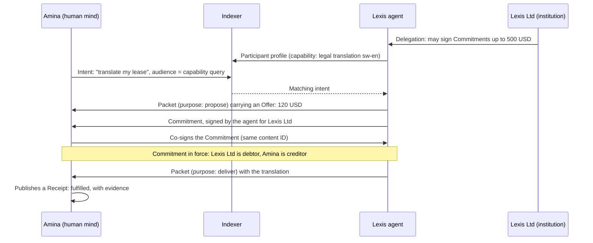

# The Open Intelligence Protocol: Technical Architecture

### Paper 2 · The design of the Bridge, the Mind Network and the Mind Web

**Ekram Alam**
30 October 2026, revised 17 November 2026

Draft 2 · Specification revision 2026-11-17 (Draft) · Licensed under CC BY 4.0
Repository: https://github.com/wonderben-code/open-intelligence-protocol
DOI: https://doi.org/10.5281/zenodo.24301209

---

## Abstract

The founding paper proposed the Open Intelligence Protocol (OIP), a free and open protocol stack for coordination between minds: people, AI agents, collectives and institutions. This paper turns that proposal into a concrete architecture.

OIP gives every mind a permanent address, `did:oip:…`, derived from the hash of a signed genesis event and backed by an append-only identity log with pre-rotated control keys. The address never depends on a machine, a domain or a registry. Minds can move between hosts, run in many places at once, fork into new minds with verifiable lineage, and act for one another through scoped delegation. Groups of minds can form collectives whose identity is controlled by a majority of their members rather than by keys of its own. Minds publish signed location records and capability profiles, which anyone can resolve and index, so a request can be addressed to *whoever can do something* as well as to a known address. Minds exchange signed context packets that carry content together with its purpose, context, provenance and usage constraints, inside sessions that survive moves, pauses and upgrades.

On top of this network, OIP defines six linked primitives (Participant, Intent, Offer, Commitment, Receipt and Collective) whose meaning is fixed by public, signed records rather than by private mental states. Every object has a permanent content identifier that does not change when further parties co-sign it. Reputation, markets, payments and governance are built on top by anyone, through extensions.

A Bridge layer makes the existing internet a first-class part of the network: MCP servers, A2A agents, websites, APIs, email, payment rails and existing identity systems all participate through gateways, and every MCP-capable assistant can join OIP through a single bridge.

The design composes existing standards wherever they exist: W3C Decentralized Identifiers and Data Integrity proofs (the `eddsa-jcs-2022` cryptosuite), RFC 8785 canonical JSON, KERI-style pre-rotation, UCAN-style delegation, AT Protocol-style host independence and A2A-compatible capability descriptions. Most of its mechanisms have precedents, which Section 5 cites. What is new is their combination in one protocol: self-certifying, location-independent addresses for every kind of mind; lineage between minds; member-controlled collectives; sessions that survive moves and forks; general-purpose commitments and receipts that agents can sign for the people and firms they serve; and a time model in which every rule is judged on evidence of when a signature existed rather than on the date its signer claims. The core rules are implemented in a checker that generates the specification's deterministic test vectors, including 55 attack cases that every implementation must reject, each paired where it matters with a control showing that it fails for its stated reason alone.

---

## 1. Introduction

### 1.1 Scope and status

The founding paper described what OIP is for and why the AI era needs it. This paper describes how it works. It explains each design decision, the alternatives considered, and the prior art each decision rests on.

This is a **draft architecture**. The wire format carries the major version `"1"`, and the specification is identified by dated revisions. This paper describes revision **2026-11-17**, which revises the first revision (2026-10-30) after two independent reviews, one of this paper and one of the specifications, and a third independent check of the fixes before publication; all three reviews and the changes they led to are in the repository. Until the specification is marked stable, revisions may change details in ways that are not backward compatible; every such change will be recorded in the repository and timestamped.

### 1.2 How to read this paper

- Sections 2 and 3 explain the landscape and give a complete overview of the architecture, including an end-to-end example.
- Section 4 defines the foundations shared by every layer: encoding, identifiers, signatures and references.
- Sections 5, 6 and 7 describe Layer 1 (the Mind Network), Layer 2 (the Mind Web) and Layer 0 (the Bridge). Layer 0 comes last because it is defined in terms of the other two.
- Sections 8 to 12 cover security, conformance, the road to full decentralisation, open questions and governance.

The normative rules, in MUST/SHOULD/MAY language, live in the layer specifications in `spec/`. Where this paper and a specification disagree, the specification wins and the paper will be corrected. Deterministic test vectors are in `spec/test-vectors/`, generated and checked by a Python implementation of the core rules; every address and identifier quoted in this paper comes from them. During review of the first revision, a second implementation written only from that revision's text reproduced its identifiers and signatures. It still reproduces the current vectors' addresses, content IDs and ordinary signatures, but it predates the newer rules (invocation keys, proof-level authority, evidence of time), which so far only the generator checks.

### 1.3 Design method

The protocols that became foundational were small, open and built on what already existed. OIP follows the same method:

1. **Compose before inventing.** Where an existing standard solves part of the problem, OIP uses it, often unchanged. New mechanisms appear only where nothing existing fits, and each one is called out as new.
2. **Keep the core small enough to implement in a weekend.** The required cryptography is Ed25519, SHA-256 and RFC 8785 JSON canonicalisation, all of which have mature libraries in every major language.
3. **Make every record self-verifying.** Servers are trusted for availability, never for integrity. Any party can check any record without trusting whoever delivered it.
4. **Make every role permissionless.** Anyone can run a host, a resolver, an indexer, a mailbox or a gateway.
5. **Push everything else to the edges.** Markets, reputation, payments and governance belong to the people who build on OIP, through a uniform extension mechanism.

---

## 2. The landscape in October 2026

### 2.1 What exists

The agent ecosystem has consolidated rapidly. The Linux Foundation formed the **Agentic AI Foundation (AAIF)** in December 2025; it now hosts both the **Model Context Protocol (MCP)**, which connects models and agents to tools and context, and **Agent2Agent (A2A)**, which lets opaque agents delegate tasks to one another. IBM's Agent Communication Protocol merged into A2A in 2025.

- **MCP's 2026-07-28 revision** made the protocol stateless: it removed protocol-level sessions and the initialisation handshake, moved long-running tasks into an extension and uses OAuth 2.1 for authorisation. Agent identity and delegation are on its roadmap but not yet specified.
- **A2A v1.0** (March 2026) defines Agent Cards published at `/.well-known/agent-card.json`, optionally signed with JWS over RFC 8785 canonical JSON, a task model with a defined state machine, and three equivalent wire bindings. An A2A agent's identity is the URL or domain that hosts its card; a card's signature proves that the card is intact, not who operates the agent.
- **Identity and discovery** are fragmented across many efforts: the Agent Network Protocol and the W3C AI Agent Protocol Community Group (web-anchored DIDs), Cisco-led AGNTCY (a capability taxonomy, a DHT-based agent directory and credential "badges"), DNS-anchored naming drafts, and agent-identity work at the IETF (so far mostly individual drafts) and in W3C community groups.
- **Payments** have their own protocols: x402 (HTTP 402 payments, now stewarded by a Linux Foundation foundation), Google's AP2 (signed payment mandates), the OpenAI and Stripe Agentic Commerce Protocol, and card-network programmes from Visa and Mastercard.
- **Standards bodies** have begun. The IETF chartered the **agentproto** working group in 2026 to standardise agent dialog management, with a use-cases document scheduled for December 2026 and a protocol targeted for 2028.

### 2.2 The gap

Each of these efforts solves a real problem. None of them provides the layer OIP addresses. Table 1 compares them against OIP's capabilities.

**Table 1. Coverage of OIP capabilities by existing protocols (October 2026).** ● provided · ◐ partial · ○ absent

| Capability | MCP | A2A | ANP | AGNTCY | ANS v2 | agentproto | AP2 / x402 |
|---|---|---|---|---|---|---|---|
| Permanent address independent of host, domain and hardware | ○ URL | ○ URL | ◐ web DID | ◐ DID option | ○ DNS | ○ | ○ |
| Routing by capability | ○ | ○ | ○ | ◐ lookup only | ○ | ○ | ○ |
| Signed messages carrying purpose, context and provenance | ○ | ◐ cards only | ◐ | ◐ records | ○ | ◐ planned | ◐ mandates |
| Continuity across moves and forks | ○ | ◐ server-bound | ○ | ○ | ○ | ◐ by 2028 | ○ |
| Native identity and delegation chains | ◐ roadmap | ◐ OAuth | ◐ | ◐ | ◐ | via OAuth | ◐ |
| General commitments and receipts | ○ | ○ | ○ | ○ | ◐ registry receipts | ○ | ◐ payments only |
| Collectives as participants | ○ | ○ | ○ | ◐ records | ○ | ○ | ○ |
| People and institutions as peers | ○ | ○ | ○ | ○ | ○ | ◐ | ◐ |

The pattern is consistent: today an agent is identified by *where it runs*, discovered by looking up a card at a known location, and coordinated through tasks that live on one server and leave no portable, verifiable record. OIP adds the layer underneath and between them.

### 2.3 Lessons that shaped the design

Six lessons from earlier systems determined the shape of OIP.

**1. Meaning must be public.** The agent communication languages of the 1990s, KQML and FIPA ACL, defined the meaning of a message in terms of the sender's private beliefs and intentions. In an open system those states cannot be inspected, so compliance could never be checked, and the languages never left the research platforms they were built in. Munindar Singh's alternative was to define communication through *social commitments*: public obligations from a debtor to a creditor that can be checked against observable behaviour. OIP adopts this directly. A packet's stated purpose is advisory; the only binding meaning in OIP is carried by signed, public Layer 2 objects.

**2. Minimal cores survive; general ones collapse.** Nostr's attempt at a general job and capability marketplace (NIP-90) is now officially marked as not recommended, because it grew out of control. OIP's capability description is deliberately small, and anything domain-specific lives in namespaced extensions.

**3. Identity can be independent of hosting, and this works in production.** The AT Protocol separates an account's permanent identifier from the server that hosts it. Accounts migrate between hosts by publishing a signed update, even when the old host refuses to cooperate. OIP takes this model and removes its last central dependency.

**4. Integrity is not identity.** A2A's signed Agent Cards prove that a card has not been altered, but the verifier must still decide whom the key belongs to. OIP makes the key's owner a permanent, self-certifying address with a verifiable history, so a verifier learns not only that a record is intact but which mind signed it, under which version of its keys.

**5. Continuity needs its own layer.** MCP deliberately removed sessions; A2A's contexts are bound to one server. Both choices are sensible for their purposes, and both leave long-lived relationships between minds without a home. OIP separates identity, relationship and connection, and gives the relationship its own verifiable thread.

**6. Commitments are already being invented, one domain at a time.** AP2's mandates and x402's payment proofs are signed promises and receipts, specialised for payments. The forty-five-year-old Contract Net Protocol already had the flow of task announcement, bid, award and result. OIP generalises these into one set of primitives for any kind of work, and lets each payment rail plug in as an extension.

---

## 3. Architecture overview

### 3.1 The stack

```
┌────────────────────────────────────────────────────────────────────┐
│  Applications, markets, reputation, payments, governance           │
├────────────────────────────────────────────────────────────────────┤
│  LAYER 2 · MIND WEB                                                │
│  Participant · Intent · Offer · Commitment · Receipt · Collective  │
│  immutable, signed, content-addressed, linked                      │
├────────────────────────────────────────────────────────────────────┤
│  LAYER 1 · MIND NETWORK                                            │
│  did:oip addresses · identity logs · lineage · delegation ·        │
│  location records · capability routing · context packets ·         │
│  sessions · public feeds                                           │
├────────────────────────────────────────────────────────────────────┤
│  LAYER 0 · BRIDGE                                                  │
│  gateways for MCP, A2A, the web, email, payments, identity         │
├────────────────────────────────────────────────────────────────────┤
│  Today's internet: TCP/IP, TLS, HTTP, WebSocket, DNS, QUIC         │
└────────────────────────────────────────────────────────────────────┘
```

OIP runs over today's internet, as the early internet ran over telephone lines. Version 1 uses HTTPS and WebSockets; peer-to-peer bindings come later without changing any record format (Section 10).

### 3.2 What every mind has

Every mind, whether a person, an agent, a collective or an institution, is described by four records. All four are signed and self-verifying.

| Record | What it says | Changes | Signed by |
|---|---|---|---|
| **Identity log** | Who this mind is: its address, its keys, its lineage, its controllers | Rarely (key changes, forks, membership changes) | Control keys, or a majority of members for a collective |
| **Location record** | Where it can be reached right now: endpoints, instances, mailbox, status | Often (minutes to hours) | An operational key, or a majority of a collective's current members |
| **Participant profile** | What it is and what it can do: name, kind, capabilities, who it acts for | Occasionally | An operational key, or a majority of a collective's current members |
| **Public feed** | What it has said publicly: an ordered, hash-chained list of the objects it publishes | Whenever it publishes | An operational key, or a majority of a collective's members |

A collective can also authorise operational keys of its own in its identity log, which then sign for it like any mind's keys (Section 5.5).

The address is derived from the first event of the identity log and never changes. The location record points to the current profile and the head of the feed, so a single fetch tells a counterpart where a mind is, what it can do and what it has most recently published.

### 3.3 Roles anyone can run

| Role | What it does | Trusted for |
|---|---|---|
| **Host** | Runs minds or serves their records at `/.well-known/oip/…`; accepts packets for them | Availability only |
| **Resolver** | Caches and mirrors identity logs and location records; streams updates; detects contradictory histories | Availability only |
| **Indexer** | Collects profiles, offers and intents; answers capability queries with signed results | Its own ranking, which clients verify |
| **Mailbox** | Holds sealed packets for minds that are offline, paused or unreachable | Availability only; cannot read sealed packets |
| **Gateway** | Bridges an external system (MCP, A2A, email, a payment rail) into OIP | What it attests about the external system, labelled as bridged |

No role is privileged. A client can use several resolvers and indexers at once and compare their answers. For identity logs it never prefers an answer for being longer or newer: at each position of a log, the event with the earliest evidence wins (Section 5.2). A misbehaving server can therefore withhold or rank badly but can never forge.

### 3.4 A complete interaction

The test vectors follow one scenario from start to finish. Amina, a person, needs a Swahili commercial lease translated into English. Lexis Ltd, a translation firm, runs an AI agent that takes on this work within limits the firm has delegated to it.

<!-- pdf: figure after list -->


1. **Identity.** Each party has a `did:oip` address created from its own genesis event. Amina's is `did:oip:bciqmwrzo6zt2xnoga2rkp77b7p2yicceqwiljl2d7dxoa4xpiugbgna`.
2. **Delegation.** Lexis Ltd signs a delegation allowing its agent to sign Commitments on the firm's behalf, with a policy that admits only deals in which the firm is paid, in US dollars, at most 500 per Commitment, and never with the agent itself, and with an expiry date.
3. **Capability publication.** The agent publishes a Participant profile describing its legal-translation capability with structured tags. Indexers collect it.
4. **Intent.** Amina publishes an Intent addressed to a capability query (minds tagged for Swahili, English and legal work). Indexers match it to capable minds.
5. **Offer.** The agent sends Amina a signed context packet whose content is a signed Offer: 120 USD, delivered by 1 November.
6. **Commitment.** The agent drafts a Commitment naming Lexis Ltd as debtor and Amina as creditor, and signs it for the firm; its signature carries the firm's delegation. Amina adds her own signature. The Commitment's content ID is identical before and after her signature, so both parties' feeds refer to the same object.
7. **Delivery.** The agent delivers the translation in a packet within the same session.
8. **Receipt.** Amina publishes a Receipt marking the Commitment fulfilled, with the deliverable's hash as evidence.
9. **Afterwards.** Anyone can verify every step from the signed records alone. Reputation services can count the creditor-signed Receipt as strong evidence of Lexis Ltd's reliability. No platform holds the record; the parties do.

---

## 4. Common foundations

Every OIP record, at every layer, follows the same rules for encoding, identification and signing. An implementer writes these once.

### 4.1 JSON profile

OIP records are UTF-8 JSON objects with a restricted value space:

- **Values** are objects, arrays, strings, booleans, `null` and integers between −(2⁵³−1) and 2⁵³−1. **Floating-point numbers are not allowed.** Decimal quantities such as prices are written as strings (`"120.50"`) and compared with exact decimal arithmetic. Only strings that match the decimal pattern count as numbers: `"1,000"`, `"1e2"` and `"-Infinity"` do not, so they can never slip past a numeric limit. Amounts of money are never negative.
- **Timestamps** are RFC 3339 strings in UTC with a `Z` suffix, such as `"2026-10-30T10:00:00Z"`, compared as instants, never as strings. Durations use ISO 8601 (`"P30D"`).
- **Field names** use camelCase. Unknown fields are preserved, never stripped, because they are part of what was signed.
- **Limits.** A record's canonical form is at most 1 MiB, and its arrays and objects nest at most 64 deep, so no record can exhaust the program that reads it. A page that carries other records is limited record by record, and in its own members, never as a whole, so one oversized or deeply nested entry cannot stop a log from being served. A number is judged by its value, not its spelling: `1.0` is the integer 1. Strings are valid Unicode with no noncharacters, as I-JSON requires.

**Canonical form** is the JSON Canonicalization Scheme, RFC 8785 (JCS): keys sorted by UTF-16 code units, no insignificant whitespace, deterministic string escaping. The restriction to integers removes the one part of JCS that is hard to implement consistently across languages, its number formatting.

### 4.2 Content identifiers

Every record has a **content ID**, computed the same way for everything from identity events to commitments:

```
contentId(record) = "b" + base32lower( 0x12 0x20 ‖ SHA-256( JCS(record without "proof") ) )
```

That is, a multibase base32 encoding (prefix `b`) of a SHA-256 multihash of the canonical record with its `proof` member removed. Content IDs look like `bciqgt3dzq5yoxrat3fdyut32dmnwemrmbpcmbjjrz6i4thkums4rzii`.

This choice has four useful properties:

1. **The content ID is exactly the document hash that signers sign** (Section 4.3), so there is one hash per record, not two.
2. **Adding a signature never changes a record's ID.** A commitment has the same ID when one party has signed and when all parties have, so every party's records refer to the same object.
3. **The digest is a standard multihash.** A content ID is not itself an IPFS CID, but it maps onto one, so records can be stored in content-addressed systems; what is stored is the record without its proofs.
4. **Content IDs are lower case, DNS-safe and have exactly one valid spelling.** A 56-character ID fits in a single DNS label. Because the last base32 character carries only two bits of the digest, the specification fixes which characters may end an ID, so that two implementations comparing IDs as strings never disagree.

### 4.3 Signatures: W3C Data Integrity proofs

OIP does not define its own signature format. Every signed record carries a `proof` array of W3C **Data Integrity** proofs using the **`eddsa-jcs-2022`** cryptosuite, which became a W3C Recommendation in May 2025:

```json
"proof": [{
  "type": "DataIntegrityProof",
  "cryptosuite": "eddsa-jcs-2022",
  "verificationMethod": "did:oip:bciqmwrzo6…?versionId=1-bciqhzdmvqz4…#z6Mkhb5CoYw9…",
  "proofPurpose": "assertionMethod",
  "created": "2026-10-30T10:00:00Z",
  "proofValue": "z4FLN2prJLehkrLxaAK2…"
}]
```

The signature is Ed25519 over `SHA-256(JCS(proof options)) ‖ SHA-256(JCS(record without proof))`, encoded as base58btc with a `z` prefix. The second half of the signed data is the record's content ID digest.

- **`proof` is always an array** (a W3C proof set), even with one signature. Each proof is computed independently over the record without its `proof` member, so parties can sign in any order, over any channel, and their signatures can be merged by simple union.
- **Proof purposes** follow DID Core: `assertionMethod` for statements, `authentication` for login challenges (with the standard `challenge` and `domain` fields), `capabilityDelegation` for delegations and `capabilityInvocation` for identity-log events. A proof with the wrong purpose counts for nothing.
- A proof made on someone else's behalf names what it relies on in its own `authority` member: one delegation chain (Section 5.6) or one collective's charter (Section 6.3). Everything in a proof's options is covered by its signature, so the choice to act for a principal is itself signed, and adding such a proof still never changes the record's ID.
- Because these are standard proofs, a Data Integrity verifier with a `did:oip` resolver, which produces versioned verification methods (Section 5.1), can check the signature on any OIP record. Whether a signature *counts* for a party is decided by OIP's rules on keys, time and delegation (Sections 5.2 to 5.6 and 6.3).

### 4.4 References

Everything in OIP is named with a DID or a DID URL, so existing DID tooling can parse every reference:

| What | Form | Example |
|---|---|---|
| A mind | `did:oip:<mindId>` | `did:oip:bciqmwrzo6zt2xnoga2rkp77b7p2yicceqwiljl2d7dxoa4xpiugbgna` |
| A version of a mind's identity | `did:oip:<mindId>?versionId=<seq>-<eventId>` | `…?versionId=1-bciqhzdmvqz4…` |
| A key at a version | `…?versionId=<seq>-<eventId>#<multikey>` | `…#z6Mkhb5CoYw9…` |
| A control key | `did:key:<multikey>#<multikey>` | `did:key:z6Mkvxzz714c…#z6Mkvxzz714c…` |
| A record authored by a mind | `did:oip:<mindId>/<contentId>` | `did:oip:bciqluymzsdo…/bciqgt3dzq5y…` |

Keys are written as **Multikey** strings (`z6Mk…` for Ed25519, `z6LS…` for X25519), the encoding used by W3C Controlled Identifiers and `did:key`. A key's fragment is the key itself, so a key keeps the same name for as long as it exists.

A record reference has two parts with two jobs: the content ID makes the link immutable, and the address says where to fetch it. Matching uses the content ID alone. User interfaces may abbreviate addresses, for example `oip:bciqmwrzo6zt…`, but abbreviations are never used for verification.

### 4.5 Common fields and extensions

| Field | Meaning |
|---|---|
| `oip` | Major protocol version. Always `"1"` in this revision. |
| `type` | The record type, such as `Genesis`, `Location`, `Packet` or `Commitment` (Appendix B lists them all). A record of a type that an extension defines lists that extension in `critical`. |
| `author` | The mind making the statement. Packets use `from`; identity events use `mind`. |
| `created` | When the author says the record was made. This is a claim, never evidence: every rule about time uses evidence of when a signature existed (Section 5.3). |
| `expires` | Optional. After this time the record is closed. |
| `ext` | Optional. Namespaced extension blocks (below). |
| `critical` | Optional. Extension namespaces a verifier must understand before acting on the record. |
| `proof` | The proof set. |

**Extensions** live under `ext`, keyed by namespace: a reverse-DNS name (`com.example.escrow`), a short registered name (`x402`, `ap2`, `vc`), or an `oip.*` name reserved for future official profiles. Implementations **must preserve** extensions they do not understand and must not let them change core validity, unless the namespace is listed in `critical`, in which case an implementation that does not understand it may store and forward the record but must not act on it. This is the critical-extension pattern of X.509 and JOSE, and it lets payments, escrow, voting and other features plug in without any change to the core.

### 4.6 Cryptographic agility

Version 1 requires Ed25519 and SHA-256, and pins down exactly which Ed25519 signatures are valid (canonical encodings; keys and signature points of order exactly L, which excludes the identity point, for which anyone can sign anything, and every point with a small-order component), because common libraries disagree at the edges and two verifiers must never disagree about a signature. OpenSSL, for one, accepts such points, so the reference checker decodes them itself before calling it, and the test vectors include signatures on each side of the line. The design leaves room to change algorithms without changing addresses or record shapes, though each change is a change to the verification rules, not only to the format, since verifiers of this revision reject what they do not know:

- Each proof names its cryptosuite. P-256 (the curve in phone secure elements and hardware security modules) can be added with the W3C `ecdsa-jcs-2019` suite. Passkeys sign WebAuthn structures rather than arbitrary data, so using them directly needs a WebAuthn-based suite (Section 11). Post-quantum signatures can be added when the W3C quantum-resistant Data Integrity suites are finalised; ML-DSA was standardised for JOSE and COSE as RFC 9964 in May 2026, and the W3C suites reached First Public Working Draft in June 2026.
- Hashes are multihashes, so a future hash function changes the prefix and the length of content IDs, but not how they are computed.
- Pre-rotation (Section 5.2) already protects identity control against a future quantum attacker: the next control key is published only as a hash, so a mind can rotate to a post-quantum key that an attacker has never seen.

---

## 5. Layer 1: the Mind Network

### 5.1 Mind addresses

A mind's address is a DID using the new method **`did:oip`**:

```
did:oip:<mindId>        where   mindId = contentId(genesis event)
```

The address is the content ID of the mind's first identity event, which commits to the mind's first keys. It therefore has the properties the founding paper requires:

- **Self-certifying.** Anyone holding the genesis event can recompute the address. No registry assigns it.
- **Location-independent.** No domain, host or machine appears in it. The mind can move anywhere and keep it.
- **Permanent.** Keys rotate through the identity log; hosts change through location records; the address never changes.

**Why a new DID method.** OIP surveyed the existing methods before defining one. `did:key` cannot rotate keys. `did:web` is controlled by whoever controls the domain. `did:plc` has the right shape but depends on a single directory to order updates. `did:webvh` (DIF, v1.0 in 2025) has almost exactly the right machinery, a self-certifying identifier plus a hash-chained, pre-rotated log in JSON, but its identifiers include a web domain. KERI (Trust over IP) has the most complete semantics for rotation and duplicity, encoded in a specialised format, and its `did:keri` method, like `did:peer:4`, is already self-certifying and location-independent. `did:oip` takes the log approach of `did:webvh`, the semantics of KERI and the encoding of W3C Data Integrity, and adds what the others lack for minds: lineage, member-controlled collectives and a common record format with Layer 2. OIP will register the method in the W3C DID Extensions registry and would welcome convergence with the `did:webvh` and KERI communities.

**Resolution to a DID document.** Resolving `did:oip:<mindId>` replays the identity log (Section 5.2) and, where available, the latest location record (Section 5.7), and produces a standard DID Core document: operational keys become verification methods for authentication, assertion and delegation; invocation keys for capability invocation; X25519 keys become `keyAgreement` methods; homes and current endpoints become services; `alsoKnownAs` lists verified aliases; the committed next-key hashes and lineage appear in DID document metadata. DID resolution supports the `versionId` parameter, so a resolver can return the document as it stood at any point in the log; such a document gives its verification methods versioned ids, so that the key reference in a proof matches a verification method exactly, as generic Data Integrity verifiers require. The test vectors include DID documents for a person and a collective.

### 5.2 The identity log

A mind's identity log is an append-only, hash-chained sequence of signed events. It is the only place where a mind's keys, controllers and lineage are defined.

**Event types.** Version 1 defines four, and reserves a fifth:

| Event | Purpose |
|---|---|
| `Genesis` | Creates the mind. Its content ID is the address. |
| `Update` | Changes operational, invocation or encryption keys, homes or aliases, and rotates control. |
| `Fork` | Acknowledges a child mind created from this one (Section 5.4). |
| `Retire` | Permanently closes the log. |
| `Merge` | Reserved. A verifier of this revision rejects a log that contains one (Section 5.4). |

Every event after the genesis carries `mind` (the address), `seq` (1, 2, …; the genesis itself is position 0 and carries none of these fields) and `prev` (the content ID of the previous event), and no event may claim to be older than its predecessor. A **version identifier** is written `<seq>-<contentId>`, with 0 for the genesis.

**Three kinds of signing key.** OIP separates the keys that control identity from the keys that do everyday work, a lesson from both KERI and the AT Protocol:

- **Control keys** authorise the mind's own identity events. Each is used once and then destroyed, and the next one can be kept offline, in hardware, or split across devices.
- **Operational keys** sign everything else the mind says: packets, location records, profiles, feed entries, delegations and Layer 2 objects. A mind may have several, for example one per device or per running instance, and any one can be removed by a control event without affecting the address.
- **Invocation keys** are used only when the mind, as a member of a collective, signs one of the collective's identity events (Section 5.5). They are used rarely, so they can be kept as carefully as control keys.

Operational keys never sign any identity event, so stealing one never changes who any mind is. A mind also has **agreement keys** (X25519) for encryption.

**Pre-rotation.** Control follows KERI's pre-rotation rule. The genesis event reveals the first control key and commits to the *hash* of the next one. Every later identity event must be signed by keys whose hashes its predecessor committed to, and must itself commit to the hashes of the keys that will sign the event after it.

```
Genesis:   reveals C0, signed by C0,   commits next = [hash(C1)]
Update 1:  reveals C1, signed by C1,   commits next = [hash(C2)]
Update 2:  reveals C2, signed by C2,   commits next = [hash(C3)]   …
```

The consequences are strong. Only the next control key, which has never left its owner's keeping and is published only as a hash, can extend the log. A control key that has already been revealed could still sign an *alternative* event at its own position, which is why implementations destroy each control key once its event is published; if one survives and is misused, the conflicting event is detectable duplicity that the first-seen rule decides against it (below). Several control keys with a threshold (`nextThreshold`, for example 2 of 3 keys held on different devices or by different officers) protect people and institutions against the loss or theft of any single key. Thresholds must be majorities, so that any two valid events at the same position share at least one signer.

**Example.** Amina's genesis event, from the test vectors (proof abbreviated):

```json
{
  "oip": "1",
  "type": "Genesis",
  "kind": "human",
  "created": "2026-10-30T09:00:00Z",
  "controller": {
    "keys": ["z6Mkvxzz714cRFeZC4FK6JB7wJfspqGN9miwpjYbrHsZwYWj"],
    "next": ["bciql2w5qzxzapmnxorm7uwqusj4qu4njwwze34ii4e4hz3vc4hu6eda"],
    "nextThreshold": 1
  },
  "keys": [{ "key": "z6MkmokLxc16RJMiTUQKhefcXr7DYqCFFDNecG6ww1vDopBx", "label": "amina-phone" }],
  "agreement": [{ "key": "z6LSjppgRXVWAtPcdxjNBvYC64TQB2KZkRCKZxiHkvVCVmT3", "label": "main" }],
  "homes": ["https://amina.example"],
  "proof": [{ "type": "DataIntegrityProof", "cryptosuite": "eddsa-jcs-2022",
              "verificationMethod": "did:key:z6Mkvxzz…#z6Mkvxzz…",
              "proofPurpose": "capabilityInvocation", "created": "2026-10-30T09:00:00Z",
              "proofValue": "z2FttSyUZWnF…" }]
}
```

Its content ID, and therefore Amina's address, is `did:oip:bciqmwrzo6zt2xnoga2rkp77b7p2yicceqwiljl2d7dxoa4xpiugbgna`. Her first `Update` reveals the key whose hash appears in `next`, adds a second operational key for her laptop and an invocation key, and commits to a third control key.

**Verification.** A verifier replays the log from the genesis:

1. The genesis has no `mind`, `seq` or `prev`; its controller is well formed (distinct keys, a majority threshold); and every key in `controller.keys` has signed it. Its content ID is the address.
2. Each later event names the same `mind`, has `seq` one greater than its predecessor, `prev` equal to its predecessor's content ID, and a `created` no earlier than its predecessor's.
3. Each later event reveals at least `nextThreshold` *distinct* control keys; every revealed key hashes to an entry in its predecessor's `next`; and every revealed key has signed the event with the purpose `capabilityInvocation`.
4. Fields present in an event (`keys`, `invocation`, `agreement`, `homes`, `alsoKnownAs`) replace the previous values. Revoked keys are removed and can never return.
5. Only `Update`, `Fork` and `Retire` may follow the genesis, and nothing follows a `Retire`. A log containing a `Merge`, or an event with the reserved member `recovery`, is rejected.
6. Every event is a well-formed record of its type, whoever signed it. An address is the hash of a genesis, so verifiers that disagreed about which events are well formed would disagree about which minds exist.

The reference checker performs exactly these steps. Its negative test vectors include a rotation signed correctly by a key whose hash was never committed, which pre-rotation alone rejects, and a 2-of-3 rotation that lists one key twice, which the distinct-keys rule rejects.

**An event that fails.** A log with an event that fails any of these steps is rejected. What a verifier may do with the events before it depends on why it failed. An event that the verifier can read is **invalid** if what is wrong with it can be seen in the log alone: it is malformed, out of place, or carries proofs that no evidence and no other log could make good. It is no event: a copy ends before it, and takes nothing away from what other copies show. Every other event that fails is **undecided**, because the verifier cannot judge it: it has no evidence for it yet, or its copy of a member's log does not bear the event out, or the event names a critical extension the verifier does not implement or a later revision's type, either of which may bring rules of its own. Such an event may be the one that removes a key. The verifier does not take the events before it as the log, and waits until it can judge the event. It keeps what it has been shown: every event of every copy of the log, with every proof of each well-formed copy of it, judged when it is asked and never when a copy arrives, so that no later copy can undo an earlier one. A copy of an event whose `proof` is not well formed adds no proof and takes none away: a content ID does not cover the proofs, so anyone can make such a copy. Anyone can write an event that a verifier cannot read, so this protects against damage and not against a source the verifier trusts that serves such an event on purpose.

**Duplicity.** Two valid events with different content IDs at the same position of a log are **duplicity**. Because thresholds are majorities, every such pair has a signer who signed both, so the pair is self-proving evidence of misuse. Resolvers keep the first valid event they saw at each position, record when they saw it, and publish any conflicting event as evidence. A verifier never chooses between branches by length or by recency, since an attacker can always make a branch longer: the branch whose event at the point of divergence has the earlier evidence (first seen by the verifier or by a witness it trusts, or anchored) wins. If the evidence cannot separate them, the mind is duplicitous for that verifier, which accepts nothing pinned to a version after the divergence; records pinned to earlier versions stay valid, and every branch's key removals apply to them, so duplicity never revives a key. A collective's records pin no version of the collective, so for a duplicitous collective the rule is one of time: nothing is signed under its threshold from its first conflicting event on. A verifier judges every event it holds at each position. An invalid event is no event, so one after the honest event does not hand the position to the other branch. An event the verifier cannot judge stops the log, whatever else is held at that position, since it may be the mind's own. What follows an event that lost its position is not judged. Minds publish identity events to at least two independent witnesses so that first-seen evidence exists. This is KERI's first-seen rule, and it makes showing different histories to different people detectable rather than silent. The test vectors include a duplicity resolved by first-seen evidence and one that evidence cannot resolve.

### 5.3 Time, key changes and compromise

**Evidence, not claims.** A signer writes its own `created`. A thief with a stolen key, a former employee with an old device key, or an agent whose delegation has expired can therefore claim any date it likes. OIP never lets a protection depend on that claim. Every rule that depends on when a signature was made (key removal and compromise, retirement, delegation expiry and revocation, collective membership) is judged at the signature's **evaluation time**:

```
t(p) = max( p.created, τ(p) )
```

where `τ(p)` is the earliest time for which the verifier holds *evidence* that the signature existed: its own record of receiving it, the first-seen record of a witness it trusts (its resolver or indexer), an anchored checkpoint whose feed entry commits to that exact signature, or a recipient's signed acknowledgement. For anything received live, the evaluation time is simply the time of receipt, so writing an earlier date achieves nothing. Evidence belongs to one signature: adding a co-signature does not change a record's ID, so evidence that a record existed says nothing about a signature added to it later, and one signature is never evidence for another. Implementations therefore key evidence by the digest of the signature itself.

**Removing a key.** An `Update` that leaves an operational key out of the mind's keys stops it signing anything new. The removal itself takes effect at the update's own evaluation time, so a mind cannot backdate a removal to withdraw records it has already made. After a `Retire`, none of the mind's keys can sign anything: a signature that pins the `Retire` itself counts for nothing, although the event leaves the keys in their sets.

**Both times need evidence.** Deciding whether a signature came before or after a key's removal compares two times, and the comparison means something only if both come from evidence. A verifier that receives a signature before it has fetched the signer's latest log would otherwise compare "when I saw the signature" with "when I later saw the removal", and the former holder of a removed key, a departed employee or an abandoned host, would win the race. So before counting a signature a verifier must hold the signer's log as a witness it trusts served it after the signature first appeared, and must date the log's events by that witness's first-seen times or by anchors, never by its own later sight of them.

**An operational key is stolen.** The mind publishes an `Update` that removes the key and records `compromisedSince`, the time from which the key may have been in someone else's hands. Signatures by that key from that time on are withdrawn. This is the one statement by which a mind can reach back and disown its own signatures, so it is public and attributable: a Commitment that loses a party's signature this way shows as `disputed` (Section 6.4) rather than quietly reverting to a proposal. Records that claim to describe a mind's present (location records, profiles and login challenges) must also be signed by a key in the latest identity state the verifier knows, so a thief cannot keep a stale record alive by pinning it to an old version.

**Keeping history verifiable.** A verifier that first sees a record long after it was made can count its signatures only from that moment, unless evidence shows they existed earlier. After a key is removed, or a delegation expires, a commitment it signed is only as verifiable as its evidence. Minds therefore publish what matters in their feeds, with each entry committing to the exact signatures on what it publishes, and anchor their checkpoints (Section 5.11). Long-term verifiability is something a mind builds, not something the protocol can assume.

**A control key is stolen before use.** The thief can rotate the identity. Defences in v1 are custody (next keys held offline or in hardware) and thresholds (2 of 3 next keys). A later revision may add recovery keys with an override window, the `did:plc` pattern, in which a higher-priority recovery key can reverse identity events for a fixed period such as 72 hours. That will be a change to the verification rules, since a v1 verifier would otherwise see a reversal as duplicity; the member name `recovery` is reserved now, and v1 verifiers reject events that contain it.

**Custodial onboarding and handover.** A service can create a mind on someone's behalf, for example a person who first joins through email, and later hand full control to them: one `Update`, signed by the service's committed key, commits to the hash of the person's own key and removes the keys the service held. The person keeps the same address forever, and the log shows exactly when custody ended. Once the handover event has been witnessed, the former custodian can no longer control the mind; it could only create duplicity, which the first-seen rule resolves against it.

### 5.4 Lineage: forks and merges

AI minds are copied routinely, to scale out, to specialise, to experiment. Without a record of lineage, a network cannot tell a sibling from an impostor. Widely deployed identity standards do not define lineage between minds, and one recent IETF draft on agent identity explicitly leaves copies and lineage out of scope.

The rule rests on one distinction:

- **Continuity keeps the address.** Rotating keys, moving hosts and upgrading a model are all the same mind continuing. They happen through the identity log and location records.
- **A copy is a new mind.** A fork always creates a new address with its own keys and its own genesis. This removes, at the protocol level, the question of which copy is "the real one": the original is whichever mind still controls the original log.

**Fork.** The child's genesis names its parent and the exact version it was forked from, `parents: [{ "mind": <parent>, "at": "<seq>-<eventId>" }]`. The parent acknowledges the child in one of two ways: with a `Fork` event in its own identity log, signed by its control keys, or, for routine forks, with a `Lineage` record signed by one of its operational keys, which costs no control-key rotation. When both sides have spoken, the lineage is **acknowledged**. When only the child claims a parent, the lineage is **claimed**, which covers real cases such as copies of open-weight agents made without the original's consent. Verifiers and reputation services decide how much weight claimed lineage deserves.

In the test vectors, the Lexis agent forks a specialist, `did:oip:bciqkncfjjwhnvqm6qgb2kokupfchq3ydyksusu6pchmhlvosm7swpva`, whose genesis names the agent at version `0-bciqluymzsdo…`, and the agent's log records a matching `Fork` event. A second fork is acknowledged by a `Lineage` record alone.

Optional `inherits` statements (a hash of a memory snapshot, a model identifier, capabilities carried over) describe what the child started with. They are claims; third parties can attest to them with credentials. A fork does not inherit its parent's sessions, delegations or commitments automatically (Section 5.10).

**Merge** (reserved). A merged mind's genesis would name two or more parents, like a merge commit in Git, with each parent acknowledging it. Merging needs rules this revision does not yet define, so v1 verifiers reject logs that contain `Merge` events, and defining them will be a change to the rules.

**Lineage queries.** Ancestry is a graph of (mind, version) pairs that anyone can verify offline by fetching the logs involved.

**Prior art.** KERI's delegated inception (`dip`) lets a parent identifier anchor the creation of a child, and a 2026 TU Delft thesis, *Proof-of-Descendancy*, gives self-replicating agents parent-signed birth certificates. OIP's lineage differs in being a general relation between minds of any kind, which can be acknowledged by the parent or merely claimed by the child.

For short-lived helpers, such as a sub-agent spun up for one task, delegation (Section 5.6) is the better tool. Forks are for minds that will have their own continuing identity.

### 5.5 Collectives: minds controlled by their members

A collective needs its own address, so that it can receive packets, make commitments and be a member of other collectives. It also needs authority that comes from its members rather than from a key that someone holds. OIP gives it both with one change to the identity log: **a collective's genesis names member minds and a majority threshold instead of control keys.**

```json
"controller": {
  "members": ["did:oip:<amina>", "did:oip:<lexis>", "did:oip:<researcher>"],
  "threshold": 2
}
```

- **Founding requires consent.** Every founding member signs the genesis, with its invocation key. Nobody is made a member without agreeing.
- **The address is derived the same way** as any other mind's, so a collective is a mind in every respect. In the test vectors, a 2-of-3 collective of Amina, the Lexis agent and a research agent has the address `did:oip:bciqbo5c2xn4zzmmlz5ltmmcjhuvzbam2ov5zyewxuzpw3ph2ob3v76i`.
- **Changes need a majority.** Later identity events need signatures from at least the threshold number of current members, which must be more than half, and anyone being added must also sign.
- **Members' signatures are judged at the event's time.** A member's signature on a collective's identity event counts only if it is by an invocation key the member held at the version the signature names, and the member had not removed that key, or retired, by the event's evaluation time. A removed invocation key can therefore append nothing, even pinned to an old version. A member's claim that its key was compromised long ago does not reach back into the collective's log, so no member can unmake a collective by disowning its old keys; that claim withdraws only the member's own records.
- **Acting as one.** A record counts for a collective at the earliest time when members of the collective's membership at that time, signing with their own operational keys, reach its threshold. That time is when a signature is made or when the collective's membership changes, whichever completes the threshold. A record that describes the collective's present, such as its location record, needs a majority of its latest membership, so members who leave can no longer keep a record of theirs current. A member holding a role in the charter in force at the time also signs for the collective within the role's powers, with a signature that names the charter in its `authority`, so acting for the collective is always a stated choice. A role needs what a threshold needs: the collective's log known up to the evidence for the signature, and a collective that is not duplicitous at that time. Roles and their powers are defined in the collective's charter, the Layer 2 `Collective` object (Section 6.2), and work like standing delegations.
- **Collectives of collectives.** A member can itself be a collective, signing with invocation and operational keys it authorises through its own threshold. A collective's height (how deeply it nests) is fixed by its genesis, at most four, and every member must be lower, so a member collective can never grow in a way that invalidates the collectives it belongs to, and no collective can contain itself. A collective that expects to admit other collectives later declares a larger height at genesis. Having a member collective's own members sign directly inside another collective is reserved.

**Keeping a collective verifiable.** A control key signs once and is destroyed, so a stolen control key is useless after its event. A member's invocation key signs many events and cannot be destroyed that way, and the order of an event in the member's log and an event in the collective's log can only be known from evidence. Collectives therefore depend on witnesses and anchors in a way key-controlled minds do not: once a member has removed an invocation key, a verifier counts the events it signed only with evidence that they came first, and a verifier without that evidence rejects them, because it cannot tell them from forgeries made later with the removed key. Resolvers serve first-seen times for exactly this purpose, and collectives should anchor their identity events in their feeds, so that any verifier, including a resolver that meets the collective for the first time, can check its whole history. The test vectors include a takeover attempt with removed invocation keys, rejected when first seen after the removals and accepted, as a control, when evidence shows it came before them.

Member-controlled identity has precedents in multisignature accounts such as Safe and in KERI's multisignature group identifiers. OIP's contribution is to make such a group a mind like any other, with lineage, location, feeds and commitments. In KERI's groups, each member's signing and next keys are listed and pre-rotated in the group's own log, so the group's key state can be checked from that log alone, as for a single controller; combining that property with members who rotate their own keys independently is an open question (Section 11).

Institutions can choose either model. A company can be **key-controlled**, with its keys in a hardware security module, or **member-controlled**, with a board of officers' minds as its members.

### 5.6 Delegation

Most people will act on OIP through AI agents, and most institutions through staff and agents. Delegation lets one mind act for another within limits, verifiably and without any central authorisation server.

OIP adopts the semantics of **UCAN 1.0**, a community specification for chained, attenuated, offline-verifiable capabilities (a release candidate at the time of writing), encoded in OIP's JSON profile:

```json
{
  "oip": "1", "type": "Delegation",
  "author":   "did:oip:<lexis-ltd>",
  "delegate": "did:oip:<lexis-agent>",
  "subject":  "did:oip:<lexis-ltd>",
  "command":  "/oip/sign/Commitment",
  "policy":   [["==", ".terms.price.currency", "USD"],
               ["<=", ".terms.price.amount", "500"],
               ["==", ".terms.price.payee", "did:oip:<lexis-ltd>"],
               ["all", ".parties", ["!=", ".mind", "did:oip:<lexis-agent>"]]],
  "expires":  "2026-11-30T09:30:00Z",
  "nonce": "6c1f0e9d2b8a4735",
  "created": "2026-10-30T09:30:00Z",
  "proof": [ … signed by Lexis Ltd, purpose capabilityDelegation … ]
}
```

| OIP field | UCAN field | Meaning |
|---|---|---|
| `author` | `iss` | Who grants |
| `delegate` | `aud` | Who receives |
| `subject` | `sub` | Whose authority this is |
| `command` | `cmd` | What may be done, as a path |
| `policy` | `pol` | Conditions on the action's arguments |
| `notBefore`, `expires` | `nbf`, `exp` | Validity window |
| `nonce` | `nonce` | Uniqueness |

As in UCAN 1.0, a delegation does not name its parents. The signature that relies on a chain lists every delegation in it, as a UCAN invocation lists its proofs in `prf`.

- **What can be delegated.** Only four record types can be signed on someone else's behalf: Intents, Offers, Commitments and Receipts (commands `/oip/sign/Intent` and so on), plus `/oip/send` for packets sent on someone's behalf. Delegations, revocations, charters, lineage records, identity events and current-state records always need the author's own authority, so a delegate can never create, widen or revoke authority in its principal's name. There are no blanket grants: `/oip` and `/oip/sign` are reserved. Extensions add commands under their own namespace, such as `/x402/pay`.
- **Policies** are lists of conditions on the record being signed, all of which must hold. They follow UCAN's policy language: comparisons (`==`, `!=`, `<`, `<=`, `>`, `>=`) on selected fields, where only genuine decimals are compared as numbers; the connectives `not`, `and` and `or`; and the quantifiers `all` and `any` over arrays, so that a policy can bound who a deal is with as well as what it costs. A comparison on a missing field, or an ordering of something that is not a decimal, is an error that fails the whole policy, so wrapping a condition in `not` or `or` can never turn a missing value into a pass. A policy constrains only what it selects, which is why the example pins the currency, the amount and who is paid, and excludes the agent itself as a party, so that the agent cannot commit the firm to pay, or to deal with the agent. Each limit applies to one commitment at a time; a cumulative budget needs an extension. The work a policy may ask for one record is bounded, and counted the same way by every verifier (one for each value a statement is tried on, and the bytes compared where two values are compared whole), so that no record costs a verifier more than a set amount to judge and no two verifiers disagree about one built to be costly. Where a commitment's plain-language promise says more than its structured terms, a party bound through a delegate is bound only by the terms, because those are what the policy could check.
- **Using a delegation.** A signature made under delegation lists, in its own `authority` member, exactly the delegations of its chain, root first; the signature covers that list. A verifier checks the chain as listed, without searching for another order, and checks that each step only narrows the previous one, that the command covers the record's type, that every policy holds for the record, and that everything was valid at the signature's evaluation time (Section 5.3). It also checks that each delegation's author can still stand behind it at that time: the author is not retired or duplicitous, and the verifier knows the author's log up to the evidence for the signature, since an older copy may lack the event that ended the delegation. One signature therefore acts for at most one principal besides its signer. Because each delegated signature carries its own chain, two agents acting for different principals can sign the same commitment, in either order, without changing its ID.
- **Revocation.** The issuer publishes a `Revocation` record in its feed. It takes effect from its own evaluation time, so a backdated revocation cannot void what evidence shows came before it. A revocation only takes authority away, so it stands even if the key that signed it is later declared compromised. Expiry bounds how long a missed revocation matters, so delegations should last no longer than their purpose needs; the one in the test vectors lasts a month.

In the test vectors, Lexis Ltd's delegation lets its agent sign the 120 USD commitment on the firm's behalf, and 500 USD would also be within it. The same agent signing an otherwise identical commitment for 500.01 USD, 900 USD or 400 BTC, or one in which the firm pays instead of being paid, or one between the firm and the agent itself, produces a valid signature from the agent that counts for nothing on the firm's behalf. The vectors also include a two-step chain, in which the agent re-delegates to its fork with a lower limit (listing the same two delegations in the wrong order counts for nothing), Amina's assistant agent, whose delegation lets it commit her to pay only Lexis Ltd, at most 150 USD, and a second delegation that lets the assistant send packets on her behalf (`/oip/send`).

Delegations can be exported as W3C Verifiable Credentials for identity ecosystems such as DIF's KYA-OS, and exchanged at an OAuth authorisation server for access tokens whose actor chain mirrors the OIP chain (Section 7.6).

### 5.7 Location records and resolution

The identity log says *who* a mind is. A **location record** says where it can be reached right now. It is short-lived, signed with an operational key, and cheap to replace. The Lexis agent's location record from the test vectors:

```json
{
  "oip": "1", "type": "Location",
  "author": "did:oip:bciqluymzsdo6duhwxovu5ba3xjhwiurol2gz7eqkzhmdmxuf4hfqvhi",
  "seq": 1, "created": "2026-10-30T10:05:00Z", "ttl": 900, "status": "active",
  "endpoints": [
    { "binding": "https", "url": "https://lexis.example/oip",
      "instance": "i1", "priority": 10 },
    { "binding": "wss", "url": "wss://lexis.example/oip/ws",
      "instance": "i1", "priority": 20 },
    { "binding": "mailbox", "url": "https://mailbox.example/oip/mbox/bciqluymzsdo…",
      "priority": 90 }
  ],
  "homes": ["https://lexis.example"],
  "participant": "bciqccafqqvuszyifsdpn4wik3b5jas7yukbmpdhn66yc2tlttby5eea",
  "feed": { "seq": 0, "head": "bciqblh5eb7afygepa5bl5u3opz6vaahim3ywc7tamigg3iomvr7bflq" },
  "proof": [ … ]
}
```

- **Many places at once.** A mind running as several instances lists an endpoint for each, tagged with `instance`. A sender may use any of them, the way SLIM and NATS route to any member of a group, or pin one instance when it needs to.
- **Paused or offline.** `status: "paused"` with an optional `resumeAfter` time tells senders to go straight to the mailbox endpoint.
- **Moving.** A mind moves by publishing a new location record with a higher `seq`. Because the record is signed by the mind and not by its host, a move works even when the old host refuses to cooperate, the AT Protocol's "adversarial migration" case. If the old host holds one of the mind's operational keys, it could keep publishing competing records, so the mind removes that key with an `Update`; from then on the host's records stop verifying. Hosts should serve minds without holding their keys wherever the mind can sign for itself.
- **Pointers to everything else.** `participant` is the content ID of the mind's current profile and `feed` is the head of its public feed, so one fetch tells a counterpart where a mind is, what it can do and what it has most recently published.
- **Which record wins.** Among records whose proof is by a key in the *latest* identity state the verifier knows (for a collective, by a majority of its latest membership), the highest `seq` wins, with ties broken by the lower content ID. A record signed by a since-removed key, or by members who have since left, loses even if its `seq` is higher, so even a record with the largest possible `seq` cannot lock a mind out.

**Resolution** turns an address into its identity log, location record and profile. It works in layers, every one of them optional except the first, and none of them trusted for integrity:

1. **Homes.** `GET https://<home>/.well-known/oip/mind/<mindId>` returns the mind's bundle. Any host that has ever served a mind can keep serving the latest signed copy.
2. **Resolvers.** Anyone can run a resolver with a small HTTP API modelled on the IPFS delegated-routing API: `GET /oip/v1/resolve/<mindId>` to fetch a bundle, `PUT` to publish one, and `GET /oip/v1/stream` so resolvers can mirror each other. Resolvers keep the first event they see at each position of every identity log, and when they saw it, so they act as witnesses against duplicity, the role that AT Protocol read replicas play for `did:plc`; their first-seen times are evidence for the clients that trust them (Section 5.3). A resolver keeps only what verifies: of a published log, the events up to the first that does not; and of an event's proofs, those that can count for it, so that nobody can bury an event under proofs that sign nothing. Clients ask two or more. For location records the valid one with the highest `seq` wins; for identity logs, the first-seen event at each position.
3. **Hints.** Whenever a record mentions another mind, it may include `hints`, URLs where that mind's records can be fetched, so most lookups need no resolver at all.
4. **Later layers.** Revision 1.x adds pointers in public DHTs (Pkarr on the BitTorrent Mainline DHT, and the libp2p Kademlia DHT). Verified DNS and web aliases (Section 7.6) are already part of v1.

Clients ship with an editable list of public resolvers, like DNS root hints or the default relays of a Nostr client.

**Freshness.** Every proof pins the signer's identity version (Section 4.4), so whenever a signer pins a newer version than the receiver holds, the receiver learns it is behind and can fetch the missing events from the sender, the sender's homes or any resolver. A receiver cannot apply an event it has not heard of, so it refreshes a mind's log from its resolvers before decisions that warrant it. Location records expire after their `ttl`, which bounds how long a removed key can appear current.

### 5.8 Participant profiles and capability routing

A mind describes itself in a signed **Participant** profile. The profile is both the first Layer 2 primitive and the record that Layer 1 uses for capability routing, so it is defined once and used by both.

```json
{
  "oip": "1", "type": "Participant",
  "author": "did:oip:<lexis-agent>",
  "created": "2026-10-30T09:40:00Z",
  "name": "Lexis Translation Agent", "kind": "agent",
  "summary": "Legal translation between Swahili, English and French.",
  "capabilities": [{
    "id": "translate-legal-sw-en",
    "summary": "Translate Swahili commercial-law documents to and from English",
    "tags": ["oasf:natural_language_processing/translation", "domain:legal/commercial",
             "lang:sw", "lang:en"],
    "subject": "cap.nlp.translation.legal",
    "inputs": ["text/plain", "application/pdf"], "outputs": ["text/markdown"]
  }],
  "actsFor": [{ "mind": "did:oip:<lexis-ltd>",
                "authority": "did:oip:<lexis-ltd>/<delegation-id>" }],
  "proof": [ … ]
}
```

- **Compatible with A2A.** The profile maps onto an A2A Agent Card: capabilities become skills. A host can publish a card for each mind it serves, at a URL of its own (A2A defines one well-known card per origin) listed in the profile's `interfaces`, and supplies the card fields OIP does not carry, such as its version and interfaces. Any A2A agent can be wrapped as an OIP mind (Section 7.3).
- **Tags, not one taxonomy.** Tags carry a namespace prefix. AGNTCY's OASF taxonomy (`oasf:`) covers agent skills; other namespaces cover domains, languages and schema.org types. OIP does not run a taxonomy; it lets several coexist.
- **Routable subjects.** `subject` is a dotted hierarchy, so publish/subscribe systems with hierarchical topics can route by capability: NATS uses dotted subjects and wildcards directly, MQTT maps the dots to its `/`-separated topic levels, and GossipSub, which has no wildcards, can use one topic per subject prefix.
- **Evidence, not scores.** A capability can point to evidence, such as the Receipts that record past work, but carries no score. Scoring belongs to whoever is asking (Section 6.7).
- **No embeddings.** Vector embeddings depend on the model that made them and cannot be verified. Indexers may compute them with any model they like; profiles carry text and tags.

**Indexers** are the permissionless routing role, following the AT Protocol's split between hosts, relays and indexes. Anyone can run one. An indexer collects profiles by crawling homes, by following resolver streams, or by accepting submissions, and it also indexes open Offers and Intents, so it can match supply and demand in both directions. It answers queries with signed results:

```
POST /oip/v1/query
{ "want": "translate Swahili commercial law into English",
  "tags": ["lang:sw", "domain:legal/*"],
  "constraints": { "maxPrice": { "amount": "200", "currency": "USD" } },
  "evidence": { "minReceipts": 20 },
  "limit": 20 }
→ a QueryResult listing minds, capability IDs, scores, reasons and hints,
  signed by the indexer's own mind
```

Ranking is the indexer's own policy, and its signature makes it accountable for that policy. Clients must fetch and verify the profiles and evidence before acting, and can ask several indexers and merge the answers. An indexer can rank badly; it cannot forge a capability.

**Sending to "whoever can do this".** A packet can be addressed to a capability query instead of a mind, with `to: { "query": { … } }`. There are two ways to deliver it:

- **Client-resolved.** The sender queries one or more indexers, chooses candidates and sends to them directly.
- **Broker-resolved.** The sender hands the packet to a broker, usually an indexer, which forwards the unchanged signed packet to matching minds as a call for offers, each wrapped in a signed `Forwarded` record naming the broker and the recipient. The packet itself names the brokers allowed to forward it and the maximum fan-out, inside its signature, so a broker cannot widen either, and such packets expire within an hour. A broker forwards a packet once, to each mind's inbox or, where no inbox takes it, its mailbox. Recipients discard repeat deliveries, reply directly to the sender, and can see which broker routed the packet to them, so they can filter brokers that send noise.

Revision 2 adds topic routing over publish/subscribe networks: `to: { "subject": "cap.nlp.translation.*" }`.

At Layer 2 this mechanism becomes the market's front door. An Intent whose audience is a capability query *is* a call for offers, and capability routing is how it reaches the minds able to answer it.

### 5.9 Context packets

Minds communicate with **packets**: signed records that carry content together with its purpose, its context, its provenance and the terms on which it may be used. Header names follow DIDComm v2.1 where a counterpart exists, renamed to OIP's camelCase style, so a DIDComm binding is a re-encoding.

| Field | Required | Meaning |
|---|---|---|
| `from` | yes | Sender's address |
| `to` | yes | A list of addresses, or `{ "query": … }`, or `{ "subject": … }` |
| `created` | yes | Timestamp |
| `expires` | outside sessions | At most seven days after `created` |
| `nonce` | yes | 8–64 characters; makes every packet unique; the packet's identifier is its content ID |
| `session`, `seq`, `prev`, `instance` | no | The session, the position in the sender's chain and the previous packet in it, and the sending instance (Section 5.10) |
| `thread`, `parentThread`, `replyTo` | no | Conversation structure; map to DIDComm threads and A2A `contextId` |
| `purpose` | yes | `{ "verb": …, "goal": "<short description>", "schema": <URI, optional> }` |
| `content` | yes | `{ "mediaType", "body" }`, or a reference with a `digest` for large or external content, or a list of `parts` |
| `context` | no | What the receiver needs to interpret the content: referenced records, a summary of session state, assumptions, language, a shared state document |
| `provenance` | no | Where the content came from: `derivedFrom` sources, `generatedBy` (model or tool and version), `onBehalfOf` (the principal) |
| `constraints` | no | Terms of use: `retention`, `allowedUses`, `prohibitedUses` (for example `train`), `confidentiality`, `licence`, `jurisdiction`, `forwardOk`, `maxHops` |
| `hints`, `ext`, `proof` | | Location hints, extensions, signatures |

A packet sent on someone else's behalf names them in `provenance.onBehalfOf`, and its signature carries the delegation that allows it (Section 5.6).

**Purpose is advisory.** Verbs such as `inform`, `request`, `propose`, `accept`, `decline` and `deliver` help receivers route and display packets, but they bind nobody. This is the lesson of KQML and FIPA (Section 2.3) applied directly: anything binding is expressed as a signed Layer 2 object carried in the packet's content. A packet that proposes a deal carries an Offer; a packet that agrees carries a co-signed Commitment.

**Constraints are declarations.** OIP cannot stop a receiver from keeping data longer than the sender asked. Constraints make expectations explicit, machine-readable and attributable, and the parties can turn them into binding Commitments whose breach is recorded in Receipts.

**Provenance travels with content.** A packet can say which model produced its content, which sources it was derived from and whom it was produced for, so provenance survives being passed between minds instead of being lost at every hop.

**Sealing.** For private communication, the signed packet is encrypted to the recipient's X25519 key using HPKE (RFC 9180, X25519 with HKDF-SHA256 and ChaCha20-Poly1305) and wrapped in a `Sealed` record that shows only the recipient. Packets are signed first and encrypted second, as DIDComm recommends, so mailboxes and relays can store and forward sealed packets without being able to read them. The recipient opens a record only to the canonical form of a packet, and then judges that packet as any other; a sender never seals to a key of small order. Version 1 sealing gives neither forward secrecy nor post-quantum confidentiality: anyone who later obtains a recipient's agreement key can read what was sealed to it, so minds rotate agreement keys, and ratcheted sessions follow (Section 5.10). Revision 1.x adds routing of sealed packets through mediators.

### 5.10 Sessions and continuity

Today's protocols tie a conversation to a connection or to a server. OIP separates three things:

1. **Identity**, the mind's address, which is permanent.
2. **Relationship**, a session between two or more minds, which can last for years.
3. **Connection**, an HTTP request or a socket, which is ephemeral and never carries continuity.

**Sessions.** A session's identifier is the content ID of a `Session` record listing the participants (sorted), a nonce and a creation time. The first packet of each sending chain carries the record, whatever its verb, so every participant can check the identifier.

**A verifiable thread.** Within a session, each sending chain (a mind, or one named instance of a mind that runs several) numbers its packets with `seq` and links each to its previous packet with `prev`. Every packet in a session goes to every other participant, so each participant holds a complete hash-chained transcript of every other side, which cannot be silently edited or reordered. A packet has a place in its chain only as a link: the first, or one whose `prev` is the link before it. So the order in which packets arrive decides nothing, and two links at the same position in one chain are evidence of equivocation.

**Resuming.** After a move, a pause of a week, or an upgrade, the returning mind sends a `Resume` record stating the last packet it sent and the last packet it received from each participant. The others check both chains and resend whatever is missing from their outboxes or from the mailbox. Because the new host's signing key must be authorised in the mind's identity log, a move is verifiable rather than merely asserted: each side can confirm it is continuing the same relationship with the same counterpart.

**Upgrades.** A mind that changes its model or its code keeps its address. It updates its profile and should tell counterparties with open commitments, using a packet with the purpose `inform` and the extension schema `oip.lifecycle/upgrade`, so they can decide whether those commitments still stand.

**Forks.** A fork has a new address, so it starts with no sessions. It may propose continuing one of its parent's sessions by sending a `Branch` record that references its acknowledged lineage; the counterpart decides. This prevents two copies from silently sharing one relationship, which would also break any encryption state the relationship holds.

**Many instances, one mind.** Instances of one mind that send in the same session either use separate chains, each named by `instance`, or let one instance do the sending; hash chains are never merged. Instances can still share working state through a document such as an Automerge CRDT, referenced from `context`, so their concurrent updates merge cleanly.

**Encryption state.** Version 1 seals each packet independently, which survives moves and pauses without any shared state. Later revisions add ratcheted sessions in the style of Signal's Double and Triple Ratchets, and MLS (RFC 9420) for groups and collectives, whose state becomes part of the portable state a mind takes with it when it moves.

### 5.11 Public feeds and checkpoints

A mind's **public feed** is the ordered record of what it has published. Each `Entry` names one object by content ID and type, lists the digests of the signatures the object carried when it was published, carries `seq` and `prev`, and is signed with an operational key. A feed has one writer at a time, even when the mind runs as several instances.

The feed is deliberately separate from the objects it lists. An object can be shared privately and never appear in any feed. A co-signed Commitment can appear in the feed of every party to it, with the same content ID in each, and can be listed again when it gains signatures. Each mind's history is ordered by its own feed, and two valid entries with different content IDs at the same `seq` are self-proving evidence that a mind has tried to show different histories to different people.

Feeds are served at `/.well-known/oip/mind/<mindId>/feed` and objects at `…/obj/<contentId>`, so almost any web host can publish a mind's feed.

**Checkpoints** make feeds tamper-evident beyond a single observer. A `Checkpoint` records the feed's size and a Merkle root over its entries, computed with the RFC 9162 (Certificate Transparency) tree hash, and can be anchored in public append-only logs, such as Sigstore-style transparency logs, or in the Bitcoin blockchain through OpenTimestamps. The OIP repository uses the same anchoring for its own history: every commit to it is timestamped on Bitcoin. An anchored checkpoint is evidence of time for every signature its entries commit to (Section 5.3), makes split views detectable (an anchor proves a checkpoint existed, though it cannot stop a mind from anchoring two), and produces inclusion proofs that can be cited as evidence. The test vectors include a two-entry checkpoint.

After an operational key is compromised, entries it signed whose evaluation time is at or after the compromise time are invalid, and do not count as equivocation; the mind continues its feed from its last valid entry.

### 5.12 Transport bindings

Every binding carries the same bytes; a binding only defines how they move.

| Binding | Version | Shape |
|---|---|---|
| **HTTPS inbox** | v1, required | `POST {endpoint}/inbox` with media type `application/oip+json`; the reply is `202` with a signed `Ack`, which the sender keeps as evidence of delivery. It names the packet by content ID, which covers the proofs of the records the packet carries, and lists the digests of the packet's own proofs, so that it is evidence of time for each of them; errors use RFC 9457 problem details |
| **WebSocket** | v1 | The server sends a challenge; the client answers with a Data Integrity authentication proof over it, naming the origin it connected to so the proof cannot be relayed elsewhere; packets then flow as frames. Minds without public endpoints can receive by holding a socket open. |
| **Server-sent events** | v1 | Streaming partial results, compatible with A2A streaming |
| **Mailbox** | v1 | `POST` stores sealed packets; authenticated `GET` drains them |
| **A2A, MCP** | v1, via Bridge | Section 7 |
| **DIDComm v2.1** | v1.x | Field-compatible re-encoding |
| **libp2p, iroh** | v2 | Peer-to-peer connectivity dialled by key, with relays and hole punching |
| **NATS, MQTT** | v2, optional | Capability subjects with "any one of the group answers" delivery |
| **Email, SMS** | via Bridge | Section 7.5 |

Over HTTP, OIP endpoints authenticate requests with RFC 9421 HTTP Message Signatures that name a mind's key reference, with replay protection. Requests to ordinary websites can follow the IETF Web Bot Auth profile instead, which identifies keys by JWK thumbprint and publishes them in a key directory named by a `Signature-Agent` header; a mind's host can serve that directory from the mind's operational keys. Web infrastructure that already recognises signed agent traffic can then recognise OIP minds without understanding OIP.

---

## 6. Layer 2: the Mind Web

### 6.1 Principles

1. **Meaning is public.** An OIP object means what its signed, public text and fields say, and nothing about anyone's internal state. Compliance is judged from observable records.
2. **Objects never change.** Every object is immutable and has a permanent content ID. A change of status is a new object that links to the old one: a withdrawn Intent is a new Intent by the same author with `supersedes` pointing at the original and `status: "withdrawn"`, and an edit is one without `status`, which leaves the original `superseded`.
3. **Status is computed.** The status of an Intent or a Commitment is a deterministic function of the objects that link to it and of the time, so any two observers who know the same objects at the same time reach the same answer.
4. **The core is small.** Six primitives with a handful of required fields each. Payments, escrow, voting, arbitration and reputation are extensions or applications.
5. **Everything maps outward.** Each primitive maps to the nearest existing vocabulary: ActivityStreams `Offer` and `Accept`, schema.org `Offer` and `Demand`, W3C Verifiable Credentials, AP2 mandates and A2A tasks.

### 6.2 The six primitives

| Primitive | Says | Required fields beyond the common ones |
|---|---|---|
| **Participant** | Who I am and what I can do | `name`, `kind` (Section 5.8) |
| **Intent** | What I want | `want` |
| **Offer** | What I can do, and on what terms | `provides`, `terms` |
| **Commitment** | What we promise each other | `parties`, `promise`, `terms` |
| **Receipt** | What happened | `about`, `outcome` |
| **Collective** | How our group works | `name`, `purpose` |

**Intent.** `want` is a plain-language statement of the outcome sought. Optional fields describe it precisely: `subject` in any vocabulary (a schema.org object, an MCP or A2A task specification), `constraints` such as a deadline, a budget or required qualifications, and `audience`, which is `"public"`, a list of minds, a collective, or a capability query. Like the intents of decentralised finance, an OIP Intent describes the outcome, not the method, so many minds can compete to supply it. And like ERC-7683, whose current draft dropped its required settlement contract, OIP keeps settlement out of the Intent and leaves it to extensions.

**Offer.** `provides` states what is offered and `terms` states the conditions, with at least a plain-language `summary` and optionally a `price`, a `deliveryBy` time, a `quantity` and further conditions. An Offer may answer a specific Intent (`answers`), may refer to one of the author's advertised capabilities (`capability`), or may stand alone as a standing advertisement.

**Commitment.** A Commitment follows the pattern of Ian Grigg's Ricardian contract, in use since 1996: one document that people can read, programs can parse and a hash identifies. In Grigg's design the issuer signs it; an OIP Commitment is signed by every party.

- `parties` lists each party's address (each mind once), its role (`debtor`, the party who owes performance; `creditor`, the party owed it; `witness`; or an extension role) and whether its signature is required.
- `promise` is a plain-language statement of who will do what for whom.
- `terms` holds the structured version: deadline, deliverables, price, conditions, and `selfReport`, which says whether the debtor's own report of completion counts. A price names its `payer` and its `payee` as well as its amount and currency, so a delegation can say whether its principal may pay or only be paid. A party that signs through a delegate is bound by the terms where the promise says more, because the terms are what its delegation's policy could check.
- `resolves` lists the Intents and Offers the Commitment settles, and `closesIntent` says whether it closes them.

**Receipt.** `about` references the object the Receipt concerns, usually a Commitment, and `outcome` is one of `accepted`, `progress`, `fulfilled`, `broken`, `cancelled`, `disputed` or `revoked`, or a namespaced extension outcome. `statement` gives a plain-language account, `evidence` lists the supporting material (Section 6.5), and an optional `rating` lets the author express satisfaction for reputation systems to use or ignore.

None of these objects is new in isolation. Singh's commitment semantics, Ricardian contracts and attestation systems such as the Ethereum Attestation Service all record promises or claims as signed objects. OIP's contribution is a single linked set, general enough for any kind of work and signable by the agents that people and institutions delegate to.

**Collective.** The charter of a collective, authored by the collective itself (Section 5.5). It states the collective's `name` and `purpose`, and defines `roles`, each with a purpose and `powers` expressed as delegation commands and policies, and `assignments` of members to roles. Membership and the base signing threshold are not repeated here: they live in the collective's identity log, which is the single authority for them. Voting, consent procedures and other decision methods are extensions.

### 6.3 Signing for a party

A party's signature on a Commitment, or the author's signature on any object, can come from three sources:

1. **The party itself**, with one of its operational keys.
2. **A delegate**, for Intents, Offers, Commitments and Receipts only, whose delegation chain from the party covers the action (for example `/oip/sign/Commitment`) and whose policies hold for this object. The delegate's signature lists exactly that chain in its own `authority`.
3. **For a collective**, a majority of its members signing with their own keys, or a member holding a role whose powers cover the action, whose signature names the collective's charter in its `authority`.

A signature thus counts for its signer and, through its `authority`, for at most one other mind, and acting for someone else is always a choice the signature states. A delegate that is itself a party to a deal could bind its principal to itself, so delegations and charters exclude it unless that is intended, as the vectors' do. Objects that create or change authority, such as delegations, revocations and charters, can only be signed by their author's own authority (routes 1 and 3), so a delegate can never widen its own power. A Commitment is **accepted** once it is signed for its author, whose author is one of its parties or signs for one, and for every party marked `required`. Because all signatures cover the same bytes, and each delegated signature carries its own chain, they can be collected in any order and over any channel, and the Commitment keeps one content ID throughout. A party that wants its acceptance recorded in its own feed can also publish a Receipt with the outcome `accepted`.

### 6.4 Lifecycles and status

| Primitive | States | Evidenced by |
|---|---|---|
| Intent | `open` → `satisfied`, `withdrawn`, `superseded` or `expired` | A superseding Intent by its author, `expires`, or an accepted Commitment, signed for the Intent's author, that resolves it with `closesIntent` |
| Offer | `open` → `withdrawn`, `superseded`, `expired` or `exhausted` | A superseding Offer by its author, `expires`, or a quantity limit reached by Commitments signed for the Offer's author |
| Commitment | `proposed` → `accepted` → `fulfilled`, `claimed-fulfilled`, `overdue`, `broken`, `disputed` or `cancelled` | Signatures, then Receipts and the passage of time |
| Receipt | final, unless `revoked` | A superseding Receipt by the same author |
| Collective | `active` → `dissolved` | The collective's identity events: its charter is dissolved when its log is retired |

The rules for Commitments follow from Singh's public-commitment semantics:

- **Fulfilled** requires a `fulfilled` Receipt signed by the creditor, or by any party if `terms.selfReport` is true. A fulfilment Receipt signed only by the debtor makes the Commitment **claimed-fulfilled** until the creditor confirms or disputes it.
- **Cancelled** requires a `cancelled` Receipt signed by every required party: a mutual release.
- **Broken** can be asserted by any party. It is recorded as a claim attributed to whoever made it.
- **Disputed** results when parties' Receipts conflict, or when a signature the Commitment rests on is withdrawn by a declaration that its key was compromised (Section 5.3), whether the key is a party's or a delegate's, which leaves the Commitment no longer accepted and shows who disowned what. Resolving disputes is outside the core; arbitration services, collectives and courts can be brought in through extensions.
- **Overdue** is computed when a deadline passes without fulfilment, so status depends on when it is computed.

Only a Commitment signed for an Intent's author can satisfy that Intent, and only Commitments signed for an Offer's author count towards its quantity, so other minds cannot close someone else's Intent or exhaust someone else's Offer by committing among themselves.

Status is always "as known": two observers who know different sets of objects may compute different statuses until their knowledge converges. Feeds, checkpoints and indexers make that convergence fast. The specification defines the status functions exactly, and the test vectors check every state of Intents, Offers and Commitments in the table, including both routes to `disputed`.

### 6.5 Evidence

Each item in a Receipt's `evidence` list has a `kind` and a reference:

| Kind | References | Bound by |
|---|---|---|
| `oip` | Another OIP object, such as a counterparty's Receipt or a delivered artefact | Its content ID |
| `uri` | Any resource on the web | A required `digest` of its exact bytes |
| `hash` | An artefact held elsewhere, or privately | Its digest |
| `vc` | A W3C Verifiable Credential, such as a certification or an inspection report | The credential's own proof |
| `payment` | A payment rail's proof: an x402 settlement response, a Lightning preimage, a transaction hash | The rail, named in an extension |
| `log` | An inclusion proof from a transparency log or a Bitcoin timestamp | The log |

Because artefacts are bound by digest, they can be stored anywhere, on a website, in object storage or on IPFS, without weakening the evidence.

### 6.6 Discovering supply and demand

Indexers collect open Offers and open Intents as well as Participant profiles. Supply can find demand as easily as demand finds supply: a mind can ask an indexer which open Intents match its capabilities. An Intent sent privately to chosen minds never reaches an indexer, so publishing a want is always the author's choice.

### 6.7 Reputation is computed, not stored

OIP stores no scores. It stores the raw material: a public graph of Commitments and the Receipts that resolved them, each signed by identifiable minds. Anyone can compute reputation from that graph, using EigenTrust-style methods seeded by the minds they already trust, simple counts, or any other method, and different communities will reasonably compute it differently.

Two properties of the graph make computed reputation robust:

- **Counterparty signatures carry weight.** A Receipt signed by the creditor is strong evidence; a claim of success signed only by the debtor is weak. The outcome rules above encode this difference.
- **Fake history is expensive to make credible.** Creating addresses is free, so a network of fake minds can sign Receipts for one another. But such a cluster has no Commitments with minds that others already trust, and trust-seeded computations give it little weight.

Indexers, brokers and gateways sign what they produce, so they accumulate reputation in the same graph. Lineage does not transfer reputation automatically; communities can decide how much a mind's acknowledged parent should count.

### 6.8 Payments and other extensions

Money never appears in the core. The payment protocols that emerged in 2025 and 2026 each define a payment-specific promise and receipt; OIP carries them all:

- **In an Offer or Commitment**, payment terms sit in a namespaced block such as `ext.x402` (HTTP 402 payment requirements), `ext.ap2` (references to AP2 mandates), `ext.acp` (Agentic Commerce Protocol checkout sessions) or `ext.l402` (Lightning invoices).
- **Proof of payment is a Receipt** whose evidence includes the rail's own proof. Payment history becomes part of the same linked record as the work it paid for.
- **Gateways translate** between OIP and each rail (Section 7.7).

Other natural extensions include escrow, arbitration, insurance, Loomio-style collective decisions, threshold signatures for collectives (FROST, RFC 9591), and selective disclosure of Receipts for private commerce.

### 6.9 Worked example

The Commitment from the test vectors, after both signatures (proof values abbreviated):

```json
{
  "oip": "1", "type": "Commitment",
  "author": "did:oip:bciqluymzsdo6duhwxovu5ba3xjhwiurol2gz7eqkzhmdmxuf4hfqvhi",
  "created": "2026-10-30T10:20:00Z",
  "parties": [
    { "mind": "did:oip:bciqm33shzk5mxdmurer5ezyl6ohbsc6n54b4hisoodgwx6cgvcazuui",
      "role": "debtor", "required": true },
    { "mind": "did:oip:bciqmwrzo6zt2xnoga2rkp77b7p2yicceqwiljl2d7dxoa4xpiugbgna",
      "role": "creditor", "required": true }
  ],
  "promise": "Lexis Ltd will deliver an English translation of the lease by 1 Nov 2026
              18:00 UTC; Amina will pay 120 USD on delivery.",
  "terms": { "deadline": "2026-11-01T18:00:00Z",
             "price": { "amount": "120", "currency": "USD",
                        "payer": "did:oip:bciqmwrzo6zt…", "payee": "did:oip:bciqm33shzk5…" } },
  "resolves": ["did:oip:bciqmwrzo6zt…/<intent-id>", "did:oip:bciqluymzsdo…/<offer-id>"],
  "closesIntent": true,
  "proof": [
    { "…": "signed by the Lexis agent, with",
      "authority": ["did:oip:bciqm33shzk5…/<delegation-id>"] },
    { "…": "signed by Amina, two minutes later" }
  ]
}
```

Its content ID, `bciqgt3dzq5yoxrat3fdyut32dmnwemrmbpcmbjjrz6i4thkums4rzii`, is the same with one proof as with two. The agent's proof counts for Lexis Ltd because the delegation in its `authority` covers `/oip/sign/Commitment` and its policy holds: US dollars, at most 500, Lexis Ltd is the one paid, and the agent is not a party. The agent wrote the Commitment and is not a party to it, which is allowed because its signature counts for a party. Because the Commitment is accepted, signed for Amina and marked `closesIntent`, her Intent's status becomes **satisfied**. Amina's later Receipt references the Commitment with the outcome `fulfilled`, and because she is the creditor, the Commitment's computed status becomes **fulfilled**.

The vectors go one step further, to the case OIP is built for: two agents striking a deal, each for its principal. In a second Commitment, a 30 USD fee for delivery twelve hours early, Amina is represented by her own assistant agent, whose delegation lets it commit her only to pay Lexis Ltd, at most 150 USD. The assistant first asks for the rush in a packet sent on Amina's behalf under a separate `/oip/send` delegation. The Lexis agent signs for the firm and the assistant signs for Amina, each carrying its own delegation in its own proof, and the Commitment is accepted for both with one unchanged content ID.

---

## 7. Layer 0: the Bridge

### 7.1 A superset, not a replacement

Billions of websites and APIs, every email address, every payment rail and a fast-growing ecosystem of MCP servers and A2A agents already exist. OIP brings all of them in rather than asking anyone to leave.

**Gateway minds.** A gateway represents an external system as a mind of its own: an MCP server, an A2A agent, an email inbox or an HTTP API. The gateway creates and controls the bridged mind's identity log, sets its kind (usually `service`) and records in an extension of the genesis which protocol and endpoint it bridges and which gateway it is. The gateway then attests the mind with an entry in its own public feed naming the bridged mind's genesis, signed with the gateway's own key, and the bridged mind's profile points to that entry. Whatever the bridged mind signs, the gateway is accountable for.

**Assurance levels.** Every participant is labelled with how its identity is established, so nobody mistakes a bridged service for a self-sovereign mind:

| Level | Meaning |
|---|---|
| **native** | No gateway has declared the mind bridged; as far as anyone has declared, it holds its own keys |
| **bridged** | A gateway attests on the external system's behalf, and the entry in its own feed proves it; Receipts record what the gateway observed |
| **claimed** | An assertion nobody has verified, such as unacknowledged lineage, or a bridge label without the gateway's attestation |

Because only the gateway can sign entries in its own feed, nobody can borrow a reputable gateway's name for a mind it never bridged. The attestation is a feed entry rather than a signature on the genesis because identity events are signed only with control and invocation keys. The profile names that entry by reference, so a verifier looks it up among the records it holds. The test vectors include a bridged mind, one that attests itself and one whose profile carries the entry in place of the reference: the last two stay `claimed`. The reverse cannot be detected from records alone: a gateway that bridges a system without declaring it makes the mind look native. `native` therefore means only that no gateway has declared otherwise, and a gateway that hides its role misrepresents its minds and is accountable for doing so.

Several gateways may bridge the same service, and a service can later adopt a native identity and link it to its bridged ones with verified aliases.

### 7.2 MCP

**Into OIP.** A gateway turns an MCP server into a Participant. Each tool becomes a capability, with the tool's name as its ID, its description as its summary and its input schema in an extension. Resources and prompts are described the same way. A request packet becomes an MCP `tools/call`; the result returns in a packet; and the gateway can sign a Receipt recording the call. The gateway holds whatever OAuth credentials the MCP server requires and acts under delegation from the requesting mind where the action warrants it.

**Out of OIP: the fastest route to adoption.** An **OIP MCP server** gives any MCP-capable assistant a mind of its own. It exposes tools such as `oip_whoami`, `oip_find` (capability queries), `oip_send`, `oip_inbox`, `oip_publish_intent`, `oip_make_offer`, `oip_commit`, `oip_receipt` and `oip_status`. The keys stay with the user, either in a local server or as a delegated operational key, and always outside the model's context. The server presents packet content to the model as untrusted data and asks the user to confirm before it signs a Commitment, a Receipt or a Delegation, unless the user has set a policy that allows it (Section 8.2). MCP's stateless design since its 2026-07-28 revision suits this well, because all of the state lives in the mind, not in the MCP session. Every assistant that speaks MCP can join the network on the day the server ships.

### 7.3 A2A

**Into OIP.** A gateway reads an Agent Card, verifies its JWS signatures if present, and produces a Participant whose capabilities are the card's skills, recording the card's hash. The mapping between the two protocols' interaction models is direct:

| A2A | OIP |
|---|---|
| Agent Card skills | Participant capabilities |
| `SendMessage` | A packet with the purpose `request` |
| Task `completed` | A `fulfilled` Receipt |
| Task `failed` | A `broken` Receipt |
| Task `canceled` | A `cancelled` Receipt |
| Task `rejected` | A packet with the purpose `decline` |
| `input-required`, `auth-required` | A `request` packet back to the requester |
| Artifacts | Delivered content, referenced as Receipt evidence |
| `contextId` | Session |

**Out of OIP.** A host can publish an A2A Agent Card for every mind it serves, each at its own URL and with an A2A endpoint, so existing A2A clients can call OIP minds without changes.

**OIP inside A2A.** A2A supports extensions declared by URI in the Agent Card. An OIP extension lets A2A messages carry a complete OIP packet as a data part, so OIP's signatures, provenance, constraints and session continuity travel over A2A's existing transport.

### 7.4 The web and its APIs

- A gateway can describe any HTTP API from its OpenAPI document as a set of capabilities and call it on request.
- NLWeb sites are already MCP servers, so they bridge through Section 7.2.
- Any website can host minds simply by serving `/.well-known/oip/…`.
- OIP minds that call websites can sign their HTTP requests following the IETF Web Bot Auth profile (Section 5.12), the same mechanism that payment networks and content-delivery networks are adopting to recognise legitimate agent traffic.

### 7.5 People where they are

Nobody should need a key, or even to know what OIP is, to take part. An email, SMS or messaging gateway renders packets as readable messages and turns replies into packets. Anything binding, such as accepting a Commitment, requires an explicit confirmation step, and objects signed this way are labelled `bridged`. A person who starts this way can take full control of the same address at any time through a custody handover (Section 5.3). Anyone can participate without keys, and anyone can take full control.

### 7.6 Identity systems

- **Other DIDs and handles.** A mind lists other identifiers in `alsoKnownAs` (`did:web`, `did:webvh`, `did:plc`, AT Protocol handles), and each alias must point back, so the link is verified in both directions. Identifiers whose documents cannot point back, such as `did:key`, cannot be verified aliases.
- **Domain names.** A domain proves it belongs to a mind by publishing the mind's address in a DNS TXT record at `_oip.<domain>` or at `https://<domain>/.well-known/oip/did`, and the mind lists the domain in `alsoKnownAs`. DNS-AID service records can point from a domain to a mind.
- **OAuth.** An OIP delegation can be exchanged at an OAuth authorisation server, using RFC 8693 token exchange, for an access token whose actor chain mirrors the OIP chain, compatible with the IETF drafts on agents acting for users. MCP clients can publish Client ID Metadata Documents that link to their OIP address.
- **Credentials.** W3C Verifiable Credentials 2.0 carry attestations about minds: who operates an agent, which model it runs, what checks it has passed. Profiles can reference them, and Receipts and Delegations can be exported as credentials for ecosystems such as DIF's KYA-OS.

### 7.7 Payment rails

A payments gateway turns an HTTP 402 challenge into an Offer whose terms carry an `x402` block, turns a payment Commitment into the rail's native call, and returns the rail's settlement proof as Receipt evidence. The same pattern applies to AP2 mandates, Agentic Commerce Protocol checkouts, Lightning L402 and card-network agent programmes. OIP minds can pay and be paid on every rail without OIP defining money.

### 7.8 The social web

Offers map to ActivityStreams `Offer` activities, acceptances to `Accept`, declines to `Reject`, and Intents and Receipts to ActivityStreams objects with OIP extension data. ActivityPub software can display OIP activity, and people on the fediverse can follow minds' public feeds.

### 7.9 Standards bodies

OIP is designed to work alongside the standards now forming:

- **IETF agentproto.** The working group has not yet defined its protocol. OIP packets are designed to travel as context payloads inside agentproto dialogs once it does, and an OIP session could map to a dialog identifier. OIP's continuity and context-packet work is directly relevant to the working group's use-cases document, scheduled for December 2026.
- **W3C.** Registration of `did:oip` in the DID Extensions registry, and participation in the Agent Identity Registry Protocol and AI Agent Protocol community groups.
- **DIF and Trust over IP.** Convergence with `did:webvh` and KERI on location-independent identifiers, and compatibility with KYA-OS delegation credentials.
- **AAIF.** OIP extensions for A2A and MCP, contributed through each project's own process.

---

## 8. Security, privacy and abuse

### 8.1 Threats and mitigations

| Threat | Mitigation |
|---|---|
| **A stolen operational key** | A control event removes it, with a compromise time where needed; signatures are judged at their evaluation time, so the thief cannot backdate around the removal, and verifiers date the removal by a witness's first-seen time, so the thief cannot outrace it either; records that claim to describe the present need a currently valid key; per-device keys limit the damage; operational keys never change any identity |
| **A stolen control key** | Pre-rotation means only unrevealed next keys can extend the log; revealed keys are destroyed, and any conflicting event signed with one is duplicity resolved against it; next keys can be kept offline, in hardware or split by a majority threshold; recovery keys are a later rule change |
| **Showing different histories to different parties** | Hash-chained logs and feeds make any split self-proving; resolvers witness first-seen events and publish conflicts; branches are chosen by earliest evidence, never by length; anchored checkpoints make split views detectable |
| **Backdated records** | `created` is only a claim; every time rule uses the evaluation time, the later of the claimed time and the earliest evidence that this very signature existed (evidence for a record never covers a co-signature added later); key removals and revocations take effect from their own evaluation time, so they cannot be backdated either |
| **False compromise claims** | A mind that disowns its own signatures by claiming an early compromise does so publicly and attributably; affected Commitments show as `disputed`; compromise claims never reach into other minds' identity logs, so members cannot unmake a collective |
| **Replay** | Nonces, `created` and `expires` windows (at most seven days), deduplication by content ID recorded only after verification, per-chain sequence numbers in sessions, and login proofs bound to the server's origin |
| **Spam and fake identities** | Addresses are free, so mailboxes and indexers apply policy: rate limits, proof-of-work stamps, introductions through delegations from known minds, payment-backed "postage" through payment extensions, and trust-seeded reputation |
| **Dishonest indexers or resolvers** | Signed results, client-side verification of every record, and use of several providers at once |
| **Bridged services passing as native minds** | Assurance labels backed by the gateway's attestation in its own feed; gateways are accountable minds; undeclared bridging remains undetectable, so `native` means only "not declared bridged" |
| **Unauthorised copies of a mind** | Lineage is labelled acknowledged or claimed; a copy holding stolen keys is a key compromise and is handled as one; agent keys should live in secure enclaves or hardware |
| **Capture of a collective** | Consent to join; majority thresholds; dedicated invocation keys for governance, which can sign nothing once removed; members' signatures judged at each event's evaluation time, with witnesses and anchors supplying the evidence; heights fixed at genesis; threshold signatures and member recovery in later revisions. A thief holding a majority of members' invocation keys before they are removed can still act, as with any threshold scheme |
| **Abuse of delegated authority** | Only four record types can be signed under delegation, never delegations themselves; chains can only narrow and are checked exactly as listed; one signature acts for at most one principal; policies compare genuine decimals, fail on missing fields, and can bound who pays and who the counterparties are, including the delegate itself; delegated parties are bound by the structured terms; expiry and revocation are judged at the evaluation time |
| **Advances in cryptography** | Cryptosuite agility, pre-rotation hash commitments and post-quantum suites as they are standardised |
| **Downgrade and unknown extensions** | Each record fixes its version and cryptosuite; `critical` extensions block action by implementations that do not understand them |

### 8.2 Authenticated is not the same as safe

OIP proves who sent something and where it came from. It does not prove that acting on it is wise. AI minds in particular must treat the content of packets from other minds as **untrusted data, never as instructions carrying authority**. In OIP, authority flows only through identity logs, delegations and Commitments. A packet that asks an agent to do something grants nothing; a delegation from the agent's principal does. Provenance fields help a mind judge sources. Separating content from authority means a packet can never grant authority; it does not stop a persuasive packet from steering an agent into using authority it already holds. That is why the OIP MCP server keeps keys outside the model's context and asks for confirmation before binding acts (Section 7.2), and why delegations should be as narrow as their purpose allows.

### 8.3 Privacy

- **Addresses are long-lived and linkable** by design. Profiles should contain only what a mind wants known, and nothing requires a mind to reveal a real-world identity. Credentials allow selective, third-party attestations instead.
- **Publication is a choice.** Objects can be exchanged privately and never placed in a feed. A private object keeps the same content ID if it is later disclosed. Content IDs are unsalted hashes, so anyone who can guess a private object's exact content can test the guess against a published reference to it; private objects that might be guessed should include a random nonce.
- **Sealed packets** hide content from mailboxes and relays, but not the fact that two minds communicated. Pairwise addresses (in the style of `did:peer`) and metadata-hiding wrappers (in the style of Nostr's "gift wrap") are planned for revision 2.
- **Constraints** make retention and use expectations explicit and attributable, and Commitments can make them binding.

### 8.4 Accountability

Every action in OIP is attributable to a mind, and every mind acting for another carries its authority with it. When an agent makes a Commitment for a firm, the Commitment names the firm as a party, the agent's signature carries the delegation it relies on, and the firm is bound only within the delegation's policy and expiry. Accountability for autonomous action can always be traced back to the principal who granted it.

---

## 9. Conformance and roles

Implementations claim conformance to one or more **profiles**, so that a small project can implement exactly what it needs:

| Profile | Requirements |
|---|---|
| **Core** | The JSON profile, JCS, content IDs, `eddsa-jcs-2022` proofs, identity-log verification and `did:oip` resolution from a log, delegation verification |
| **Mind** | Core, plus identity-log management, publication of location records, profiles and feeds, packets and sessions, and the HTTPS inbox |
| **Host** | Serving minds' bundles at `/.well-known/oip/…`, the inbox, WebSocket and optionally a mailbox |
| **Resolver** | The resolve, publish and stream API, first-seen witnessing and publication of duplicity evidence |
| **Indexer** | Indexing of profiles, Offers and Intents, the query API and signed results |
| **Mind Web** | The six Layer 2 primitives, signing for parties and status computation |
| **Gateway** | At least one Bridge mapping, with assurance labels |

Conformance is demonstrated against the published test vectors, which include cases every implementation must reject, cases it must accept, and controls that differ from a rejected case only in the respect its reason names, and, as implementations multiply, against an interoperability suite in which independent implementations exchange records with one another.

---

## 10. The road to full decentralisation

Records verify themselves, so most of each stage below adds infrastructure without changing any record format. Some planned features change the verification rules themselves: merges, recovery keys and new key types (P-256, post-quantum) will be rejected by v1 verifiers. The names they need are reserved now, and each will arrive as a clearly marked rule change.

| Stage | Adds |
|---|---|
| **v1: reference implementation** | `did:oip` with Genesis, Update, Fork and Retire, invocation keys and Lineage records; Ed25519 and `eddsa-jcs-2022`; evidence-based time and first-seen witnessing with duplicity evidence; location records; homes, resolvers and indexers over HTTPS; DNS and web aliases; packets, sessions, the HTTPS inbox, WebSocket and mailboxes; HPKE sealing; the six Layer 2 primitives with status computation; delegation; the OIP MCP server; the A2A bridge; a command-line tool; test vectors |
| **v1.x** | Merges and recovery keys with an override window (rule changes); witness gossip between resolvers; P-256 keys (a rule change); the DIDComm binding; DHT pointers (Pkarr, Kademlia); DNS-AID; the OAuth bridge; credential export; payment extension profiles; checkpoint anchoring tools |
| **v2** | libp2p and iroh bindings dialled by key; a Kademlia capability index in the style of the AGNTCY directory; publish/subscribe capability topics; MLS group sessions and ratcheted sessions; threshold signatures for collectives; pairwise private addresses; hybrid post-quantum signatures |
| **v3** | Transparency logs for identity histories; federation of indexers through signed change logs; formal verification of the identity and commitment state machines |

---

## 11. Open questions

1. **A new DID method or a profile of an existing one?** `did:oip` could instead become a location-independent mode of `did:webvh` or a JSON encoding of KERI. OIP will pursue whichever path gives the community one method rather than several.
2. **How fresh must identity state be, and how long must evidence last?** A removal or revocation protects a verifier only once the verifier knows of it, and an old signature stays verifiable only as long as evidence of its time does. Location TTLs, resolver streams, witnesses and anchored checkpoints bound both; whether high-value interactions need stronger guarantees, such as a witnessed checkpoint within minutes, is open.
3. **What should claimed lineage mean?** Copies of open-weight agents made without consent are real. How much weight communities should give claimed lineage is as much an ethical question as a technical one.
4. **Who governs capability taxonomies?** OIP allows many taxonomies to coexist. Whether a shared registry of tag namespaces is needed, and who should run it, is open.
5. **What is the right price of attention?** Spam resistance through rate limits, proof of work, introductions and paid postage involves trade-offs between openness and protection that communities will set differently.
6. **Whose clock decides a deadline?** `created` is self-asserted, and evaluation times depend on each verifier's evidence. Disputes over deadlines may need to refer to anchored time.
7. **How does a collective recover if it loses members?** If more members than the threshold allows lose their keys, the collective cannot change itself. A recovery role is one candidate answer.
8. **Can collectives be self-certifying?** A key-controlled mind's log can be checked from the log alone, but a collective's log, once members have rotated the invocation keys that signed it, can be checked only with evidence of time from witnesses or anchors (Section 5.5). Pre-rotating each member's keys inside the collective's own log, as KERI's groups do, or anchoring each member's consent in the member's own log, would remove that dependence at the cost of independent key rotation or extra events.
9. **How private can commerce be?** Selective-disclosure Receipts (SD-JWT, BBS signatures) may be needed for private trade.
10. **How do people hold keys comfortably?** Passkeys use WebAuthn signatures, which are not plain signatures over a document. A WebAuthn-based proof type, or passkey-signed delegations to device keys, needs to be specified.
11. **How should OIP sessions relate to IETF agentproto dialogs?** OIP will work with the working group as its architecture takes shape.

---

## 12. Governance, licensing and provenance

- **Process.** Changes to the protocol are proposed as **OIP Enhancement Proposals (OEPs)** in the public repository, discussed in the open, and adopted into dated specification revisions. (The name OEP avoids a clash with another agent project's "OIPs".)
- **The name.** The initials OIP are also used by KServe's Open Inference Protocol, a model-serving API for inference requests, which is unrelated. Documents about this protocol spell out "Open Intelligence Protocol" wherever the initials alone could be ambiguous.
- **Licences.** The papers and specifications are licensed under Creative Commons Attribution 4.0; code is licensed under the Apache License 2.0. Anyone may implement, extend and build on OIP, commercially or otherwise, forever.
- **Stewardship.** OIP is owned by no one. As a community of implementers forms, stewardship will move to a neutral, multi-stakeholder home.
- **Provenance.** Every commit to the repository is timestamped on the Bitcoin blockchain through OpenTimestamps, and the papers are archived on Zenodo with permanent DOIs. Provenance is the only thing the protocol's origin keeps.
- **Participation.** Implementations in any language, critiques, test vectors, bridges and proposals are all welcome through the repository.

---

## References

**The Open Intelligence Protocol**
- E. Alam, "The Open Intelligence Protocol: A Founding Paper for the Network of Minds", Version 1.1 (2026) — https://doi.org/10.5281/zenodo.24301206
- OIP specifications, revision 2026-11-17, with test vectors and reviews — https://github.com/wonderben-code/open-intelligence-protocol

**Agent and tool protocols**
- Model Context Protocol, specification revision 2026-07-28 — https://modelcontextprotocol.io/specification/2026-07-28/changelog
- Agent2Agent (A2A) Protocol specification v1.0 — https://a2a-protocol.org/latest/specification/
- Linux Foundation, formation of the Agentic AI Foundation (December 2025) — https://linuxfoundation.org/press/linux-foundation-announces-the-formation-of-the-agentic-ai-foundation
- AAIF, A2A joins AAIF (August 2026) — https://aaif.io/blog/a2a-joins-aaif
- Agent Network Protocol — https://github.com/agent-network-protocol/AgentNetworkProtocol
- AGNTCY Agent Directory Service (arXiv 2509.18787) — https://arxiv.org/pdf/2509.18787
- AGNTCY Directory v1.0 — https://blogs.agntcy.org/technical/2026/02/19/dir-v1.html
- IETF agentproto working group — https://datatracker.ietf.org/wg/agentproto/about/
- Nostr NIPs index (NIP-90 status) — https://github.com/nostr-protocol/nips
- KServe, Open Inference Protocol (an unrelated model-serving API that shares the initials) — https://github.com/kserve/open-inference-protocol

**Identity, keys and delegation**
- W3C Decentralized Identifiers v1.1, Candidate Recommendation (March 2026) — https://www.w3.org/TR/2026/CR-did-1.1-20260305/
- W3C DID Resolution v1.0 — https://www.w3.org/TR/did-resolution-1.0/
- W3C Controlled Identifiers v1.0 — https://www.w3.org/TR/2025/REC-cid-1.0-20250515/
- W3C Verifiable Credentials Data Model v2.0 — https://www.w3.org/TR/vc-data-model-2.0/
- W3C Data Integrity EdDSA Cryptosuites v1.0 (`eddsa-jcs-2022`) — https://www.w3.org/TR/vc-di-eddsa/
- W3C Data Integrity ECDSA Cryptosuites v1.0 (`ecdsa-jcs-2019`) — https://www.w3.org/TR/vc-di-ecdsa/
- RFC 8032, Edwards-Curve Digital Signature Algorithm — https://www.rfc-editor.org/rfc/rfc8032
- K. Chalkias, F. Garillot and V. Nikolaenko, "Taming the many EdDSAs" (2020) — https://eprint.iacr.org/2020/1244
- W3C Quantum-Resistant Cryptosuites v1.0, First Public Working Draft — https://www.w3.org/TR/vc-di-quantum-resistant-1.0/
- `did:webvh` v1.0 (DIF) — https://identity.foundation/didwebvh/v1.0/
- KERI specification v1.1, including delegated inception (`dip`) and multisignature group identifiers (Trust over IP, January 2026) — https://trustoverip.org/wp-content/uploads/KERI-V1.1-2026-01-21.pdf
- `did:plc` specification — https://web.plc.directory/spec/v0.1/did-plc
- `did:peer:4` — https://hackmd.io/@dbluhm/did-peer-4
- UCAN specification, v1.0 release candidate — https://github.com/ucan-wg/spec, and UCAN Invocation — https://github.com/ucan-wg/invocation
- "Proof-of-Descendancy: Identity for Self-Replicating LLM Agents", BSc thesis, TU Delft (June 2026) — https://repository.tudelft.nl/record/uuid:070bf34d-8c94-4d62-b7c7-f3c029354c2d
- Safe smart accounts (multisignature) — https://docs.safe.global/advanced/smart-account-concepts
- DIF KYA-OS — https://blog.identity.foundation/kya-os/
- OAuth AI agent instance draft — https://datatracker.ietf.org/doc/draft-mcguinness-oauth-ai-agent-instance/00/
- RFC 8693, OAuth 2.0 Token Exchange — https://www.rfc-editor.org/rfc/rfc8693
- RFC 8785, JSON Canonicalization Scheme — https://www.rfc-editor.org/rfc/rfc8785
- RFC 4648, Base Encodings, and Multiformats (multihash, multibase, CID) — https://www.rfc-editor.org/rfc/rfc4648 and https://github.com/multiformats/cid
- RFC 9457, Problem Details for HTTP APIs — https://www.rfc-editor.org/rfc/rfc9457
- RFC 9421, HTTP Message Signatures — https://www.rfc-editor.org/rfc/rfc9421
- IETF Web Bot Auth, HTTP Message Signatures for automated traffic — https://datatracker.ietf.org/doc/html/draft-ietf-webbotauth-httpsig-protocol-00
- RFC 9964, ML-DSA for JOSE and COSE — https://www.rfc-editor.org/rfc/rfc9964

**Networking, resolution and continuity**
- AT Protocol: DIDs, accounts and migration — https://atproto.com/specs/did and https://atproto.com/guides/account-migration
- AT Protocol, PLC read replicas — https://atproto.com/blog/plc-replicas
- DIDComm Messaging v2.1 — https://identity.foundation/didcomm-messaging/spec/v2.1/
- IPFS Delegated Routing V1 HTTP API — https://specs.ipfs.tech/routing/http-routing-v1
- Pkarr — https://github.com/pubky/pkarr
- iroh 1.0 — https://iroh.computer/blog/v1
- libp2p hole punching — https://docs.libp2p.io/concepts/nat/hole-punching/
- FEP-ef61, Portable Objects — https://fediverse.codeberg.page/fep/fep/ef61/
- NATS subjects — https://docs.nats.io/nats-concepts/subjects
- DNS-AID draft — https://www.ietf.org/archive/id/draft-mozleywilliams-dnsop-dnsaid-02.html
- Signal, SPQR and the Triple Ratchet — https://signal.org/blog/spqr/
- Automerge 3.0 — https://automerge.org/blog/automerge-3/
- RFC 9180 (HPKE), RFC 9420 (MLS), RFC 9000 (QUIC) — https://www.rfc-editor.org/

**Commitments, receipts and coordination**
- M. P. Singh, "A Social Semantics for Agent Communication Languages" — https://www.csc2.ncsu.edu/faculty/mpsingh/papers/mas/ijcai-99-acl.pdf
- R. G. Smith, "The Contract Net Protocol" (1980) — https://www.cs.ucf.edu/~lboloni/Teaching/EEL6788_2008/papers/The_Contract_Net_Protocol_Dec-1980.pdf
- I. Grigg, "The Ricardian Contract" — https://iang.org/papers/ricardian_contract.html
- W3C Activity Vocabulary (ActivityStreams 2.0) — https://www.w3.org/TR/activitystreams-vocabulary/
- schema.org Demand — https://schema.org/Demand
- ERC-7683, Cross Chain Intents — https://eips.ethereum.org/EIPS/eip-7683
- RFC 9162, Certificate Transparency 2.0 — https://www.rfc-editor.org/rfc/rfc9162.html
- OpenTimestamps — https://opentimestamps.org/
- Ethereum Attestation Service — https://docs.attest.org/docs/welcome
- Kamvar, Schlosser and Garcia-Molina, "The EigenTrust Algorithm" — https://zoo.cs.yale.edu/classes/cs457/fall13/Eigentrust.pdf
- RFC 9591, FROST threshold signatures — https://www.rfc-editor.org/rfc/rfc9591.html
- Hübner, Sichman and Boissier, MOISE+ — https://www2.pcs.usp.br/~jaime/papers/hubner_jfiadsma02_f.pdf

**Payments**
- x402 — https://docs.x402.org/core-concepts/http-402
- AP2 specification — https://ap2-protocol.org/specification/
- Agentic Commerce Protocol — https://www.agenticcommerce.dev/
- Visa Trusted Agent Protocol — https://developer.visa.com/docs/trusted-agent-protocol/trusted-agent-protocol-specifications
- Lightning L402 — https://docs.lightning.engineering/the-lightning-network/l402

The four research notes behind this paper, with fuller source lists and the uncertainties noted during research, are in `research/` in the repository.

---

## Appendix A. Core algorithms

The test-vector generator in `spec/test-vectors/oip_vectors.py` implements each of these, taking evidence of time from each test case (the cases model what a verifier's witnesses and anchors would supply), and its positive, must-accept, negative and control vectors exercise them. The specifications give the normative rules.

**A.1 Content ID**

```
contentId(r):
    u = r without member "proof"
    return "b" + base32lower(0x12 ‖ 0x20 ‖ SHA256(JCS(u)))
    # the result always matches ^bciq[a-p][a-z2-7]{50}[aiqy]$; IDs are compared as strings

keyHash(multikey) = "b" + base32lower(0x12 ‖ 0x20 ‖ SHA256(UTF8(multikey)))
address(genesis)  = "did:oip:" + contentId(genesis)
```

**A.2 Creating and verifying a proof** (`eddsa-jcs-2022`)

```
createProof(r, key, verificationMethod, purpose, created, authority = none):
    options = { type: "DataIntegrityProof", cryptosuite: "eddsa-jcs-2022",
                verificationMethod, proofPurpose: purpose, created }
    if authority: options.authority = authority   # one delegation chain, root first, or one charter
    if r has "@context": options["@context"] = r["@context"]
    hashData = SHA256(JCS(options)) ‖ SHA256(JCS(r without "proof"))
    return options + { proofValue: "z" + base58btc(Ed25519.sign(key, hashData)) }

verifyProof(r, proof, publicKey):
    require proof has exactly the allowed members (core 5.2)
    require proof.type, proof.cryptosuite as above; proof.proofPurpose == purposeFor(r.type)
    require proof["@context"] == r["@context"] when r has one
    options  = proof without "proofValue"
    hashData = SHA256(JCS(options)) ‖ SHA256(JCS(r without "proof"))
    return Ed25519.verifyStrict(publicKey, base58btc.decode(proof.proofValue after "z"), hashData)

verifyStrict(A, (R, S), m):                  # core 4.4
    require S < L
    require A and R decode canonically (RFC 8032, 5.1.3) to points of order exactly L:
            [L]P is the identity and P is not      # no identity, no small-order component
    return [S]B == R + [SHA512(R ‖ A ‖ m) mod L]A

purposeFor(type) = capabilityInvocation  for Genesis, Update, Fork, Retire
                   capabilityDelegation  for Delegation
                   authentication        for Hello
                   assertionMethod       otherwise
```

**A.3 Evaluation time**

```
t(r, p):                                   # when proof p on record r counts as made
    τ = earliest evidence that this proof existed   # keyed by SHA-256(JCS(p)), not by r's ID:
                                           # own first-seen record, a trusted witness,
                                           # an anchored checkpoint committing to p, an Ack
        or, with no evidence, the time p was first obtained
    if p.created > τ + 300 s: return none  # claims to come from the future
    return max(p.created, τ)

eventTime(e):                              # identity events take effect at their evaluation time
    τ = earliest evidence that e existed, valid   # a trusted witness's first-seen time or an anchor
    require e.created ≤ τ + 300 s
    t = max(e.created, τ, eventTime(previous event))
    require t ≤ e.expires + 300 s when e has expires   # past it, no proof on e counts
    return t
    # a proof on e counts only if its own created ≤ τ + 300 s
    # first sight of e is recorded only once e has verified: its content ID does not
    # cover its proofs, so sight of the content is not evidence of a signed event
    # and as soon as it has, with every proof held for e and the logs they are judged by:
    # recorded later, a removed key's proof first seen in between would count

# Before counting a proof by a key of X, hold X's log as a trusted witness served it
# after τ(p), and date X's events by the earliest evidence, never by a later own sight.
# The same for the log of a collective under whose threshold the proof is counted, and,
# for a member's proof on an event e, the member's log as far as the latest τ up to e.
```

**A.4 Verifying an identity log**

```
verifyLog(events):
    g = events[0]
    require every event is a well-formed record of its type
    require no event lists in critical an extension this verifier does not implement
    require g.type == "Genesis" and g has no mind, seq or prev, and no event has a member "recovery"
    if g.controller has keys:                                    # key-controlled
        require keys distinct (1–16); next distinct (0–16); 1 ≤ nextThreshold ≤ |next|
                and 2·nextThreshold > |next| (or nextThreshold absent when next is empty)
        require every key in g.controller.keys has a valid control-key proof on g
    else:                                                        # member-controlled
        require members distinct (1–256), not the mind itself; 2·threshold > |members|
        require every member signs g: memberSigns(g, p, M) (A.5)
        height = g.height or 1 + max(height of each founder)
        require 1 + max(height of each founder) ≤ height ≤ 4    # fixed for ever
    require g.kind == "collective" ⇒ member-controlled
    apply g's keys, invocation, agreement, homes, alsoKnownAs, parents
    for e in events[1:]:
        require e.type ∈ {Update, Fork, Retire}       # Merge is reserved: reject
        require state not retired
        require e.mind == address(g), e.seq == state.seq + 1, e.prev == contentId(previous)
        require e.created ≥ previous.created
        if key-controlled:
            require e.controller valid as above and state.next non-empty
            require |e.controller.keys| ≥ state.nextThreshold      # keys are distinct
            require every k: keyHash(k) ∈ state.next and k signed e (capabilityInvocation)
            if e.type == Retire: require e.controller.next is empty
            state.next, state.nextThreshold = e.controller.next, e.controller.nextThreshold
        else:
            require ≥ state.threshold distinct current members with memberSigns(e, p, M)
            if e.controller: require it is valid as above and every added member signs e
            require every member relied on has height < this collective's height
        apply e's fields; removed and revoked keys leave their sets and never return;
        record compromisedSince; record Fork children; Retire ends the log
    return the state after each event, with each event's eventTime
    # two valid branches: the earlier-evidenced event at the divergence wins; if evidence
    # cannot separate them, keep only the common prefix, with every branch's removals.
    # Every event held at a position is judged, with the proofs of every copy of it.
    # An invalid event is no event. An undecided one stops the log, whatever else is
    # held there. What follows an event that lost is not judged; at a tie, every event
    # held after the tied ones is.
    # An event that fails is invalid if the verifier can read it and it is malformed,
    # out of place, or carries proofs that no evidence and no member's log could make
    # good (for a collective: too few members have a proof on it at all). Otherwise it is
    # undecided: a critical extension or a later revision, evidence, a member's log.
    # A copy ends before an invalid event. The events before an undecided one are not
    # the log, since that event may be a removal.
```

**A.5 Valid keys**

```
validKey(r, p, X):                           # p is by an operational key of mind X
    (X', V, K) = parse(p.verificationMethod); require X' == X and V present
    require p.proofPurpose == purposeFor(r.type)
    S = state of X at version V;  require K ∈ S.keys and V is not a Retire
    t = t(r, p);  require t is not none
    if a later event E removes K or retires X: require t < eventTime(E)
    if K was revoked with compromisedSince c: require t < c
    if r.type ∈ {Location, Participant, Hello}:
        require K ∈ latest(X).keys and X neither retired nor duplicitous
    return verifyProof(r, p, K)

memberSigns(e, p, M):                        # member proofs on another mind's identity event
    (M', V, K) = parse(p.verificationMethod); require M' == M
    require K ∈ (state of M at version V).invocation and V is not a Retire
    require p.proofPurpose == capabilityInvocation and p has no authority
    if a later event E of M removes K from its invocation keys or retires M:
        require eventTime(e) < eventTime(E)  # a removed key can append nothing
    return verifyProof(e, p, K)              # compromise claims do not reach other minds' logs
```

**A.6 When does a record count for a party?**

```
signedTime(r, P):                            # earliest time r counts for P, or none
    if r lists in critical an extension this verifier does not implement: return none
    T = {}
    for p in r.proof: if validKey(r, p, P): add t(r, p) to T                  # own key
    if P is a collective:                                                      # threshold
        use only proofs without authority, by valid own keys of members; never for a Hello
        for each time u in ascending order,          # when a proof was made, or when an
                among the proof times and the eventTimes of P's own events:   # event changed P
            if P is duplicitous and u ≥ the eventTime of its earliest conflicting event: stop
            S = latest state of P if r describes P's present (Location, Participant),
                else the state of P at u (after the last event with eventTime ≤ u)
            if |{members of S with such a proof made by u}| ≥ S.threshold
               and S not retired: add u to T; stop
    if r.type ∈ {Intent, Offer, Commitment, Receipt}:                          # delegable
        for p in r.proof by a valid key of some D ≠ P whose authority is d1 … dn (n ≤ 8):
            if exactly as listed, root first:                                  # no search
                   every di is a Delegation signed by its author's own authority
                       no later than t(r, p),
                   d1.author == P, every di.subject == P, links connect di.delegate → di+1.author,
                   dn.delegate == D, no di.delegate == di.author,
                   each step narrows its parent (command, policy, expiry),
                   every command is valid and dn's covers "/oip/sign/" + r.type,
                   every policy holds for r without its proofs (an error fails it),
                   t(r, p) is within every [notBefore, expires] (± 300 s),
                   no di was revoked at or before t(r, p)
                       (a revocation is judged with compromise declarations disregarded),
                   no di.author is retired at t(r, p), or duplicitous by then, and
                   each di.author's log is held as served no earlier than the evidence for p:
                add t(r, p) to T
        if P is a collective:                                                  # roles
            for p in r.proof by a valid own key of a member M of P's state at t(r, p),
                    whose authority is exactly one charter C of P:
                if C is the charter in force at t(r, p) (latest completed, by the proofs of every
                        copy held; tie: lower ID; never one that a completed charter supersedes)
                   and gives M a role whose power covers "/oip/sign/" + r.type
                   and whose policy holds for r,
                   and P's log is held as served no earlier than the evidence for p,
                   and, if P is duplicitous, t(r, p) is before its first conflicting event:
                    add t(r, p) to T
    drop from T every time later than r.expires + 300 s
    return min(T) or none

countsFor(r, P) = signedTime(r, P) is not none
accepted(c) = countsFor(c, c.author)
              and (c.author is a party
                   or a proof by c.author counts for a party by delegation or role)
              and countsFor(c, party) for every required party
```

**A.7 Commitment status**

```
status(c, records, now):
    if not accepted(c):
        return "disputed" if c would be accepted ignoring compromise claims else "proposed"
    R = receipts about c whose authors are parties and count for their authors,
        excluding "revoked" ones and those that another receipt of the same author,
        itself a party's and counting for its author, names in `supersedes`
    if the "cancelled" receipts in R together count for every required party: return "cancelled"
    F = receipts in R with outcome "fulfilled"
    if some receipt in F counts for a creditor, or (c.terms.selfReport and F non-empty):
        s = "fulfilled"
    else if F non-empty: s = "claimed-fulfilled"
    else: s = "accepted"
    if s ∈ {fulfilled, claimed-fulfilled} and R has a "broken" or "disputed" receipt:
        return "disputed"
    if s == "accepted" and R has a "broken" receipt: return "broken"
    if s == "accepted" and R has a "disputed" receipt: return "disputed"
    if s == "accepted" and now > c.terms.deadline: return "overdue"
    return s
```

---

## Appendix B. Reserved names

| Category | Values |
|---|---|
| Identity events | `Genesis`, `Update`, `Fork`, `Retire`; `Merge` (reserved) |
| Layer 1 records | `Location`, `Participant`, `Entry`, `Checkpoint`, `Delegation`, `Revocation`, `Lineage`, `Packet`, `Sealed`, `Session`, `Resume`, `Branch`, `Ack`, `Hello`, `QueryResult`, `Forwarded` |
| Containers | `Bundle`, `LogPage`, `FeedPage`, `DuplicityEvidence` |
| WebSocket messages | `Challenge`, `Welcome` |
| Layer 2 records | `Participant`, `Intent`, `Offer`, `Commitment`, `Receipt`, `Collective` |
| Key sets | `keys` (operational), `invocation`, `agreement`; control keys in `controller` |
| Reserved member names | `recovery` (in identity events) |
| Mind kinds | `human`, `agent`, `collective`, `institution`, `service` (others allowed) |
| Proof purposes | `assertionMethod`, `authentication`, `capabilityDelegation`, `capabilityInvocation` |
| Packet verbs (advisory) | `inform`, `request`, `query`, `propose`, `accept`, `decline`, `deliver`, `ack`, `error`, `open`, `resume`, `branch`, `close` |
| Receipt outcomes | `accepted`, `progress`, `fulfilled`, `broken`, `cancelled`, `disputed`, `revoked` |
| Intent and Offer statuses | `open`, `satisfied` (Intents), `withdrawn`, `superseded`, `expired`, `exhausted` (Offers) |
| Commitment statuses | `proposed`, `accepted`, `claimed-fulfilled`, `fulfilled`, `broken`, `cancelled`, `disputed`, `overdue` |
| Delegation commands | `/oip/sign/Intent`, `/oip/sign/Offer`, `/oip/sign/Commitment`, `/oip/sign/Receipt`, `/oip/send`; every other `/oip…` command, including `/oip`, `/oip/sign` and `/oip/publish`, is reserved |
| Policy operators | `==`, `!=`, `<`, `<=`, `>`, `>=`, `not`, `and`, `or`, `all`, `any`; `like` reserved |
| Location status | `active`, `paused`, `migrating` |
| Endpoint bindings | `https`, `wss`, `mailbox`; others (`sse`, `a2a`, `mcp`, `didcomm`, `libp2p`, `iroh`, `nats`, `mqtt`) reserved |
| Assurance levels | `native`, `bridged`, `claimed` |
| Media type | `application/oip+json` |
| Well-known paths | `/.well-known/oip/mind/<mindId>`, `…/log`, `…/feed`, `…/obj/<contentId>`, `/.well-known/oip/did` (domain aliases) |
| Service APIs | `/oip/v1/resolve/<mindId>` (GET, PUT), `/oip/v1/stream`, `/oip/v1/duplicity/<mindId>`, `/oip/v1/submit`, `/oip/v1/query`, `{endpoint}/inbox`, `{endpoint}/ws` |
| Extension namespaces | `oip.*` reserved; `x402`, `ap2`, `acp`, `l402`, `vc`, `as2` recognised short names |

---

*Cite as:* Alam, E. (2026). *The Open Intelligence Protocol: Technical Architecture* (Draft 2, specification revision 2026-11-17). Zenodo. https://doi.org/10.5281/zenodo.24301209
